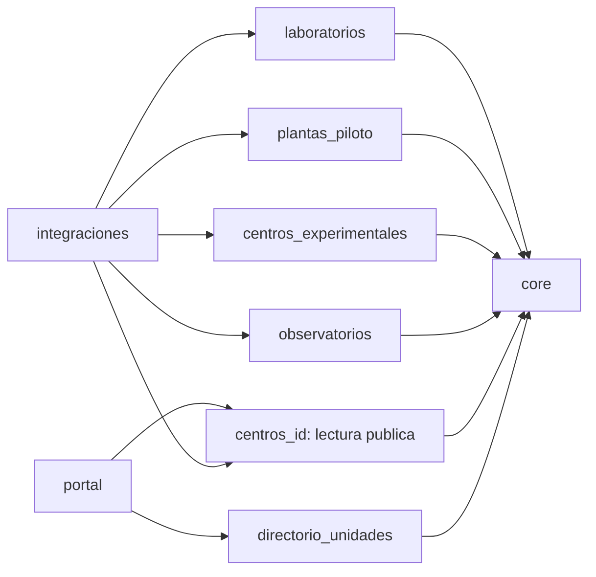

# Arquitectura vertical de unidades y Centros I+D

## Decision

El sistema no tratara los cuatro tipos de unidad como variantes de una misma
aplicacion operativa. Compartiran identidad institucional y contratos tecnicos,
pero cada tipo sera propietario de su configuracion, datos, reglas, pantallas,
administracion y pruebas.

Los cinco contextos principales son:

1. laboratorios;
2. plantas piloto;
3. centros experimentales;
4. observatorios;
5. Centros de Investigacion y Desarrollo.

Son las implementaciones iniciales del producto, no un conjunto obligatorio
ni un limite a nuevas modalidades. Una institucion puede usar solo Laboratorios;
otra habilitar varias verticales. Las categorias/subtipos se administran como
datos institucionales asociados a capacidades compatibles. Una nueva operacion
con reglas distintas necesita una extension implementada y probada, no solo
una opcion nueva en un campo. El nucleo no depende de las apps opcionales.
La revision comercial y sus controles obligatorios estan en
[Ruta de ejecucion, M02.1-M02.4](ruta-ejecucion-arquitectura-modular.md).

Centros I+D no es un quinto tipo de unidad reservable. Es un contexto de
investigacion con lineas, grupos, investigadores, proyectos, resultados,
servicios y transferencia. Puede usar capacidades de cualquiera de las cuatro
unidades mediante contratos de integracion, pero no depende de sus modelos.

## Hallazgos del sistema actual

Hoy `Unidad` contiene la identidad de los cuatro tipos, `Reserva` sirve como
expediente comun y `webcitt/domains/unidades/` concentra catalogo, ficha,
gestion, reservas y operacion. Existen perfiles especializados para laboratorio,
planta piloto, centro experimental, observatorio y plataforma tecnologica, pero
la mayor parte de la logica sigue pasando por la ficha y la reserva comunes.

La reutilizacion actual es util para conservar los datos, pero presenta cuatro
riesgos:

- una modificacion al asistente de reservas puede afectar todos los tipos;
- una importacion o controlador grande carga funciones que la unidad no usa;
- nombres iguales ocultan reglas distintas, por ejemplo una reserva por horas,
  una corrida, un ensayo de campo y una solicitud de datos;
- Centros I+D terminaria acoplado a `Unidad` si se construye sobre la estructura
  actual.

La migracion preservara `Unidad` y `Reserva` como compatibilidad hasta que cada
contexto tenga propietario y equivalencia funcional comprobada. No se dividiran
tablas en el mismo cambio que separa rutas o presentacion.

## Propiedad funcional y de datos

| Contexto | Operacion principal | Datos propios | No debe conocer |
| --- | --- | --- | --- |
| Laboratorios | Sesion por horas, practica, ensayo o servicio con recursos | estaciones, equipos, licencias, muestras, sesiones, practicas y consumos | recetas, lotes productivos, parcelas o conjuntos de datos |
| Plantas piloto | Corrida de proceso y transformacion de materia prima | familias, productos, procesos, recetas, ordenes, lotes, calidad, mermas y trazabilidad | muestras de laboratorio, activos biologicos o indicadores de observatorio |
| Centros experimentales | Ciclo, campania o ensayo de campo | areas georreferenciadas, parcelas, hatos, activos biologicos, tratamientos, muestreos y bitacoras | lineas de proceso industrial o catalogos de datos |
| Observatorios | Publicacion y solicitud de datos o analisis | fuentes, conjuntos, versiones, indicadores, metodologias, publicaciones y solicitudes | agenda fisica, equipos reservables, recetas o inventario biologico |
| Centros I+D | Gestion de investigacion, desarrollo y transferencia | centros, lineas, grupos, investigadores, proyectos, resultados, propiedad intelectual, servicios y transferencia | tablas internas de las cuatro unidades |

Una palabra comun no implica el mismo agregado. Cada contexto puede mostrar
"solicitudes", "agenda" o "recursos", pero aplica reglas y datos propios. Los
nombres de codigo expresaran el contexto: `SesionLaboratorio`,
`ProgramacionCorrida`, `EnsayoCampo`, `SolicitudDatos` y `ProyectoID`.

## Estructura objetivo del repositorio

```text
apps/
|-- core/                         # identidad, acceso, institucion, modulos y auditoria
|-- portal/                       # sitio publico y administracion editorial
|   |-- inicio/
|   |-- quienes_somos/
|   |-- servicios/
|   |-- normativa/
|   `-- noticias/
|-- directorio_unidades/          # identidad publica y clasificacion de unidades
|-- laboratorios/
|   |-- domain/                   # reglas puras de sesiones, muestras y recursos
|   |-- application/              # comandos y consultas
|   |-- infrastructure/           # modelos, repositorios y tareas
|   |-- presentation/             # urls, vistas, formularios y admin
|   |-- templates/laboratorios/
|   |-- static/laboratorios/
|   `-- tests/
|-- plantas_piloto/
|   |-- domain/                   # procesos, recetas, lotes y calidad
|   |-- application/
|   |-- infrastructure/
|   |-- presentation/
|   |-- templates/plantas_piloto/
|   |-- static/plantas_piloto/
|   `-- tests/
|-- centros_experimentales/
|   |-- domain/                   # campo, ciclos y activos biologicos
|   |-- application/
|   |-- infrastructure/
|   |-- presentation/
|   |-- templates/centros_experimentales/
|   |-- static/centros_experimentales/
|   `-- tests/
|-- observatorios/
|   |-- domain/                   # datos, indicadores y publicaciones
|   |-- application/
|   |-- infrastructure/
|   |-- presentation/
|   |-- templates/observatorios/
|   |-- static/observatorios/
|   `-- tests/
|-- centros_id/
|   |-- domain/                   # investigacion y transferencia
|   |-- application/
|   |-- infrastructure/
|   |-- presentation/
|   |-- templates/centros_id/
|   |-- static/centros_id/
|   `-- tests/
|-- aprendizaje/                  # asignaturas, guias y simuladores
`-- integraciones/                # adaptadores entre contratos publicos

shared/
|-- documents/                    # motores base PDF/XLSX, sin reglas de negocio
|-- storage/                      # interfaz de almacenamiento
`-- testing/                      # fabricas tecnicas de pruebas
```

Cada app vertical mantiene juntas sus reglas, persistencia, interfaz y pruebas.
Asi una persona que trabaje en laboratorios encuentra toda su ruta bajo
`apps/laboratorios/` y no necesita recorrer plantas, observatorios o Centros
I+D. Una carpeta solo se crea cuando contiene una implementacion real.

## Contratos compartidos

`portal` administra sus cinco secciones editoriales segun
[arquitectura-portal-administrable.md](arquitectura-portal-administrable.md).
Centros I+D no es una de ellas: cuando exista su app, el portal consumira una
proyeccion publica.

`core` no sera un deposito de utilidades. Solo posee usuarios, identidad,
periodos, permisos institucionales, auditoria y la bandeja de eventos. El
`directorio_unidades` conserva el identificador estable, nombre, tipo, slug,
estado publico, responsables y datos de contacto de cada unidad; no contiene
reservas, procesos, inventarios ni reglas operativas.

Las integraciones intercambian identificadores y copias de los datos necesarios,
no objetos ORM de otra app. Ejemplos:

- Centros I+D vincula un proyecto con una capacidad mediante `unidad_id` y el
  codigo publico de la capacidad;
- una planta recibe materia prima de un centro experimental mediante una orden
  de transferencia, sin modificar directamente su inventario biologico;
- aprendizaje solicita una sesion o corrida por el contrato publico del contexto
  correspondiente;
- el portal consulta proyecciones publicas y puede seguir funcionando si una
  operacion interna esta temporalmente indisponible.

No se permiten claves foraneas con borrado en cascada entre contextos. Una
relacion externa usa `PROTECT`, un identificador estable o una tabla de enlace
propiedad de `integraciones`. Los documentos historicos guardan una instantanea
de nombres y codigos para no cambiar cuando se edita el origen.

## Dependencias permitidas



Ningun contexto vertical importa modelos, vistas, formularios o funciones
privadas de otro. `integraciones` consume solamente sus contratos publicos y
no contiene reglas propias de una unidad.

## Aislamiento de fallos

La separacion se comprobara en cuatro niveles:

1. **Codigo:** rutas, configuracion, admin, tareas y pruebas se cargan por app;
   las reglas de arquitectura rechazan importaciones cruzadas.
2. **Datos:** cada contexto posee sus tablas y migraciones; no hay cascadas ni
   escrituras directas sobre otro contexto.
3. **Ejecucion:** correo, PDF pesados, importaciones, reportes y sincronizaciones
   se ejecutan fuera de la peticion, con tiempo limite, reintentos acotados y
   cola de errores propia.
4. **Despliegue:** Centros I+D se prepara desde el inicio para ejecutarse como
   proceso o servicio independiente. Los cuatro tipos de unidad podran extraerse
   de la misma forma si el RTO, la carga o el riesgo lo exige.

Mientras todas las apps compartan un proceso Django, un error de sintaxis o de
arranque puede detenerlo completo. La modularidad evita propagacion de reglas y
datos, pero el aislamiento absoluto requiere procesos separados, comprobaciones
de salud y un proxy que retire solo la ruta afectada. Esta limitacion se medira,
no se ocultara.

## Administracion

El administrador mostrara cinco areas operativas independientes:

```text
Laboratorios
Plantas piloto
Centros experimentales
Observatorios
Centros de Investigacion y Desarrollo
```

Cada area tendra sus propios permisos, grupos administradores, formularios,
acciones masivas y reportes. Un responsable de laboratorio no recibira acceso a
las tablas de plantas o centros. `directorio_unidades` permitira crear la
identidad basica y luego redirigira a la configuracion especializada elegida.

## Transicion sin perder datos

1. Congelar el inventario actual de rutas, tablas, permisos e importaciones.
2. Separar las rutas por los cuatro tipos y Centros I+D, manteniendo todos los
   nombres y paths actuales.
3. Crear contratos de identidad, capacidad y solicitud; `Unidad` y `Reserva`
   siguen siendo adaptadores heredados.
4. Extraer primero Observatorios, porque su solicitud de datos no debe pasar
   por la reserva fisica.
5. Extraer Plantas piloto, conservando procesos, recetas, ordenes, lotes y
   calidad en el mismo contexto.
6. Extraer Centros experimentales con sus modelos nuevos de campo.
7. Extraer Laboratorios y convertir la reserva heredada en sesion de laboratorio.
8. Crear Centros I+D como app independiente y relacionarlo solo mediante
   contratos y tablas de enlace.
9. Migrar modelos y permisos con `SeparateDatabaseAndState`, una frontera y un
   commit por vez, conservando `db_table` durante la transicion.
10. Retirar adaptadores de `webcitt` cuando no tengan consumidores.

Cada paso exige pruebas propias de la app, pruebas de contrato, cuatro recorridos
funcionales, suite integral, copia de respaldo y una reversa comprobada. No se
mezcla una migracion de datos con un redisenio de interfaz.

## Primera frontera de codigo implementada

La frontera de rutas y contratos ya esta implementada en
[rutas-y-contratos-modulares.md](rutas-y-contratos-modulares.md):

- inventario automatico de las rutas actuales por tipo;
- modulos de URLs independientes para laboratorios, plantas piloto, centros
  experimentales, observatorios y Centros I+D;
- contrato de `directorio_unidades` sin modelos nuevos;
- comprobacion que cada modulo de URLs carga sin importar otro contexto;
- matriz de propietarios para modelos, tablas, permisos, plantillas, estaticos
  y tareas actuales.

Este bloque no cambia la base de datos ni la experiencia publica. Las entradas
cargan independientemente, pero 104 rutas operativas permanecen compartidas en
`webcitt/routing/heredadas.py`. El siguiente bloque extrae Observatorios; el
aislamiento de datos, admin y despliegue sigue pendiente.
