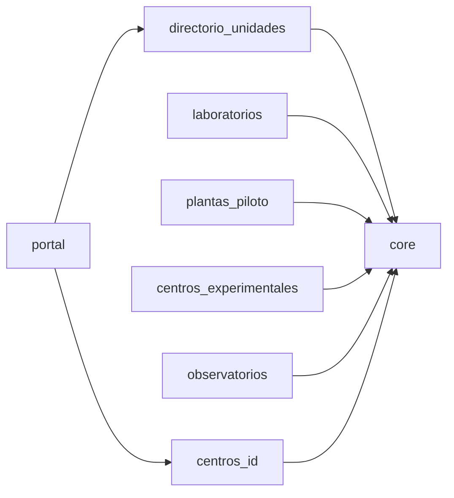

# Auditoría de arquitectura modular

> Antecedente del diagnóstico. La extracción posterior del 12 de octubre de
> 2026 está implementada: consultar [arquitectura vigente](arquitectura.md).
> Las referencias siguientes al contenedor `webcitt` describen el código
> auditado en el commit indicado, no el estado actual.

Fecha de corte vigente: 19 de septiembre de 2026

Commit de código auditado: `7edae539` en `reestructura-modular`

Base estable conservada: `654bd1a4` en `integracion-version2-funciones`

## Actualización del 19 de septiembre de 2026 (uniformidad estructural)

Las cifras de esta sección se midieron sobre `cdbb0a62` y sustituyen, donde
difieran, a las del dictamen original de `7edae539` que se conserva abajo.

- Suite integral: **1.433 pruebas correctas y una omitida**.
- Las cinco verticales **ya son apps Django instaladas** y propietarias de su
  plantilla pública; la afirmación contraria del dictamen original quedó
  superada por `a074afac`, `cbb7dc29` y `2bd39f66`.
- Modelos: 98 de 110 siguen en `webcitt`; las cinco verticales tienen 0.
- Rutas: 104 de 119 siguen en `webcitt.domains`.
- Capacidades con control de servidor: 2 de 21 declaradas. Las tipologías de
  unidad tienen además su propio interruptor institucional aplicado en el
  servidor ([Tipologías administrables](tipologias-administrables.md)).
- Perfiles institucionales de prueba: existe 1 de los 4 requeridos.
- M02.3: **cerrado** en `ee074c39` y `4d55e70e`: tipologías de unidad y
  clasificaciones administrables con decisiones registradas
  ([Categorías administrables](categorias-administrables.md)).
- Una instalación sin `webcitt` sigue sin ser posible: el URLconf raíz
  compone `webcitt.routing.heredadas`.

## Dictamen original (`7edae539`)

El bloque 184 cerró la estabilización arquitectónica y habilitó la aceptación
definitiva de Laboratorios. No se detectaron funciones rotas en el alcance
automatizado: la suite integral terminó con **1.392 pruebas correctas y una
omitida**; la puerta de Laboratorios añadió 277 pruebas enfocadas y la revisión
de navegador completó 770 combinaciones sin incidencias. Django check,
migraciones en seco y Ruff también están limpios.

La arquitectura está en una transición controlada hacia un **monolito
modular**, pero todavía no está terminada. Las entradas públicas, manifiestos,
contratos e identidad institucional ya tienen fronteras explícitas. La mayor
parte del negocio, modelos, administración y migraciones de las unidades sigue
perteneciendo a `webcitt`. Laboratorios, Observatorios, Centros experimentales,
Plantas piloto y Centros I+D son hoy paquetes de presentación; todavía no son
apps Django operativas y persistentes independientes.

Por ello, el sistema conserva el comportamiento actual mientras se reorganiza,
pero aún no puede garantizar que una caída del proceso Django o de la base de
datos afecte solo a un módulo. Esa garantía requiere completar M10 y M11, no
solo separar carpetas.

## Evidencia del corte vigente

| Control | Resultado |
| --- | --- |
| Rama y publicación | Interruptor integral de reservas en `7edae539`; documentación previa en `7a0f6e57` sobre `reestructura-modular` |
| Suite integral vigente | 1.392 pruebas correctas, una omitida, 501,783 s; ejecutada sobre el contenido de `7edae539` |
| Aceptación de Laboratorios | 277 pruebas enfocadas correctas, 86,159 s |
| Calidad estática | Ruff correcto; `manage.py check` sin incidencias |
| Esquema | `makemigrations --check --dry-run`: sin cambios pendientes |
| Internacionalización | ES/EN compilados; 8.810 mensajes traducibles más la cabecera de catálogo en cada idioma |
| Señales | 19 contratos, 19 decoradores y 19 conexiones propias; sin hallazgos en el último corte integral |
| Responsive | 182 combinaciones públicas y 574 autenticadas sin desbordamiento ni errores JavaScript; 14 casos de modal PDF en la misma pestaña |
| Árbol de pruebas | 91 archivos `test_*.py`; 1.375 métodos y clases de prueba detectados estáticamente, además de casos parametrizados y dinámicos |

La certificación responsive es válida para las superficies y anchos ensayados:
ES/EN a 360, 390, 768, 1024, 1200, 1366 y 1920 px. No sustituye pruebas en
dispositivos físicos, auditoría completa de accesibilidad, rendimiento bajo
carga ni recorridos con proveedores OAuth reales.

## Estado de la ruta M00-M13

| Hito | Estado auditado | Qué falta para cerrarlo |
| --- | --- | --- |
| M00 | Implementado | Mantener inventario y compatibilidad mientras se extraen consumidores |
| M01 | Evidencia local, cierre institucional pendiente | Captura coordinada de base y adjuntos, copia externa cifrada e inmutable, custodia de claves y medición real de RPO/RTO |
| M02.1 | Parcial avanzado | Terminar consumidores y contenido institucional, y validar todos los perfiles operativos en despliegue real |
| M02.2 | Completo para reservas; parcial como plataforma | Reservas tiene control integral; cada capacidad futura deberá cerrar sus propias rutas, comandos, tareas y exportaciones |
| M02.3 | Pendiente | Categorías y modalidades administrables sin límite fijo a los cuatro tipos actuales |
| M02.4 | Estabilización cerrada | Las extracciones adicionales se harán dentro de cada vertical y se validarán en su propia aceptación |
| M03-M07 | Fronteras de presentación creadas; negocio pendiente de extracción | Dar a cada vertical servicios, admin, pruebas y finalmente persistencia propios |
| M08 | Portada pública solamente | Construir Centros I+D con investigación, líneas, proyectos, resultados, permisos y datos propios |
| M09 | Inicio administrable; resto parcial | Hacer administrables Quiénes somos, Servicios, Normativa y Noticias por su sección |
| M10 | Pendiente | Trasladar propiedad de modelos, tablas, ContentTypes y permisos por contexto, con reversa probada |
| M11 | Pendiente | Aislar ejecución, credenciales, tareas y recuperación; probar fallos reales por contexto |
| M12-M13 | Pendientes | Empaquetado instalable/comercial, retiro de compatibilidad y auditoría final de perfiles, seguridad, carga y recuperación |

## Modularidad que ya existe

- La identidad del producto **Sistema de Laboratorios y Centros de
  Investigación y Desarrollo (SLCID)** está separada de la identidad UPEC.
- Configuración institucional y Portal son apps Django propias con modelos,
  administración y migraciones propias.
- Diez paquetes nuevos declaran manifiestos versionados; las rutas públicas de
  Portal y de las cuatro verticales se incluyen de forma explícita.
- Los cuatro tipos de unidad conservan entradas y perfiles diferenciados.
- La habilitación institucional de capacidades tiene historial, versión,
  concurrencia y permisos; Inicio es la primera capacidad completa que usa el
  control.
- Reservas dispone de 44 módulos internos. Diecisiete operaciones de escritura
  críticas ya pasan por servicios con autoridad fresca, bloqueo transaccional,
  unidad esperada, auditoría y pruebas de carrera.
- La resolución de período y el contrato de la guía integrada tienen módulos
  públicos propios. Una prueba de arquitectura impide que el negocio de unidades
  vuelva a importar `reservas.views`, excepto la fachada pública del paquete.
- Reserva, revisiones, solicitudes de cambio, programaciones y participantes son
  expedientes de consulta en Django Admin. Las dos últimas superficies ya no
  permiten altas, ediciones ni eliminaciones manuales fuera del flujo operativo.
- El ciclo automático admite alcance explícito por unidad en vencimientos,
  recordatorios, riesgos, correos y guías. Cada intento SMTP se reclama bajo
  bloqueo para evitar entregas simultáneas y conservar reintentos recuperables.
- Las reconciliaciones históricas de revisiones y FT02 exigen una unidad,
  bloquean Unidad y Reserva, son idempotentes y revierten también la auditoría
  cuando se ejecutan con `--simular` o falla un efecto posterior.
- Los cargadores FabLab están clasificados como datos demostrativos y fallan
  cerrados: requieren habilitación local, unidad y confirmación; producción los
  desactiva siempre y la simulación revierte el lote completo.
- El envío de correo, los recordatorios y los respaldos tienen procesos o
  contenedores separados del proceso web, lo que reduce su impacto operativo.
- Marca, logos, paleta, degradados, tipografías, ES/EN y contenido de Inicio se
  administran con borradores, publicación y revisiones conservadas.

## Acoplamiento y deuda que permanecen

### Persistencia y registro Django

`INSTALLED_APPS` contiene tres apps propias: `webcitt`,
`configuracion_institucional` y `portal`. Los paquetes `laboratorios`,
`observatorios`, `centros_experimentales`, `plantas_piloto`, `centros_id`,
`directorio_unidades`, `core` e `integraciones` no son todavía apps Django
instaladas con persistencia operativa propia. Las verticales llaman al adaptador
`apps.integraciones.unidades_heredadas`, que delega en el negocio de `webcitt`.

La concentración también se ve en el historial de esquema: hay 202 archivos
Python bajo `webcitt/migrations`, frente a ocho en configuración institucional
y dos en Portal, contando los `__init__.py`. Mover clases o cambiar `app_label`
sin M01/M10 podría duplicar tablas o romper ContentTypes, permisos Guardian y
relaciones.

### Controladores y comandos grandes

| Elemento | Tamaño medido |
| --- | ---: |
| `webcitt/domains/unidades/gestion.py` | 4.344 líneas |
| `gestion_unidad_view` | 1.053 líneas |
| `gestion_reserva_accion_view` | 399 líneas; adapta HTTP y delega todas sus escrituras en servicios transaccionales |
| `webcitt/domains/unidades/reservas/views.py` | 1.809 líneas |
| `crear_reserva` | 573 líneas |
| `webcitt/domains/unidades/reservas/creacion_transaccion.py` | 598 líneas; único propietario de la escritura atómica de creación |
| `webcitt/domains/unidades/reservas/correccion.py` | 665 líneas; caso de uso principal de 251 líneas |
| `webcitt/models/reservas.py` | 1.974 líneas |
| `cargar_laboratorios_institucionales.py` | 4.930 líneas |
| `cargar_pruebas_fablab.py` | 2.055 líneas; carga ficticia protegida, aún monolítica |

En la acción administrativa de reservas ya se extrajeron asignación, notas,
solicitud de información, rechazo, cancelación, aprobación, inicio, inasistencia,
cierre no atendido, finalización atendida y actualización/corrección.
`corregir_reserva` serializa por unidad, bloquea el expediente vigente y coordina
agenda, recursos, condiciones, participantes, consumibles, adjuntos, revisiones,
planificación, avisos y trazabilidad dentro de una transacción. La vista conserva
la traducción HTTP y ya no escribe directamente una reserva. Horarios y adjuntos
tienen módulos compartidos. La resolución académica vive en `periodos.py` y
los campos de la guía integrada en `guia_contrato.py`; cronograma, visitas y
guías ya no importan reglas desde `reservas.views`. El primer corte del bloque
181 trasladó entrada común, propósito, intención, calendario, producto/proceso,
equipos, espacios, software, consumibles, servicios, adjuntos, modalidad y
cotización a `creacion_entrada`, `creacion_recursos` y `creacion_servicio`, con
pruebas directas sin construir una petición HTTP completa. El bloque 182 movió
la creación completa a `creacion_transaccion`: expediente, sesiones, recursos,
consumibles, participantes, guías, planificación y aviso se escriben bajo una
sola transacción. La vista conserva la adaptación HTTP y no ejecuta escrituras,
bloqueos ni `transaction.atomic()` dentro de `crear_reserva`.

La búsqueda de marcadores no mostró stubs funcionales con
`NotImplementedError`. Los `pass` encontrados corresponden principalmente a
clases base sin cuerpo, carreras controladas por `IntegrityError` y relaciones
opcionales ausentes. Esto no demuestra ausencia total de código sin uso; los
comandos de carga y controladores grandes deben auditarse por consumidores antes
de dividirlos o eliminarlos.

## Seguridad, datos y continuidad

La configuración de producción falla cerrada si faltan una clave fuerte,
hosts u orígenes CSRF. Activa HTTPS, HSTS, cookies seguras, protección de marcos,
CSP, timeouts de PostgreSQL y verificación de red privada o TLS de base. Hay
pruebas contra login CSRF, enumeración de cuentas, HTML almacenado, cabeceras y
configuración fuerte.

El perfil local no es un perfil de despliegue. `check --deploy` sobre
`config.settings` reporta las seis advertencias esperadas: HSTS, redirección
HTTPS, clave local, cookies seguras de sesión/CSRF y DEBUG. Producción debe usar
exclusivamente `config.settings_production` detrás del proxy institucional.

Persisten estos límites antes de producción:

1. CSP todavía admite `unsafe-inline`; retirar scripts y manejadores incrustados
   permitirá usar nonces o hashes.
2. No existe un flujo CI versionado en `.github/workflows` u otro proveedor que
   repita automáticamente suite, Ruff, migraciones y auditoría de dependencias.
3. GitHub reporta 17 alertas Dependabot en la rama predeterminada: tres altas,
   seis moderadas y ocho bajas. El lock de `reestructura-modular` fue verificado
   previamente sin vulnerabilidades conocidas mediante `pip-audit`, pero debe
   repetirse y conciliarse con la rama de entrega antes de publicar una versión.
4. TLS, MFA, firewall, monitoreo, alertas, rotación, gestor de secretos y
   escaneo de imagen se documentan, pero requieren evidencia de infraestructura.
5. Un fallo de PostgreSQL, del URLConf o del proceso Django sigue siendo un
   dominio de fallo compartido.

El ensayo local M01 restauró y comparó 135 tablas, 6.654 registros y 358
adjuntos, sin relaciones rotas. Docker incluye servicios separados para web,
programador y respaldos, más checksums y restaurador temporal. Aún falta la
prueba institucional con datos capturados de forma coordinada, usuarios de base
con privilegio mínimo, copia externa inmutable y tiempos RPO/RTO medidos. Hasta
entonces no se debe declarar recuperación garantizada ni mover tablas reales.

## Orden recomendado desde este corte

La entrada y la transacción de `crear_reserva` están separadas, el control
integral de reservas está activo y el bloque 184 quedó cerrado. Laboratorios
superó su aceptación definitiva. El desarrollo funcional continúa en este
orden: Plantas piloto, Centros experimentales, Observatorios y Centros I+D.

Quedan cuatro puertas funcionales: una al terminar cada una de las cuatro
verticales que siguen. No se abrirán auditorías generales entre entregas.
Los hitos M01 institucional, M02.3 y M10-M13 conservan su alcance, pero ya no
bloquean el desarrollo funcional. Su ejecución necesita datos reales,
infraestructura o madurez de cada vertical.

La secuencia, el límite de esta fase, el estado real de cada vertical y sus
criterios de salida están en [Ruta de cierre de la reestructuración y desarrollo
de verticales](ruta-cierre-reestructuracion-y-verticales.md).

Los criterios específicos, la evidencia vigente y los límites de aislamiento
de Laboratorios están en [Aceptación funcional y límites de aislamiento de
Laboratorios](aceptacion-laboratorios.md).

## Cierre de la etapa

La estabilización M02.4 y el alcance de reservas de M02.2 cumplen su criterio:
crear, aprobar, iniciar, corregir, completar, cancelar y recuperar una reserva
usa casos de uso y una autoridad común; rutas, administración, tareas y comandos
aplican el mismo control de capacidad. Suite integral, carreras PostgreSQL,
señales, ES/EN y recorridos responsive permanecen en verde. La siguiente etapa
es Planificación completa de Plantas piloto.

## Fotografía histórica inicial

Fecha de corte inicial: 15 de septiembre de 2026

Hito funcional: `654bd1a4` en `integracion-version2-funciones`

Rama de reestructuración: `reestructura-modular`

## Dictamen del corte inicial

Actualizacion del 16 de septiembre: las entradas publicas se separaron en
seis paquetes bajo `apps/`; las 104 rutas operativas compartidas quedan
explicitamente en `webcitt/routing/heredadas.py`. Se conservan 119 endpoints,
95 modelos y los mismos permisos. La evidencia reproducible y los limites
estan en [Rutas y contratos modulares](rutas-y-contratos-modulares.md).
Los indicadores siguientes conservan la fotografia del hito original.

La plataforma funciona y tiene una base de pruebas amplia, pero todavía no está
dividida en aplicaciones Django independientes. La organización por carpetas
`domains/portal`, `domains/usuarios` y `domains/unidades` mejoró la lectura del
código, aunque los tres dominios siguen compartiendo la aplicación `webcitt`,
su etiqueta, sus 95 modelos, sus migraciones, el archivo de rutas y varios
puntos de importación en el arranque.

El cambio seguro no consiste en mover todas las carpetas de una vez. Primero se
deben fijar contratos, romper ciclos y reducir los controladores grandes. Luego
se podrá trasladar cada dominio a su propia aplicación conservando tablas,
permisos, URLs y datos.

## Evidencia del estado actual

| Indicador | Resultado |
| --- | ---: |
| Aplicaciones propias en `INSTALLED_APPS` | 1 (`webcitt`) |
| Modelos de `webcitt` | 95 |
| Migraciones aplicadas de `webcitt` | 197 |
| Archivos Python auditados, sin migraciones | 220 |
| Importaciones internas detectadas | 590 |
| Componentes en el ciclo principal de importación | 20 |
| Rutas de negocio de `webcitt` | 120 |
| Nombres de ruta duplicados | 0 |
| Archivos de pruebas | 64 |
| Pruebas del hito | 805 aprobadas, 1 omitida |
| Plantillas | 135 |
| Archivos CSS / JavaScript | 41 / 31 |
| Errores de sintaxis al compilar | 0 |

Comprobaciones directas contra `127.0.0.1:8000`:

| Caso | Resultado esperado y obtenido |
| --- | --- |
| Portada `/` | HTTP 200, HTML |
| Acceso `/login/` | HTTP 200, HTML y cookie CSRF propia |
| Ficha de Planta Piloto de Lácteos | HTTP 200, HTML |
| Documento de materiales e insumos | HTTP 200, PDF |
| Administrador anónimo | HTTP 302 hacia el acceso del administrador |

`manage.py check`, `makemigrations --check --dry-run`, Ruff, `compileall` y la
suite completa están en verde en el hito auditado.

## Aspectos que ya están bien encaminados

1. Las vistas dejaron el antiguo `webcitt/views.py` y se agrupan por dominio.
2. Los modelos están separados por responsabilidad dentro de `webcitt/models/`.
3. El administrador se divide en módulos temáticos.
4. Las plantillas de unidades se agrupan por aula, gestión, guías, reservas,
   repositorio y visitas.
5. Los cálculos del aula ya tienen módulos puros como `motores.py` y
   `escenarios.py`.
6. Las rutas mantienen nombres únicos y existe una cobertura funcional amplia.
7. La configuración de producción está separada de la configuración base.

Estas piezas permiten una migración gradual sin rehacer la interfaz ni la base
de datos.

## Problemas de arquitectura encontrados

### 1. El arranque carga demasiadas funciones a la vez

`webcitt/urls.py` importa fachadas de dominios y declara 120 rutas. A su vez,
`domains/unidades/__init__.py` importa vistas de gestión, producción y prácticas,
y `domains/unidades/reservas/__init__.py` importa todo el flujo de reservas.

Una excepción de importación en uno de esos módulos puede impedir construir
todo el URLConf. Por esa razón un fallo de una sección puede afectar páginas
que no usan esa sección.

El administrador tiene un riesgo equivalente: `admin/__init__.py` importa de
forma anticipada quince módulos administrativos. Django ya realiza
autodescubrimiento por aplicación, por lo que cada futura app debe registrar
solo sus propios modelos.

### 2. Existe un ciclo amplio de importaciones

El análisis estático encontró un componente circular de 20 módulos. Entre los
casos directos más claros están:

- `reservas.views` importa `reservas.cronograma` y `cronograma` vuelve a importar
  funciones de `views`;
- `reservas.views` importa `reservas.cambios` y `cambios` vuelve a importar
  validadores de `views`;
- `reservas.guias` obtiene constantes desde `reservas.views`;
- `aula` importa `calidad` y `calidad` vuelve a importar consultas de `aula`;
- `asignaturas`, `cronograma`, `notificaciones` y reservas se llaman entre sí;
- `seguridad`, visitas y prácticas comparten funciones concretas en ambos
  sentidos.

Varias importaciones locales dentro de funciones evitan que el ciclo falle hoy,
pero ocultan la dependencia y dificultan probar un módulo por separado.

### 3. Los modelos dependen de capas superiores

La dirección esperada es `vistas -> casos de uso -> modelos`. Actualmente hay
cuatro dependencias inversas:

- `models/reservas.py` importa utilidades de HTML, firmas y prácticas;
- `models/recursos.py` importa la definición de secciones de plantas;
- `models/reservas.py` también contiene reglas de flujo y presentación;
- `models/reservas.py` depende de `workflows/reservas.py`.

Un modelo no debe conocer vistas, HTML, PDF ni una carpeta de casos de uso. Las
reglas puras deben vivir en el dominio propietario y las decisiones de
presentación deben quedar fuera del modelo.

### 4. Dos controladores concentran gran parte del sistema

| Archivo o función | Tamaño aproximado |
| --- | ---: |
| `domains/unidades/gestion.py` | 4.910 líneas |
| `gestion_unidad_view` | 1.053 líneas |
| `domains/unidades/reservas/views.py` | 3.406 líneas |
| `crear_reserva` | 1.220 líneas |
| `models/reservas.py` | 2.105 líneas |
| `reservas/guias.py` | 2.060 líneas |
| `gestion_reportes.py` | 1.598 líneas |

Estas vistas validan entradas, consultan datos, ejecutan reglas, escriben en la
base, preparan documentos y construyen contexto. Una modificación pequeña puede
afectar muchas funciones y obliga a importar casi todo el dominio.

### 5. La etiqueta `webcitt` une toda la persistencia

Los 95 modelos comparten `app_label`, permisos, `ContentType` y una secuencia de
197 migraciones. Mover clases a aplicaciones nuevas sin una migración de estado
haría que Django las interprete como modelos nuevos y podría intentar crear o
renombrar tablas.

Por esto se prohíbe una reubicación masiva de modelos. Cada traslado deberá
conservar temporalmente `db_table` y usar migraciones de estado explícitas,
incluyendo la actualización controlada de permisos y `ContentType`.

### 6. Rutas, plantillas y estáticos aún tienen un único propietario técnico

Las rutas están en `webcitt/urls.py`; las 135 plantillas y los 72 archivos CSS y
JavaScript están bajo el espacio común `webcitt`. La estructura visual por
secciones es clara, pero Django no puede instalar, probar o retirar una sección
como aplicación autónoma.

Cada app futura debe poseer sus rutas, plantillas y recursos con namespace. Los
nombres públicos actuales se conservarán mediante inclusiones compatibles y,
cuando haga falta, alias de transición.

### 7. El administrador no declara todavía la propiedad de todos los modelos

Hay 59 modelos registrados directamente y 36 sin registro directo. Parte de
estos últimos se administra mediante inlines o el panel propio de gestión, lo
que puede ser correcto. Falta una matriz explícita que indique para cada modelo:

- app propietaria;
- interfaz de edición: admin, inline, panel propio o solo sistema;
- permisos para ver, crear, editar y eliminar;
- política de auditoría.

La migración no debe registrar indiscriminadamente los 36 modelos. Primero se
documentará cuál es su interfaz autorizada.

### 8. Hay documentación que describe una arquitectura todavía no materializada

`docs/arquitectura.md` menciona dominios superiores como `core` y `centros_id`,
pero en el código ambos siguen integrados en `webcitt`. Debe distinguirse entre
la arquitectura vigente y la arquitectura objetivo para que un nuevo
desarrollador no asuma que esas apps ya existen.

### 9. El servidor de desarrollo declara dos rutas para `media`

Con `DEBUG=True`, el patrón agregado por `static(settings.MEDIA_URL, ...)`
coincide con la ruta personalizada `media_no_xframe`. La primera coincidencia
actual hace que el sistema funcione, pero la duplicación debe eliminarse cuando
la entrega de archivos quede bajo una app de recursos con una política única.

## Arquitectura objetivo

La auditoría se corrige con una frontera más precisa: las cuatro clases de
unidad no formarán una sola app operativa. La decisión vigente se documenta en
[Arquitectura vertical de unidades y Centros I+D](arquitectura-vertical-unidades-centros-id.md).

| App | Responsabilidad y datos propios |
| --- | --- |
| `core` | Identidad, acceso, períodos y auditoría institucional. |
| `portal` | Sitio público y proyecciones de lectura. |
| `directorio_unidades` | Identidad pública y clasificación, sin operación. |
| `laboratorios` | Sesiones, prácticas, muestras, recursos y consumos. |
| `plantas_piloto` | Procesos, recetas, corridas, lotes, calidad y trazabilidad. |
| `centros_experimentales` | Áreas, ciclos, ensayos, activos biológicos y bitácoras. |
| `observatorios` | Fuentes, datos, indicadores, publicaciones y solicitudes. |
| `centros_id` | Investigación, proyectos, resultados, servicios y transferencia. |
| `aprendizaje` | Asignaturas, guías, simuladores y evidencias. |
| `integraciones` | Adaptadores entre contratos públicos; no posee negocio. |

Centros I+D se crea como contexto independiente cuando empiece su desarrollo.
No reutiliza `Unidad`, `Reserva` ni el modelo histórico `Proyecto`. Puede
vincular capacidades por identificadores estables y tablas de enlace.

El portal mantiene Inicio, Quiénes somos, Servicios, Normativa y Noticias como
módulos editoriales con permisos y administración separados. No se crea una app
Django por pestaña, pero tampoco una vista o tabla universal. La estructura se
define en [Arquitectura del portal administrable](arquitectura-portal-administrable.md).



Las flechas no autorizan importar modelos internos. Las lecturas cruzadas usan
contratos, y los cambios cruzados usan casos de uso públicos o eventos. Una
reserva por horas, una corrida, un ensayo de campo y una solicitud de datos son
agregados distintos aunque compartan conceptos de agenda o solicitante.

## Estructura interna de cada app

Se evitarán carpetas vacías y capas sin utilidad. Una app pequeña puede empezar
con archivos simples; solo crecerá a subcarpetas cuando el volumen lo exija.

```text
apps/
├── core/
├── portal/
├── directorio_unidades/
├── laboratorios/
├── plantas_piloto/
├── centros_experimentales/
├── observatorios/
├── centros_id/
├── aprendizaje/
└── integraciones/
    ├── apps.py
    ├── urls.py
    ├── models.py o models/
    ├── admin.py o admin/
    ├── forms.py
    ├── services.py o application/
    ├── selectors.py
    ├── templates/aprendizaje/
    ├── static/aprendizaje/
    └── tests/
```

Reglas internas:

1. `urls.py` solo conecta rutas con vistas de su app.
2. Las vistas traducen HTTP; no contienen reglas extensas ni generan PDF.
3. `services` ejecuta comandos que cambian estado.
4. `selectors` concentra consultas de lectura reutilizables.
5. Los cálculos sin base de datos permanecen como funciones puras.
6. Los modelos contienen invariantes propias, no presentación ni navegación.
7. Cada app registra su admin y posee sus plantillas, estáticos y pruebas.
8. Los contratos públicos se importan desde módulos con nombre estable;
   ninguna app consume funciones privadas de otra.

## Alcance real de la independencia

Esta arquitectura permitirá que un error durante una petición de reservas no
rompa el portal o el aula, y evitará que importar una ruta cargue módulos ajenos.
También permitirá ejecutar pruebas y administrar permisos por app.

Una aplicación Django dentro del mismo proceso no ofrece aislamiento total: un
error de sintaxis o una excepción en `AppConfig.ready()` puede impedir arrancar
todo Django. El aislamiento absoluto requiere procesos o servicios separados.
En esta etapa no conviene convertir cada módulo en un microservicio; aumentaría
la operación, las transacciones distribuidas y el riesgo sobre los datos. La
meta inmediata es aislamiento funcional dentro de un monolito modular.

## Plan de migración sin pérdida de datos

### Fase 0. Hito estable

- `integracion-version2-funciones` queda como referencia funcional en
  `654bd1a4`.
- Toda la reestructuración ocurre en `reestructura-modular`.
- No se mezclan nuevas funciones de producto durante los movimientos.

### Fase 1. Fronteras comprobables sin mover modelos

- dividir `webcitt/urls.py` en rutas de portal, usuarios, laboratorios,
  plantas piloto, centros experimentales, observatorios y Centros I+D;
- retirar importaciones masivas de los `__init__.py`;
- mantener nombres y URLs públicas;
- añadir una prueba de arquitectura que rechace ciclos nuevos e importaciones
  prohibidas;
- definir módulos públicos de contratos y consultas.

Esta fase no requiere migraciones de base de datos y ofrece la primera reducción
real del riesgo de arranque.

### Fase 2. Reducir controladores grandes

- dividir `crear_reserva` por pasos y casos de uso;
- dividir `gestion_unidad_view` por módulo operativo;
- separar validación, escritura, consulta y presentación;
- mover generación de PDF y Excel a adaptadores de documentos;
- conservar transacciones atómicas alrededor de cada comando.

### Fase 3. Romper dependencias inversas y ciclos

- sacar HTML, firmas y prácticas de `models/reservas.py`;
- mover la taxonomía de secciones a un contrato de unidades;
- conservar la barrera automática que impide importar `reservas.views` desde el
  negocio de unidades;
- separar calidad de la construcción del aula;
- sustituir llamadas privadas entre dominios por servicios públicos.

La fase termina cuando el grafo interno no contiene ciclos entre dominios.

### Fase 4. Crear apps con vistas y servicios

- crear las apps verticales definidas en la arquitectura vigente;
- trasladar primero URLs, vistas, formularios, servicios, plantillas, estáticos
  y pruebas;
- mantener temporalmente los modelos en `webcitt` mediante adaptadores de
  persistencia explícitos;
- validar que desactivar rutas de una app no impida cargar las demás.

### Fase 5. Trasladar modelos por contexto

El orden recomendado es: `portal` y `directorio_unidades` sin mover datos,
`observatorios`, `plantas_piloto`, `centros_experimentales`, `laboratorios`,
`aprendizaje`, `centros_id` y al final `core`. Cada vertical conserva sus
tablas durante la transición.

Para cada conjunto:

1. inventariar tablas, claves foráneas, permisos, datos y administradores;
2. conservar el nombre de tabla existente;
3. aplicar `SeparateDatabaseAndState` cuando corresponda;
4. migrar `ContentType` y permisos sin duplicarlos;
5. revisar relaciones genéricas, fixtures y nombres usados por Guardian;
6. ejecutar pruebas de ida y reversión sobre una copia de la base;
7. retirar el exportador correspondiente de `webcitt.models`.

### Fase 6. Propiedad administrativa y visual

- entregar a cada app su registro administrativo;
- documentar los 36 modelos sin registro directo;
- ubicar plantillas y estáticos bajo el namespace de su app;
- conservar componentes institucionales compartidos en `core`;
- eliminar la ruta duplicada de `media` y centralizar su política de acceso.

### Fase 7. Resiliencia y retiro del legado

- añadir comprobaciones de salud por app;
- encapsular integraciones externas con tiempo de espera y manejo de fallo;
- usar banderas solo para integraciones opcionales, no para ocultar errores de
  dominio;
- retirar fachadas, rutas y módulos heredados cuando no tengan consumidores;
- actualizar `docs/arquitectura.md` con la estructura finalmente materializada.

## Puertas de calidad para cada fase

Cada fase debe cumplir todo lo siguiente:

1. mismos nombres de ruta y respuestas públicas, salvo cambio documentado;
2. cero migraciones inesperadas;
3. cero ciclos nuevos y reducción medible de los existentes;
4. ninguna importación de vistas desde modelos;
5. pruebas propias de cada app y suite integral en verde;
6. comprobación de permisos, admin, reservas, documentos y archivos;
7. prueba de migración sobre una copia de PostgreSQL antes de tocar producción;
8. documentación de propietario, contrato público y dependencias de cada app;
9. commit pequeño y reversible por frontera funcional.

## Primera entrega recomendada en la rama nueva

La primera modificación de código debe limitarse a:

1. separar las 120 rutas en módulos sin cambiar ninguna URL;
2. dejar los `__init__.py` sin importaciones anticipadas;
3. crear pruebas que comparen todas las rutas antes y después;
4. añadir reglas automáticas de dependencia;
5. extraer de `reservas.views` los validadores consumidos por `cambios` y
   `cronograma` para romper los primeros ciclos.

No se moverán modelos ni migraciones en esa primera entrega. Así se obtiene una
mejora verificable de independencia con un riesgo controlado y un punto de
reversión claro.
