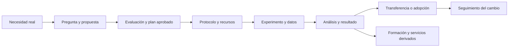

# Auditoría de contenidos y funciones de los centros de investigación y desarrollo

Revisión inicial: 7 de octubre de 2026. Última ampliación: 13 de octubre de 2026.

El [análisis de contenidos, capacidad científica y servicios del 13 de octubre](#análisis-de-contenidos-capacidad-científica-y-servicios--13-de-octubre-de-2026)
contrasta código, base local activa y rutas públicas. Incluye el inventario de
los tres centros, la evaluación de sus veinte áreas y una ruta de desarrollo
con criterios de aceptación. Las secciones anteriores conservan el alcance y
las verificaciones de cada fecha; no sustituyen este inventario actualizado.

La [implementación posterior de organización y operación del CIDT](#implementación-de-organización-y-operación-del-cidt--13-de-octubre-de-2026)
reorganiza la navegación, completa fichas y actualiza el catálogo local. El
inventario anterior de ochenta servicios describe el estado previo a ese bloque.

La propuesta entregada es adecuada como base conceptual, pero necesita ajustes para convertirse en una especificación completa. Prioriza correctamente la agenda, las personas, los proyectos y los resultados. Sus principales vacíos son la operación de servicios, el acompañamiento, la integración con cursos y reservas, la reproducibilidad de simulaciones y el control de lo que se publica como evidencia institucional.

El resultado recomendado es una ficha pública de seis pestañas, un espacio personal para seguimiento y una consola de gestión. Las seis pestañas organizan la información; las operaciones se ejecutan en módulos con responsables, reglas y registros verificables. El [prompt maestro](prompt-maestro-centros-id.md) desarrolla cada sección y sus criterios de aceptación.

## Alcance de la revisión inicial del 7 de octubre

Se contrastó el texto adjunto con modelos, formularios, vistas, navegación, cargadores, administración, plantillas y pruebas existentes de Centros I+D. También se revisaron los módulos y documentos relacionados con laboratorios, cursos, préstamos, reservas, notificaciones y simulaciones.

Los estados funcionales de esta auditoría describen lo observado en código y documentación. No se consultó la base activa, no se recorrió la interfaz en navegador y no se ejecutó la suite. La presencia de una prueba escrita no equivale a una prueba ejecutada en esta revisión. Las afirmaciones del texto sobre pruebas aprobadas y publicación de una rama son antecedentes, no resultados verificados aquí. No se modificó la aplicación ni su contenido institucional.

## Evaluación de la propuesta original

| Elemento | Dictamen | Ajuste necesario |
| --- | --- | --- |
| Definir el centro por agenda, equipo y resultados | Adecuado | Relacionar cada afirmación con proyectos, personas, fuentes y fechas reales. |
| Separar investigación, innovación, servicios y formación | Adecuado con matiz | Son categorías distintas que pueden participar en el mismo proyecto. Una capacitación vinculada a un proyecto conserva su registro formativo y su relación con el proyecto. |
| Tratar toda actividad técnica como I+D | Inadecuado | Evaluar la novedad y la incertidumbre del trabajo. Un ensayo rutinario presta un servicio; su participación en un proyecto no convierte por sí sola todo el ensayo en I+D. |
| Llamar al CIDT centro de desarrollo tecnológico y transferencia | Hipótesis funcional razonable | La categoría oficial y cualquier acreditación deben proceder de documentos institucionales y de la autoridad competente. |
| Seis pestañas comunes | Adecuado | Mantener un núcleo común y módulos configurables. No exigir prototipos, patentes o TRL a centros cuya actividad no los utiliza. |
| Presentar capacidades antes de investigación | Mejorable | Mostrar primero la agenda y sus resultados; ofrecer acceso inmediato a capacidades mediante acciones visibles. |
| Proponer o solicitar como única entrada | Insuficiente | Distinguir proponer un reto, pedir servicio, reservar, inscribirse, iniciar simulación y solicitar acompañamiento. |
| El centro no es un espacio reservable | Correcto respecto a la entidad organizativa | Sus espacios, equipos y sesiones sí pueden ser reservables. La interfaz debe explicarlo sin bloquear esas operaciones. |
| Todos los marcos exigen comité externo y las mismas piezas | Afirmación excesiva | Separar obligaciones institucionales, requisitos de una acreditación específica y buenas prácticas propuestas. |
| Todos los desarrollos ordenados por nueve niveles TRL | Aplicación excesiva | Usar TRL cuando corresponda al desarrollo tecnológico y exigir evidencia de la valoración. No confundir madurez con impacto o protección intelectual. |
| La falta de una norma encontrada demuestra falta de creación | No sustentado | La búsqueda infructuosa no prueba inexistencia. Solicitar el acto de creación o su referencia al custodio institucional. |
| El CIDT puede ser el primero en Ecuador en hacerlo bien | No sustentado | Retirar la afirmación comparativa salvo estudio exhaustivo, fechado y reproducible. |
| Se revisaron veinticuatro centros | Antecedente sin matriz adjunta | Conservar solo con inventario de páginas, fechas y hallazgos por centro. Esta auditoría no reproduce ese estudio. |
| Ocultar toda sección vacía | Útil para módulos opcionales | La identidad, el estado real, el contacto y las condiciones de acceso deben tener una verificación mínima antes de publicar el centro. |

La distinción entre I+D y otras actividades es coherente con los criterios de novedad, creatividad, incertidumbre, sistematicidad y posibilidad de transferencia o reproducción descritos por la OCDE. Son criterios de clasificación de la actividad, no una certificación organizativa del CIDT. [OCDE sobre los criterios de Frascati](https://www.oecd.org/en/publications/research-and-innovation-careers-observatory-2026_138ed294-en/full-report/monitoring-research-and-innovation-careers-through-reico_9c309891.html).

La innovación requiere que el producto o proceso se ponga a disposición de usuarios o entre en uso. Publicar un prototipo o registrar una patente no demuestra por sí solo adopción ni impacto. [Manual de Oslo 2018](https://www.oecd.org/en/publications/oslo-manual-2018_9789264304604-en.html).

## Correcciones del sustento institucional

El Estatuto UPEC publicado mediante Resolución 069 CSUP 2026 incluye laboratorios y centros de investigación y desarrollo. Su artículo 74 los vincula con aprendizaje, investigación, vinculación, experimentación, validación, innovación y transferencia, y remite las funciones a normativa interna. Esto refuerza la inclusión de formación y servicios, siempre diferenciados de la producción investigadora. No acredita por sí solo la creación ni el funcionamiento del CIDT. [Estatuto UPEC, artículo 74, páginas 60 y 61 del PDF](https://upec.edu.ec/images/stories/Elecciones_CSUP/2026/Estatuto_UPEC.pdf).

La comunicación del CACES sobre el MEEUEP 2023 indica que se utilizaría en procesos a partir de 2026. Su objeto es la evaluación de universidades y escuelas politécnicas; no debe presentarse como una acreditación particular de cada centro. El cuerpo del boletín está fechado el 19 de septiembre de 2023, aunque la página muestre otra fecha de publicación. [CACES sobre el MEEUEP 2023](https://www.caces.gob.ec/caces-aprobo-el-modelo-de-evaluacion-externa-con-fines-de-acreditacion-para-las-universidades-y-escuelas-politecnicas/).

El Registro Oficial confirma la publicación del Acuerdo SENESCYT 2023 032 sobre registro de coworking y acreditación de espacios de innovación y transferencia. La página consultada no permite validar por sí sola la tabla de ponderaciones del texto, su aplicabilidad al CIDT ni sus posibles reformas. Los valores 20, 20, 20, 20, 10 y 10 y el umbral de 70 deben quedar pendientes de cotejo del articulado y anexo aplicables; no convertirlos todavía en una rúbrica automática. [Registro Oficial 345, tercer suplemento, 4 de julio de 2023](https://www.registroficial.gob.ec/tercer-suplemento-al-registro-oficial-no-345/).

## Inventario funcional observado

En esta tabla, “presente” significa identificable en código o documentación; “parcial” indica que existe una pieza inicial; “pendiente” describe una capacidad no encontrada en la superficie revisada de Centros I+D.

| Función | Estado | Evidencia y alcance real |
| --- | --- | --- |
| Ficha pública y seis pestañas | Presente | [mapa.py](../apps/centros_id/mapa.py) define el orden vigente: centro, áreas, investigación, innovación, equipo y servicios. El orden propuesto en el texto todavía difiere. |
| Áreas, equipos, procesos, planos y ubicación | Presente | [models.py](../apps/centros_id/models.py) contiene Componente, EquipoCentro, ProcesoArea, Zona y PlanoCentro. La ficha del equipo no constituye una agenda operativa. |
| Líneas, grupos, investigadores, proyectos y resultados | Presente | Proyecto registra línea, equipo, plazos, financiador, monto, hitos, avance y etapa; Resultado incluye enlace, autores, TRL, licencia y confidencialidad. Faltan requisitos editoriales que garanticen evidencia suficiente antes de publicar. |
| Gobierno, documentos e informes | Presente como soporte | Existen OrganoGobierno y DocumentoCentro, incluido informe anual. No se comprobó la existencia de documentos oficiales aprobados en la base. |
| Entrada de solicitudes | Presente | [formularios.py](../apps/centros_id/formularios.py) y [secciones.py](../apps/centros_id/presentation/secciones.py) permiten reto, servicio, acceso, capacitación y visita, con cuenta e historial del solicitante. |
| Flujo de atención | Parcial | SolicitudCentro y su administración controlan una secuencia lineal. No se encontró un expediente específico de cotizaciones, reuniones, contratos, aceptación ni incidencias para el centro. |
| Asignación horaria de un área | Parcial | Zona y SolicitudCentro validan intervalos superpuestos para accesos aprobados o en ejecución. No equivale al motor de reservas de laboratorios. |
| Reserva individual de equipo del centro | Pendiente | SolicitudCentro no selecciona EquipoCentro. No se encontró una integración operativa entre ese equipo y una reserva institucional. |
| Capacidad conjunta de espacio, equipo y técnico | Pendiente | La comprobación por zona no acredita disponibilidad simultánea, cupos, licencias, mantenimiento ni consumibles. |
| Control de concurrencia de accesos del centro | No acreditado | La consulta de choques en clean y el avance desde Admin no muestran bloqueo transaccional ni restricción de exclusión para este recurso. Dos aprobaciones simultáneas requieren verificación y control. |
| Servicios con costos y entrega | Parcial | Servicio tiene descripción, entregable, usuarios y tarifa en texto. La ruta visual menciona costeo y pago, pero la solicitud del centro no contiene un ciclo financiero estructurado equivalente. |
| Cursos y aula | Presente en unidades | [cursos.py](../webcitt/models/cursos.py) y los dominios de cursos contienen ediciones, inscripciones, lecciones, evaluaciones, progreso y certificados. Curso pertenece a Unidad. |
| Cursos del centro | Pendiente de integración | Solicitar capacitación registra una necesidad. No se encontró relación del centro con Curso ni matrícula directa desde su ficha. |
| Simulaciones | Presentes en otras unidades | Hay simuladores de plantas y centros experimentales, además de simulaciones guardadas. No hay un catálogo integrado de simuladores de Centros I+D en las rutas revisadas. |
| Reproducción histórica de simulaciones | Parcial | [simulaciones.py](../webcitt/domains/unidades/simulaciones.py) guarda parámetros y recalcula con el motor vigente. Su propio contrato advierte que el resultado puede cambiar al reabrirlo. No preserva por sí solo la corrida original. |
| Acompañamiento y mentoría | Pendiente como flujo específico | Puede recibirse como reto o servicio, pero no se encontró agenda de mentorías, asignación de tutor, sesiones, acuerdos y seguimiento propios del centro. |
| Préstamo de equipos | Presente en unidades | El [flujo de préstamos](prestamos-y-evidencias.md) documenta custodia, salida, devolución y bloqueo de disponibilidad. No se verificó un enlace con EquipoCentro. |
| Recordatorios y notificaciones | Presente en reservas de unidades | El [ciclo de reservas](ciclo-reservas-notificaciones.md) requiere programación y correo configurado. No se encontró un ciclo equivalente para SolicitudCentro en las piezas revisadas. |
| Indicadores desde registros | Presente con defectos | [contenidos.py](../apps/centros_id/contenidos.py) cuenta registros publicados. Oculta ceros y algunas etiquetas no corresponden al universo contado. |
| Vinculación con laboratorios y otras unidades | Presente para identidad y navegación | [vinculos.py](../apps/centros_id/vinculos.py) resuelve nombre, tipo y enlace mediante proveedor opcional. No transporta automáticamente disponibilidad, matrícula, pagos ni permisos de operación. |
| Reporte PDF del centro | Presente | Hay ruta y generador. Un PDF generado desde registros no convierte un plan, protocolo o informe en documento oficialmente aprobado. |

## Hallazgos prioritarios

### Publicación de contenidos representativos

**Prioridad alta antes de publicar.** El archivo [cidt_muestra.py](../apps/centros_id/contenido/cidt_muestra.py) declara que personas, proyectos, casos, aliados y novedades son representativos. El cargador los guarda mediante modelos cuyos valores por defecto permiten publicación, vigencia o actividad. La separación en un archivo y una opción de carga no constituye una barrera editorial de publicación.

Se necesita procedencia explícita, estado demostrativo, aprobación por persona autorizada y exclusión de indicadores, buscadores, informes institucionales y certificados. Los ejemplos deben vivir en una vista de demostración identificada. Las fechas de ejemplo calculadas desde el día de carga tampoco prueban actualidad institucional. No se comprobó si esta muestra está cargada en la base activa.

### Estado operativo y disponibilidad

**Prioridad alta antes de ofrecer reservas.** [cidt.py](../apps/centros_id/contenido/cidt.py) carga el centro como operativo, con fuente general vacía. El cargador deriva el estado de equipos desde el componente. Esa decisión describe cómo se carga el catálogo, pero no demuestra que cada activo esté instalado, habilitado o disponible.

Separar estado institucional del centro, estado de implementación de una capacidad, condición técnica de cada activo y disponibilidad por intervalo. Cada uno necesita su evidencia y responsable. Una foto, un plano o una ficha de adquisición no acredita uso operativo.

### Indicadores y clasificación de atenciones

**Prioridad alta para rendición de cuentas.** En contenidos.py, línea 102, un cálculo igual a cero se convierte en ausencia de medición. Debe distinguirse cero comprobado, sin datos, no aplica y dato desactualizado. Las fechas calculadas al abrir la página tampoco sustituyen la fecha de validación de los registros.

En la propiedad en_ejecucion, línea 145, se cuentan solicitudes de cualquier tipo, mientras una etiqueta de sección las presenta como servicios. En cifras, línea 220, las entregadas y cerradas de cualquier tipo también alimentan “Servicios atendidos”. Filtrar por tipo y resultado efectivo, y usar nombres distintos para solicitudes, reservas, atenciones, matriculados y servicios completados.

Un aliado registrado no demuestra financiamiento externo. Un prototipo no equivale a una transferencia. Contar productos técnicos y tesis como productos del centro es posible, pero “publicaciones científicas” exige su propio filtro. Los informes públicos deben indicar universo, período, exclusiones y fuente.

### Reserva por zona frente a reserva por recurso

**Prioridad alta para evitar conflictos.** La validación actual comprueba superposición por zona; permite además que el horario confirmado sea opcional. No se encontró obligación de completar ambos extremos del intervalo antes de aprobar acceso, ni verificación de capacidad, inducción, técnico, licencias y equipos concretos.

La integración debe reservar recursos reales bajo una sola autoridad. Mantener la solicitud del centro como expediente de entrada y crear o enlazar la reserva en el sistema propietario del recurso. Confirmar acceso únicamente cuando se hayan asegurado todos los recursos imprescindibles. La concurrencia requiere pruebas con solicitudes simultáneas.

### Una ruta común para trámites distintos

**Prioridad media.** Recibida, evaluación, aprobada, ejecución, entregada y cerrada sirven como marco, pero cursos, mentorías, visitas, proyectos y servicios necesitan reglas propias. El modelo no ofrece retirada del solicitante, solicitud de información, suspensión o reprogramación como procesos completos.

Añadir subflujos por tipo con historial de decisiones. Mantener una entrada coherente y formularios condicionales. Una inscripción abierta no debería recorrer la evaluación de un proyecto de I+D, y aprobar una visita no debería exigir un entregable tecnológico.

### Integraciones y promesas de interfaz

**Prioridad media.** El centro ofrece identidad y enlaces hacia unidades. Para enseñar cursos, disponibilidad, simuladores o servicios conjuntos necesita contratos adicionales. Los módulos de las unidades ya resuelven parte del trabajo; copiarlos duplicaría contenidos y reglas.

La reutilización debe conservar la autoridad de datos y permisos. El proveedor de identidad actual no basta para autorizar reservas ni para conceder acceso al aula. La indisponibilidad de un proveedor debe mostrar estado de consulta, sin presentar un calendario vacío como disponibilidad libre.

### Gobierno y plan como evidencias

**Prioridad media.** Existen modelos para documentos, órganos, riesgos e indicadores. Faltan controles de fuente, versión, vigencia, aprobación y relación entre objetivos, metas y resultados. Antes de afirmar acreditación o cumplimiento, registrar el documento concreto y el alcance que demuestra.

Un comité asesor externo puede proponerse, pero debe mostrarse únicamente si existe y tiene designación. El equipo por cargos es útil cuando no hay nombres autorizados; no debe inflar el número de investigadores con puestos previstos o cargos vacantes.

### Simulación y gemelos digitales

**Prioridad media.** Guardar parámetros y recalcular con versiones nuevas resulta útil para experimentar, pero no conserva una evidencia histórica estable. El centro necesita distinguir abrir la corrida original de recalcular con la versión actual, y guardar datos, versión de modelo, resultados y condiciones pertinentes.

Una animación o un recorrido 360 grados no constituyen una simulación científica. Un modelo 3D tampoco demuestra un gemelo digital conectado con activos reales. Identificar la naturaleza y validación de cada herramienta antes de publicarla con esos nombres.

## Arquitectura de contenidos sin redundancias

| Registro principal | Ubicación principal | Qué muestran las otras páginas |
| --- | --- | --- |
| Identidad, base institucional, contacto y gobierno | El centro | Resumen breve y enlace. |
| Línea y proyecto | Investigación | Tarjetas filtradas por sector, área, persona o servicio. |
| Desarrollo y evidencia de transferencia | Desarrollo y transferencia | Relación con proyecto y caso, sin copiar expedientes. |
| Área, recurso y condiciones técnicas | Capacidades e infraestructura | Capacidad resumida en servicios y proyectos. |
| Servicio y modalidad de colaboración | Servicios y colaboración | Servicio relacionado dentro de área o sector. |
| Curso, edición, matrícula y certificado | Módulo de formación | Catálogo filtrado en Talento y formación. |
| Reserva y disponibilidad | Sistema propietario del recurso | Consulta y acción contextual en el centro. |
| Simulador y ejecución | Módulo propietario de simulación | Catálogo filtrado y acceso desde capacidades y cursos. |
| Noticia y evento | Talento y formación | Máximo tres destacados en la portada. |
| Documento oficial | Registro documental único | Enlace desde gobierno, acceso, seguridad o proyecto. |
| Solicitud y seguimiento | Espacio personal y consola | Acciones y estado en el contexto correspondiente. |

Un mismo servicio puede aparecer en el centro y en su área sin ser redundante si ambas vistas consultan el mismo registro. Un catálogo transversal de equipos también es útil: debe indexar activos existentes, no crear inventarios paralelos.

El mapa de relaciones entre áreas debe explicar una ruta concreta de trabajo, con entradas y entregas. Puede vivir en cada área y en los casos que lo requieran; no necesita competir con el portafolio como sección principal. La ubicación debe tener una única página canónica; desde identidad y capacidades se accede a ella.

## Orden de ejecución propuesto

1. **Veracidad y clasificación.** Inventariar fuentes, separar demostraciones, validar estado operativo y corregir ceros y etiquetas de indicadores.
2. **Contenido público.** Reorganizar las seis pestañas, crear entrada por sector y completar fichas de proyecto, servicio, recurso y curso.
3. **Acceso operativo.** Conectar reservas reales, mostrar requisitos y gestionar solicitudes con responsables, plazos configurados e historial.
4. **Formación y acompañamiento.** Integrar cursos existentes y construir sesiones de mentoría con objetivos y seguimiento.
5. **Simulación y automatización.** Incorporar herramientas pertinentes, versiones reproducibles, avisos y seguimiento de fallos de tareas.
6. **Transferencia y rendición de cuentas.** Vincular resultados con adopciones demostradas, indicadores por período e informes aprobados.

Los módulos opcionales se activan según capacidades comprobadas. Un centro de investigación social puede necesitar datos, metodología y acompañamiento sin necesitar reserva de fabricación o TRL.

## Información que debe aportar la institución

Acto de creación y adscripción; misión y visión aprobadas o identificación explícita de su estado; dirección y personal efectivamente asignado; planes y metas; proyectos y fuentes de financiamiento; inventario real y autoridad de cada recurso; reglas de acceso y seguridad; tarifas y facultades de aprobación; permisos para divulgar casos y personas; alcance de acreditaciones; condiciones de propiedad intelectual; plazos de atención; responsables de mantenimiento editorial y de operación.

Mientras falte un dato, registrar internamente su responsable y estado pendiente. No completar vacíos con proyectos, convenios, normas o cifras ficticias. La página pública debe mostrar únicamente lo validado y orientar al canal real de consulta cuando todavía no exista una operación en línea.

## Referencia de colaboración

TNO presenta proyectos por encargo, cooperación público privada, acceso a instalaciones y apoyo a empresas como formas diferentes de colaboración. Es una referencia útil para explicar al visitante cómo iniciar cada relación; no obliga a que todos los centros ofrezcan esas modalidades. [Formas de colaboración de TNO](https://www.tno.nl/en/collaboration/).

## Actualización de interfaz — 13 de octubre de 2026

El catálogo muestra todas las áreas publicadas de cada centro, sin el límite de
cuatro ni el indicador «+ áreas». Cada etiqueta abre directamente el área en el
visualizador de su centro. Se mantienen las vistas de lista y cuadrícula; las
etiquetas se distribuyen en varias filas sin recortar sus nombres.

Debajo de «Contenidos», en todas las pestañas de la ficha, se añadieron dos
paneles propios de Centros I+D:

- **Información del centro:** sigla, adscripción institucional, área prioritaria,
  dirección pública registrada, contacto, ubicación, acceso a cómo llegar,
  horario, estado y todas las carreras vinculadas, sin duplicados.
- **Capacidades del centro:** áreas publicadas, servicios activos del portafolio,
  unidades vinculadas y líneas de investigación. Los conteos corresponden al
  centro seleccionado; los ceros se muestran como tales.

Los campos opcionales aparecen cuando están registrados. La adscripción
conserva las reglas de validación institucional y de escenario local. La
dirección procede de integrantes públicos vigentes y respeta el filtro de
contenido demostrativo; no publica las cuentas de gestión. «Actualizar
información» se ofrece a quienes ya tienen permiso para gestionar el centro y
abre su editor existente. No se añaden campos, tablas ni migraciones.

La implementación reside en `apps/centros_id/`: plantillas de catálogo/ficha,
parcial `_informacion_centro.html`, estilos y `Contenidos.informacion_general`.
El panel reutiliza las colecciones de la petición. El catálogo mantiene su
presupuesto de siete consultas de conjuntos y no carga equipos o proyectos al
mostrar las áreas.

Validación realizada para esta actualización:

- 70 pruebas aprobadas con dos bases PostgreSQL temporales separadas: datos
  públicos, aislamiento entre centros, filtros de publicación, navegación y
  presupuestos de consultas. Incluyen cinco regresiones nuevas para este panel.
- 195 pruebas JavaScript aprobadas; Ruff, Django check, estado de modelos y
  ambas listas de migraciones correctos. 387 plantillas verificadas sin errores.
- Catálogo y fichas públicas de los tres centros respondieron HTTP 200. Los 20
  enlaces de áreas abren su visor correspondiente con HTTP 200.
- Chrome local aislado: 1.720, 1.366, 768, 390 y 320 píxeles de ancho. Sin
  desbordamiento horizontal, etiquetas recortadas ni datos que excedan su
  columna; el panel queda debajo de Contenidos. Lista y cuadrícula comprobadas
  en escritorio, con inspección de cuatro capturas.

El contenedor de pruebas y los perfiles temporales del navegador se retiraron.
La evidencia se conserva fuera de Git en `var/centros-informacion-20261013/`.
El servidor local sirve la versión actual; esta actualización no despliega al
servidor universitario ni modifica los registros institucionales.

### Ajuste de distribución y navegación — 13 de octubre de 2026

La cabecera marcaba «Centros I+D» solo al resolver la ruta del catálogo; la
ficha individual no se reconocía. El procesador del portal identifica ahora
los controladores del contexto `apps.centros_id`, sin importar sus modelos ni
añadir consultas. Se conserva el indicador al entrar a un centro, seleccionar
una sección o un área y abrir sus páginas de gestión o reportes.

La información lateral sigue la distribución compacta de los laboratorios:
filas con columna de etiquetas acotada, carreras en texto continuo bajo la
adscripción, contacto junto a la dirección y ubicación resumida con acceso al
mapa. «Ver ficha completa» abre identidad y contacto, donde permanecen el cargo
y los detalles ampliados. Los cuatro conteos se presentan en una franja de dos
filas, con icono, etiqueta y valor alineados; su título permanece accesible
para lectores de pantalla. La edición sigue disponible para los gestores.

Medición en Chrome con los mismos datos del CIDT-UPEC; altura combinada de
información y conteos, sin el espacio entre paneles:

| Ancho de ventana | Antes | Después | Reducción |
| --- | --- | --- | --- |
| 1.720 px | 1.157 px | 635 px | 45 % |
| 390 px | 1.190 px | 643 px | 46 % |

Se aprobaron 74 pruebas con dos bases temporales, incluidas las cuatro nuevas
regresiones de navegación. También pasaron las 195 pruebas JavaScript, Ruff,
Django check y las auditorías de plantillas y repositorio. Ambos aliases
permanecen sin migraciones pendientes. La cabecera de los tres centros responde
con el indicador activo por HTTP. Se verificaron cinco tamaños de ventana,
incluido el indicador al desplegar el menú móvil, sin recortes horizontales;
se inspeccionaron las capturas de la información en escritorio y móvil.

Evidencia: `var/centros-distribucion-20261013/`. Se conservaron los informes y
capturas; se retiraron el contenedor QA y los tres perfiles temporales del
navegador. Los registros institucionales y el catálogo de áreas no se alteran
en este ajuste de presentación.

## Análisis de contenidos, capacidad científica y servicios — 13 de octubre de 2026

### Dictamen y alcance comprobado

La aplicación ofrece una base funcional considerable para presentar y gestionar
Centros I+D. El principal desfase está entre esa estructura y la evidencia
institucional cargada. Actualmente predomina un portafolio de capacidades
propuestas; todavía no existe, en esta base, una producción científica real
documentada ni una operación económica y productiva completa de los tres centros.
La siguiente etapa debe convertir la oferta conceptual en capacidades verificadas
y expedientes de trabajo, con una identidad científica distinta para cada centro.

Esta revisión incluyó modelos, cargadores, contenido de las veinte áreas,
selectores, gestión, solicitudes, simulación, reportes, integración formativa y
presentación pública de `apps/centros_id`, además del contrato del directorio.
Se consultó la base local activa `centros` mediante transacciones SQL de solo
lectura. Para la oferta de las unidades vinculadas se consultó también `default`
en una transacción de solo lectura. No se modificaron registros, permisos,
esquemas ni estados de publicación.

Se solicitaron 103 direcciones locales distintas: catálogo, fichas, las seis
pestañas posibles por centro, veinte áreas y accesos del menú público. Hubo 101
respuestas HTTP 200. Las otras dos fueron las portadas de Innovación de CIAB y
CDHT, que responden 404 porque no tienen contenido publicable y no se incluyen
en la navegación pública. Este comportamiento coincide con `pestana_view` y
`Contenidos.tiene`; no se identificaron respuestas 500 en este recorrido. Un
HTTP 200 comprueba renderizado, no calidad científica, interacción completa,
accesibilidad o capacidad de carga bajo concurrencia.

Evidencia local fuera de Git: `var/auditoria-centros-contenido-20261013/`, con
`inventariar.py`, `inventario.json`, `verificar.py` y `verificacion.json`. Los
inventarios contienen agregados y textos públicos; no incluyen credenciales,
cuentas de gestión ni expedientes privados. Esta ampliación es documental: no
se volvió a ejecutar la suite funcional ni la inspección visual del bloque
anterior. Tampoco se inspeccionaron físicamente los recursos universitarios.

### Qué contienen realmente los tres centros

| Comprobación | CIDT-UPEC | CIAB-UPEC | CDHT-UPEC |
| --- | --- | --- | --- |
| Áreas publicadas | 9 | 5 | 6 |
| Servicios activos registrados | 57 | 11 | 12 |
| Líneas de investigación registradas | 8 | 5 | 6 |
| Proyectos registrados | 12, todos demostrativos | 0 | 0 |
| Resultados registrados | 10, todos demostrativos | 0 | 0 |
| Proyectos y resultados públicos sin marca de muestra | 0 y 0 | 0 y 0 | 0 y 0 |
| Casos registrados de transferencia | 3, todos demostrativos | 0 | 0 |
| Equipamiento sin marca de muestra | 100 categorías de catálogo | 0 | 0 |
| Equipos individuales identificados / reservables | 0 / 0 | 0 / 0 | 0 / 0 |
| Documentos registrados | 12: 7 de muestra y 5 sin esa marca | 5 sin marca de muestra | 4 sin marca de muestra |
| Convocatorias propias | 10, todas demostrativas | 0 | 0 |
| Fichas de cursos vinculados mostradas por el proveedor | 6 | 0 | 0 |
| Solicitudes registradas | 0 | 0 | 0 |
| Partidas de presupuesto registradas | 0 | 0 | 0 |
| Tarifas documentadas de servicios | 0 | 0 | 0 |
| Identidad y estado con validación registrada | No / no | No / no | No / no |

Los ceros describen lo registrado en esta instalación; no demuestran que la
UPEC carezca de investigadores, proyectos o recursos fuera del sistema. Los
conteos de áreas, líneas y servicios tampoco acreditan aprobación institucional.

Hay seis distinciones que deben conservarse en contenido, diseño y reportes:

1. **Muestra y evidencia institucional.** El CIDT tiene un escenario local
   habilitado con `DEBUG`. `escenarios.py` excluye sus muestras cuando ese
   escenario está desactivado, incluido el despliegue con `DEBUG=False`. Los
   doce proyectos, diez resultados y tres casos no son logros acreditados.
   Ninguno de los diez resultados está clasificado como publicación científica.
2. **Categoría y activo físico.** Los cien registros no demostrativos del CIDT
   no tienen código, no están marcados como activos individuales y no son
   reservables. `CargaCentro._equipos` convierte cada línea del catálogo textual
   en una ficha; no realiza un levantamiento patrimonial. No deben comunicarse
   como cien equipos instalados o disponibles. Además existen tres fichas de
   equipo demostrativas, que explican el total de 103 registros del centro.
3. **Sin marca de muestra y validado.** Ninguno de los equipos y documentos
   inventariados tiene la combinación de fuente, fecha y persona de validación
   registrada. La ausencia de `es_muestra` no prueba verificación institucional.
   `Componente` y `Servicio` requieren además una política editorial de revisión:
   no heredan todos los campos de procedencia de `ContenidoCentro`.
4. **Oferta y ejecución.** Los ochenta servicios tienen estado `consultar`,
   sujeto a evaluación. No son ochenta prestaciones ejecutadas ni ochenta
   servicios con disponibilidad y precio aprobados. Ningún servicio tiene el
   campo propio de contacto o una tarifa documentada; tampoco hay correo general
   registrado en `CentroID` para los tres centros. Puede recibirse una solicitud
   en línea, pero debe verificarse un canal institucional atendido.
5. **Curso vinculado y formación propia.** Existe integración real de lectura
   con cursos de las unidades: `oferta_publica_para_centros` devuelve hasta seis
   fichas por unidad, mantiene su total y enlaza matrícula/agenda en el propietario.
   No es correcto decir que Centros carece de toda integración formativa. Los
   cursos propios del escenario CIDT son demostraciones de convocatorias; no
   constituyen un LMS propio completo de Centros.
6. **Declaración y estado acreditado.** CIDT declara estado operativo y CIAB/CDHT
   propuesta. La identidad y el estado no tienen validación registrada en los
   tres casos. El texto conceptual de CIDT utiliza verbos como «desarrolla»,
   «integra» o «produce» que pueden interpretarse como capacidad instalada.
   Hay que contrastar esas afirmaciones con personas, activos y pruebas reales.

### Cobertura de las seis pestañas

| Pestaña | Base que existe | Brecha que debe resolver el contenido y la operación |
| --- | --- | --- |
| El centro | Propósito, presentación, ruta, gobierno, documentación, identidad, ubicación y datos laterales compactos. | Identidad respaldada, prioridades científicas, responsables reales, fuente y vigencia de cada afirmación. La portada debe explicar problemas y aportes concretos. |
| Áreas y capacidades | Veinte páginas propias, procesos, pasos, equipos, software, seguridad, relaciones y capacidades vinculadas. | Diferenciar recursos propios, compartidos y planificados; completar rangos técnicos, insumos, materiales, métodos, restricciones y disponibilidad. |
| Investigación | Líneas, proyectos, responsables, equipo, hitos, resultados y filtros de consulta. | Cargar producción real; incorporar formulación versionada, revisión de propuestas y protocolos/datos reproducibles. Las líneas actuales son agendas descritas, no resultados obtenidos. |
| Innovación y transferencia | Desarrollos, metadatos de propiedad intelectual, TRL con evidencia y casos de transferencia documentable. | Casos reales con receptor, autorización, adopción y cambio medido. En CIAB/CDHT no hay aún contenido para esta pestaña. |
| Equipo | Dirección, investigadores, grupos, técnicos y articulación académica. | Personal público vigente, competencias, dedicación y relación comprobable con proyectos. No usar cuentas de administración como sustituto de un equipo investigador. |
| Servicios y colaboración | Portafolio, solicitud por tipo, seguimiento, capacitación a medida, visitas, convocatorias y cursos vinculados. | Operar plazos, asignación, cotización, entregas, aceptación y seguimiento. La formación, producción y trabajo comunitario necesitan expedientes propios relacionados. |

La estructura de seis pestañas es adecuada y debe mantenerse común. La
profundidad científica procede de los registros y sus relaciones. Crear más
carpetas sin responsables, métodos y evidencia aumentaría la navegación sin
resolver el problema.

### Evaluación de las nueve áreas del CIDT

Los focos, recursos y resultados sugeridos en esta matriz son **propuestas para
desarrollar y verificar**. No certifican instalaciones, ofertas disponibles o
investigaciones realizadas. Los números de servicios sí proceden de la base.

| Área y oferta registrada | Orientación de I+D y entregables a desarrollar | Recursos, insumos y alcance que deben documentarse | Brecha concreta observada |
| --- | --- | --- | --- |
| IA, Datos y Software — 7 servicios | Investigar predicción, optimización e interoperabilidad sobre un problema definido; entregar código versionado, conjunto de datos autorizado, comparación con una referencia y métricas de error/costo. | Cómputo disponible, almacenamiento, versiones y licencias, datos de entrenamiento/prueba, conectores y condiciones de privacidad. | La descripción enumera WMS, MES, TMS, SCM, ERP, BI e IA; no prueba que todos esos sistemas estén conectados ni que existan modelos validados. |
| Automatización, Robótica, IoT y Electrónica — 7 | Comparar control, sensorización y automatización; entregar prototipo, firmware, diagramas, protocolo y pruebas repetibles de funcionamiento. | Bancos, medición, controladores y robots realmente disponibles; componentes, placas, alimentación, repuestos, consumibles y seguridad de operación. | Hay catálogo y proceso, pero faltan activos individuales y evidencia de desempeño para respaldar la escala real que menciona el texto. |
| Simulación, XR, Gemelos Digitales y MediaTech — 11 | Modelar procesos y validar el modelo frente a mediciones; evaluar aprendizaje/usabilidad; entregar escenario versionado, supuestos, datos, incertidumbre y evaluación de usuarios. | Estaciones y visores, captura y licencias, modelos 3D, datos experimentales, derechos de imágenes y alternativa accesible. | «Gemelo digital» y «producción audiovisual» agrupan resultados distintos. Hay servicios potencialmente solapados de videos, documentación y manuales; revisar alcance antes de fusionar. |
| Ingeniería de Producto, Prototipado y FabLab — 7 | Diseño experimental de producto, selección de proceso/material, prototipo y validación; entregar CAD, parámetros, informe dimensional o funcional y expediente de fabricación. | Máquinas, volumen y tolerancias demostradas, herramientas, materiales admitidos/excluidos, consumibles, postproceso y responsable de control. | El relato de integración institucional requiere fuente. La categoría de máquina no informa material procesable, precisión, disponibilidad ni costo. |
| Energía Inteligente y Edificio Vivo — 7 | Estudiar eficiencia, respuesta ambiental y mantenimiento; entregar línea base, series temporales trazables y evaluación antes/después con límites. | Sensores y medidores identificados, calibración pertinente, ubicación y frecuencia de medición, banco de datos, permisos y consumibles. | Los indicadores y alertas propuestos no acreditan una instalación instrumentada ni ahorros medidos. |
| Smart Factory Modular — 2 | Experimentación de manufactura flexible, tiempos, calidad y trazabilidad; entregar lote piloto documentado, registro de defectos y comparación de configuraciones. | Celdas y estaciones, herramientas, materiales, lista de componentes, tamaño de lote permitido, seguridad y criterios de aceptación. | El campo de capacidades está vacío. La descripción promete conexión con otras plataformas sin evidencia operativa registrada. |
| Smart CEDI y Supply Chain Operations 4.0 — 4 | Investigar almacenamiento, picking, inventarios y resiliencia; entregar protocolo, datos de demanda y operación, comparación de políticas y métricas de servicio. | Capacidad experimental, cargas admitidas, ubicaciones, lectores, sensores, embalajes, equipos móviles y conexión WMS demostrada. | El campo de capacidades está vacío. Debe diferenciarse la experimentación del centro de la práctica docente y las maquetas del laboratorio. |
| Comercio Exterior, Cubicaje y Embalaje — 2 | Experimentar alternativas de empaque, cubicaje y preparación documental; entregar escenarios, supuestos, errores encontrados y validación del embalaje dentro del alcance disponible. | Instrumentos de dimensión/peso, materiales de embalaje, muestras, documentación de casos y fuentes vigentes de parámetros. | Capacidades vacías y sin línea directamente asignada. Es un módulo del CEDI: evitar duplicar activos o presentarlo como operación aduanera autorizada. |
| Sala de Control y Observatorio Digital — 1 | Integrar evidencia experimental y evaluar alertas/decisiones; entregar catálogo de variables, calidad del dato, tableros y trazabilidad de eventos. | Fuentes de telemetría verificadas, interfaces, diccionario de datos, permisos, sincronización y continuidad de captura. | «Validación de prototipos» es demasiado general para explicar su función transversal; no tiene línea directamente asignada. Definir responsabilidades con IA/Datos. |

Los nueve servicios transversales restantes no tienen área asignada ni alcance
técnico completo: Cursos y talleres; Demostraciones tecnológicas; Transferencia
de soluciones; Evaluación de madurez tecnológica; Apoyo a registros de software;
Apoyo a modelos de utilidad o patentes; Formulación de proyectos externos;
Acompañamiento a innovación; Evaluación de impacto. Pueden permanecer como
servicios coordinados por el centro, pero necesitan responsable, áreas
participantes, requisitos, método, exclusiones, entregable y aceptación. No es
necesario asignarlos artificialmente a una sola área.

### Evaluación de las cinco áreas del CIAB

Todas tienen una línea, un proceso de cuatro pasos y servicios descritos. No hay
equipos propios registrados ni texto de equipamiento/software en sus fichas.
La vinculación con plantas y unidades experimentales es pertinente, pero debe
mostrar quién posee el recurso y cómo se acuerda su uso. El flujo compartido
«delimitar, diseñar, ejecutar, devolver» es una introducción; no sustituye un
protocolo específico de investigación.

| Área y oferta registrada | Foco científico y productos propuestos | Recursos e insumos por confirmar y contenido que falta |
| --- | --- | --- |
| Producción agrícola — 2 servicios | Ensayos comparativos de adaptación, productividad y uso de recursos; protocolos, datos de campo y recomendaciones con intervalo de aplicación. | Parcelas/unidad anfitriona, cultivo y semilla, suelo, riego, instrumentos de campo; diseño, repeticiones, variables, calendario y control de calidad de datos. |
| Producción pecuaria — 2 | Evaluación de alimentación, forrajes y eficiencia; registros longitudinales, análisis comparativo y recomendaciones con supuestos. | Hato/unidad responsable, balanzas e instrumentos, alimento/forraje, trazabilidad de muestras y autorizaciones; separar prestación de investigación y producción rutinaria. |
| Salud y bienestar animal — 2 | Epidemiología, evaluación de bioseguridad y bienestar; protocolos de muestreo, mapas e informes de riesgo. | Personal competente, instrumental, kits y cadena de custodia cuando correspondan; definir la unidad que emite resultados analíticos y el alcance autorizado. |
| Ciencia y tecnología de alimentos — 3 | Formulación, procesamiento, conservación y aceptación; prototipo, ficha de proceso, datos de estabilidad/calidad y análisis reproducible. | Planta/laboratorio anfitrión, materias primas, envases, consumibles y métodos disponibles; definir lotes, condiciones ensayadas y criterios de aceptación sin prometer vida útil no medida. |
| Biodiversidad, suelo y agua — 2 | Investigación de prácticas productivas, conservación y adaptación; líneas base, mapas, series de monitoreo y protocolos. | Sitios, instrumentos y muestras autorizadas, equipos de campo, métodos de laboratorio vinculados y software; registrar cobertura espacial/temporal, procedencia e incertidumbre. |

### Evaluación de las seis áreas del CDHT

También comparten un proceso introductorio de cuatro pasos. El método general
es pertinente, pero debe concretarse en instrumentos, selección de participantes,
análisis y devolución de resultados. La producción científica puede incluir
artículos, datos con acceso controlado, instrumentos validados, evaluaciones y
recomendaciones adoptadas. No debe medirse exclusivamente por patentes, equipos
o TRL.

| Área y oferta registrada | Foco científico y productos propuestos | Recursos, materiales y contenido que falta |
| --- | --- | --- |
| Salud comunitaria — 2 servicios | Diseñar y evaluar intervenciones de promoción/prevención con métodos adecuados; diagnóstico participativo, evidencia de resultados y materiales de devolución. | Instrumentos de recogida, equipo de campo y soporte de datos; población, permisos, consentimiento, revisión ética cuando corresponda y anonimización. Separar investigación de atención clínica. |
| Actividad física y bienestar — 2 | Evaluar participación, hábitos y programas inclusivos; protocolo, resultados por población y seguimiento. | Espacios e instrumentos disponibles, materiales de actividad y personal competente; accesibilidad, criterios de inclusión, seguridad y límites de interpretación. |
| Educación e inclusión — 2 | Investigar aprendizaje y validar estrategias/materiales; instrumentos, recursos accesibles y estudio de implementación. | Aulas/instituciones colaboradoras, dispositivos y materiales; versiones del recurso, diseño de evaluación, permisos y protección de participantes, especialmente menores. |
| Economía y emprendimiento — 2 | Investigar viabilidad y gestión; modelos de costos, escenarios y seguimiento de iniciativas con evidencia. | Datos autorizados, herramientas de análisis y material de formación; supuestos, sensibilidad, referencias y observación posterior de decisiones/resultados. |
| Gobernanza e integración fronteriza — 2 | Evaluar políticas y coordinación territorial; indicadores documentados, diagnósticos comparables y alternativas de intervención. | Fuentes y observatorios propietarios, instrumentos y software geográfico/estadístico; diccionario de indicadores, cobertura, sesgos y separación entre asociación y causalidad. |
| Turismo y patrimonio — 2 | Investigar visitantes, sostenibilidad y experiencias comunitarias; estudios, rutas evaluadas e inventarios participativos. | Datos del observatorio, material de campo y medios accesibles; acuerdos de uso de imágenes/saberes, permisos y evidencia de beneficios locales. |

### Ficha común que debe completar cada área

Cada área debe tener una ficha técnica administrable, con resumen sencillo y
detalle progresivo. La información esencial debe ser visible sin leer un PDF.

1. **Problemas y agenda:** sectores atendidos, preguntas de investigación,
   objetivos, línea responsable y diferencia respecto de un servicio rutinario.
2. **Capacidades comprobadas:** método, rango, escala, materiales/poblaciones
   admitidos, restricciones, incertidumbre o límites, fuente y fecha de revisión.
3. **Servicios:** necesidad que atiende, solicitantes, entradas, procedimiento,
   exclusiones, entregable, aceptación, plazo y condiciones económicas aprobadas.
4. **Productos y resultados:** separar producto ofrecible, prototipo experimental,
   publicación, dato, software, metodología y resultado adoptado; enlazarlos al
   proyecto y a su evidencia sin repetir el registro.
5. **Equipos y espacios:** categoría frente a activo identificado; propietario,
   función, capacidad, estado, mantenimiento/calibración pertinente, acceso y
   disponibilidad. Un recurso compartido conserva su reserva en la unidad dueña.
6. **Insumos y materiales:** tipos aceptados, especificaciones, presentación,
   cantidad requerida, quién los aporta, conservación, trazabilidad y disposición.
   Las existencias y costos internos no tienen que exponerse íntegramente.
7. **Procesos:** pasos, parámetros, controles, equipos e insumos, registros que
   produce cada paso, decisión de aceptación y respuesta ante desviaciones.
8. **Datos y herramientas:** protocolo, diccionario de variables/unidades, versión
   de software/modelo, licencia, acceso, procedencia y posibilidades de reproducción.
9. **Personas y colaboración:** competencias, responsable real, áreas de apoyo y
   unidad vinculada, con contacto público autorizado y capacidad de atención.
10. **Acceso y seguridad:** modalidad presencial/remota, inducción, requisitos,
    condiciones de confidencialidad, accesibilidad y solicitud correspondiente.

El editor debe distinguir «propio verificado», «vinculado verificado»,
«planificado» y «demostrativo». Estas son categorías de publicación propuestas,
no nuevos estados implementados en este bloque. Cada dato necesita propietario
editorial y próxima revisión. No debe completarse una capacidad instalada con
una imagen conceptual, una lista comercial de equipos o una afirmación genérica.

### Investigación como eje de la plataforma

La cadena que deben poder recorrer investigadores, empresas y comunidad es:

El expediente debe permitir volver desde un resultado a su método, datos y
recursos. No toda investigación termina en producto ni necesita recorrer todas
las etapas de comercialización. Un resultado negativo bien documentado puede
ser valioso. Un servicio de análisis rutinario, un curso o una producción por
encargo no se convierten automáticamente en I+D. La OCDE recoge los criterios
de novedad, creatividad, incertidumbre, sistematicidad y transferibilidad o
reproducibilidad de Frascati; sirven para clasificar la actividad y diseñar su
evidencia. [OCDE, actividades de investigación y desarrollo](https://www.oecd.org/en/publications/oslo-manual-2018_9789264304604-en/full-report/component-10.html).

La producción científica debe incluir, según pertinencia, publicaciones, tesis,
informes técnicos, datos, código, protocolos, instrumentos y desarrollos. El
modelo `Resultado` ya ofrece varias de estas categorías, relación con proyecto,
autores, DOI, versión, licencia, acceso/embargo y campos de propiedad intelectual.
También existen exportaciones RIS/BibTeX/JSON. Falta poblar esa estructura con
fuentes reales y completar una estrategia de depósito, preservación y reutilización.

Se recomienda un registro canónico por resultado, relaciones de participación
entre áreas/centros y reglas de atribución para que los macroreportes no lo
cuenten varias veces. Hoy un resultado tiene un centro y un área responsables;
los proyectos admiten varias áreas del mismo centro. La colaboración entre
centros necesita un contrato explícito de contribuciones y permisos, no copiar
el mismo resultado en tres bases o presentar colaboración por una coincidencia
de títulos.

Hay una limitación de presentación concreta: `area_view` consulta los proyectos
por su relación de varias áreas, pero las líneas y resultados por su área
directamente asignada. Un resultado de un proyecto compartido no aparece
automáticamente en todas las áreas participantes. Al ampliar este vínculo se
debe mostrar quién es responsable y quién contribuye, ofrecer la navegación
completa y conservar un solo registro/conteo del resultado. No resolverlo con
copias del mismo documento ni con asignaciones arbitrarias.

Para datos científicos, adoptar metadatos de procedencia, identificador, versión,
licencia, protocolo y condiciones de acceso. FAIR no significa publicar todos
los datos sin restricciones: incluso un recurso sensible puede describir un
procedimiento autorizado de acceso. [GO FAIR, acceso a datos y metadatos](https://www.go-fair.org/fair-principles/metadata-retrievable-identifier-standardised-communication-protocol/),
[GO FAIR, preparación de recursos reutilizables](https://www.go-fair.org/fair-principles/fairification-process/).

### Servicios que deben poder operar

| Función solicitada | Soporte actual | Desarrollo o información pendiente |
| --- | --- | --- |
| Investigación por encargo y retos reales | Solicitudes por tipo, diagnóstico, plan, etapas, entregable, evaluación e historial; proyectos e hitos. | Admisibilidad, responsable y plazo, propuesta técnica/económica versionada, acuerdo de alcance/datos/PI, aceptación y seguimiento del uso. |
| Formulación y evaluación de proyectos internos/externos | Estado de formulación, problema, objetivos, metodología, financiación referencial e hitos. | Convocatoria y expediente de propuesta, versiones, presupuesto desglosado, riesgos, evaluadores, conflictos de interés, rúbrica configurable, dictamen y decisión documentada. No basta un porcentaje de avance. |
| Capacitación | Consulta a medida, convocatorias y cursos públicos vinculados con su agenda/propietario. | Oferta propia real, programa, requisitos, cohortes, cupos, matrícula, práctica, evaluación y certificación configurada. Extender el contrato con Formación sin duplicar su LMS ni trasladar matrículas existentes. |
| Servicios de producción | Narrativa de fabricación, Smart Factory y plantas vinculadas; solicitud general y entregables. | Orden de trabajo, diseño/formulación aprobado, lote, materiales, consumos, control de calidad, reproceso y aceptación. Si produce una planta/unidad, ella conserva su operación y el centro relaciona el expediente. |
| Servicios a la comunidad | Tipos de acompañamiento/servicio, agenda conceptual de CIAB/CDHT y ruta de atención. | Demanda construida con actores, territorio/población, acuerdos, accesibilidad, ejecución, devolución, seguimiento y evidencia de beneficio. No limitarlo a visitas o noticias. |
| Autogestión de recursos | Reservas con controles, elegibilidad, horarios/bloqueos, responsables y seguimiento; financiación referencial en proyectos. | Inventario de materiales y movimientos, capacidad disponible, costeo, cotizaciones, aprobación, compromisos, ingresos/gastos y conciliación con el sistema institucional responsable. |
| Propiedad intelectual y transferencia | Registro de PI, madurez con evidencia y caso con receptor, mecanismo, fecha, línea base y autorización. | Evaluación de protección/divulgación y contratos pertinentes, licencias o transferencia documentada, adopción observada y seguimiento. Un registro de patente no demuestra impacto. |
| Simulación y experimentación digital | Calculador educativo de capacidad nominal de dos etapas; metadatos de herramientas. | Herramientas propias por área, validación científica, sesiones guardadas, versiones de entradas/datos/modelos, comparación y exportación. No hay `HerramientaCentro` registrada en los tres centros; el calculador puede aparecer como recurso de respaldo sin esa ficha. |

`PartidaPresupuesto` es planificación referencial; no constituye contabilidad
ni ejecución presupuestaria. Los reportes actuales ya distinguen catálogo,
planificación y ejecución. La autogestión debe facilitar el trabajo y la
trazabilidad manteniendo las atribuciones de aprobación de la institución.

El sistema necesita un área interna por rol: recepción/coordinación, responsable
científico, técnico, evaluador, gestión económica y administración. El público
ve alcance y resultados autorizados; el cliente ve su expediente; el investigador
ve el suyo; cada gestor actúa en su centro. La información sensible de clientes,
participantes, fórmulas, evaluaciones o resultados protegidos no pertenece al
catálogo público.

### Identidad científica y diferenciación de cada centro

| Centro | Propuesta de posición externa | Ejemplo de programa a formular, aún no ejecutado | Evidencia que lo haría creíble |
| --- | --- | --- | --- |
| CIDT | Desarrollo y validación de sistemas digitales y productivos para problemas del territorio, conectando prototipo físico, datos y experimentación. | Producción y logística trazables: producto piloto, automatización, energía, CEDI y empaque, con comparación entre configuraciones y réplica virtual. | Protocolo, activos confirmados, datos medidos, resultados repetidos, software/modelo versionado, demostración y adopción por un usuario real. |
| CIAB | Investigación agroalimentaria y de biodiversidad adaptada a sistemas productivos locales, desde campo hasta producto. | Cadena agroalimentaria sostenible: manejo productivo, calidad, conservación y valorización, con apoyo de sensores/analítica del CIDT. | Diseño experimental, condiciones de campo/lote, métodos, datos de calidad y recursos, límites y validación con productores. |
| CDHT | Investigación participativa y evaluación de decisiones sobre bienestar, educación y desarrollo territorial fronterizo. | Observatorio y evaluación de soluciones territoriales: acceso a servicios, iniciativa productiva o experiencia turística, con devolución a comunidad y decisores. | Instrumentos y fuentes, participación, muestra/cobertura, análisis reproducible, protección de datos y evidencia de cambios/adopción. |

Un programa colaborativo inicial podría estudiar una cadena agroalimentaria del
Carchi: CIAB valida producto/proceso, CIDT evalúa trazabilidad y logística, CDHT
estudia viabilidad y efectos para productores/comunidad. Debe seleccionarse un
problema y socio reales, registrar línea base y criterios de éxito antes de
ejecutar. Es una propuesta de trabajo, no un caso de éxito existente.

La combinación de investigación, formación y servicios puede ser distintiva
por su ejecución y contexto. No se encontró evidencia para afirmar que esta
plataforma sea única en el mundo, primera en Ecuador o superior a otros centros.
La relevancia internacional se construye con especialización, métodos
contrastables, colaboraciones y resultados útiles, además de una buena interfaz.

### Comparación funcional con referentes

Consulta de fuentes públicas primarias: 13 de octubre de 2026. Es una comparación
de capacidades observables, no un ranking ni una auditoría de sus sistemas
internos. Las propuestas para UPEC son inferencias de diseño a partir de esas
prácticas y del diagnóstico local.

| Referente | Práctica pública observada | Aplicación propuesta a Centros I+D |
| --- | --- | --- |
| [Fraunhofer](https://www.fraunhofer.de/en/research/range-of-services.html) | Relaciona I+D, transferencia y formación basada en investigación, con distintas vías de colaboración y aprovechamiento del conocimiento. | Vincular cada programa de formación y servicio con competencias, métodos o resultados del centro; mostrar rutas de colaboración diferenciadas. |
| [TNO](https://www.tno.nl/en/collaboration/) | Explica proyectos por encargo, cooperación público privada, instalaciones compartidas y transferencia como formas distintas de trabajo. | Acciones claras para proponer investigación, contratar un servicio, compartir recursos o colaborar; condiciones y responsables por vía. |
| [VTT](https://www.vttresearch.com/en/ourservices) | Catálogo buscable de investigación, ensayos y pilotaje, con servicios por especialidad y sector. | Entrada por problema/sector, filtros y fichas técnicas. La cantidad de servicios no debe sustituir profundidad o disponibilidad verificable. |
| [CENAIM–ESPOL: laboratorios](https://www.cenaim.espol.edu.ec/laboratorios), [servicios](https://www.cenaim.espol.edu.ec/servicios) | Presenta campos e instalaciones de investigación y prestaciones concretas para la industria, incluyendo experimentación bajo condiciones definidas. | Mostrar capacidades y condiciones de cada área con entregables específicos; articular investigación, experimentación, servicios y producción sin confundirlos. |
| [SILAB–ESPOL](https://www.espol.edu.ec/es/silab) | Plantea acceso a servicios, equipos, contacto y ubicación de laboratorios mediante un servicio integrado. | Conservar búsqueda transversal y referencia al recurso/unidad responsable. La integración no exige duplicar inventarios o perder autonomía. |
| [LabXchange](https://help.labxchange.org/en/articles/7239233) | Las simulaciones explican objetivos y equipo, permiten variar entradas, repetir y comparar predicción y resultado, apoyadas por notas/cuaderno virtual. | Experimentos digitales guiados y libres, con cuaderno, variables y explicación. Es referencia educativa; no acredita por sí misma operación productiva o investigación validada. |

Las páginas de CENAIM devolvieron errores al abrirlas directamente con el lector
web durante parte de la consulta; su contenido se contrastó con resultados
indexados del propio dominio. No se utilizó esa consulta para confirmar su
disponibilidad técnica continua ni validar una prestación específica para UPEC.

### Plataforma pública y experiencia de usuario

La portada de cada centro debería responder pronto: qué problema aborda,
qué conocimiento aporta, con qué evidencia trabaja y cómo participar. Una
composición recomendada es resumen científico breve, prioridades/retos,
proyecto o resultado real destacado, áreas disponibles y acciones de colaboración.
El panel lateral debe conservar la distribución compacta ya implementada.

Cada visitante necesita una entrada reconocible: «Quiero investigar», «Necesito
resolver un problema», «Busco un servicio», «Quiero formarme» y «Quiero colaborar».
Estas entradas conducen a registros y operaciones existentes, sin repetir la
misma información en nuevas carpetas. Las tarjetas deben indicar disponibilidad,
modalidad, responsable y siguiente acción. Un curso externo conserva organizador,
participación de UPEC y enlace seguro, como en el contrato formativo actual.

Se recomienda búsqueda por necesidad, sector, centro, área, tipo de resultado
y disponibilidad. Las páginas técnicas deben ofrecer resumen, datos claros,
diagrama útil, evidencia y ficha descargable. Las fotografías reales, renders y
esquemas deben identificarse por su naturaleza y derechos. Un render no acredita
infraestructura instalada. Los gráficos necesitan fecha de corte, unidad,
metodología y alternativa tabular; los indicadores sin datos no deben convertirse
en números decorativos.

La animación tiene sentido para explicar un flujo, cambio de escenario o dato.
El 3D/XR debe ser opcional y tener alternativa ligera; no conviene cargar visores,
modelos o telemetría al abrir una ficha informativa. Usar carga diferida, imágenes
adaptativas, filtros/paginación en servidor y trabajos asíncronos para procesos
pesados. El catálogo actual acota sus consultas y el selector científico ya
filtra/pagina en SQL; conservar esos presupuestos al ampliar la plataforma.

Adoptar WCAG 2.2 AA como objetivo de aceptación, con pruebas de teclado, foco,
contraste, formularios, subtítulos, lectores de pantalla y adaptación móvil.
El criterio de redistribución contempla contenido a 320 píxeles CSS sin pérdida
de información/función, con excepciones para piezas que necesitan dos dimensiones.
No se declara conformidad completa por haber probado algunos anchos.
[W3C, WCAG 2.2](https://www.w3.org/TR/WCAG22/).

Un perfil científico bilingüe revisado, enlaces estables, metadatos de resultados,
exportación de referencias y documentación reproducible ayudarían a la
colaboración internacional. La IA puede asistir búsqueda, documentación y
comparación de escenarios con fuentes, versión y revisión humana. No sustituye
validación científica, autorización de acceso o aprobación económica.

### Organización técnica para crecer sin desarmar lo existente

Mantener `apps/centros_id` como propietario de identidad, agenda, proyectos,
resultados y operación propia, con su base de dominio `centros`. Los laboratorios,
plantas, observatorios y unidades conservan sus aplicaciones y registros. No
crear una base o contenedor por centro o por área: la separación organizativa
se expresa en relaciones, permisos y filtros por centro dentro del dominio.

Las ampliaciones necesitan límites claros:

- **Investigación:** propuestas, evaluaciones, protocolos, experimentos y
  contribuciones relacionadas con proyectos/resultados existentes.
- **Operación propia:** solicitudes, recursos y reservas actuales, ampliados
  con órdenes, materiales y controles cuando el centro sea el operador real.
- **Formación:** contrato explícito con `apps/formacion` para consultar y operar
  la oferta del propietario; ampliar su identificación de organizador cuando
  corresponda. No insertar un segundo sistema de cursos dentro de Centros.
- **Producción vinculada:** integración con la aplicación de plantas/unidades
  responsable del lote. El expediente del centro referencia el entregable y
  autorización; no duplica inventario, consumos o certificados.
- **Gestión económica:** costo y financiación del expediente, con integración
  al sistema institucional que autoriza y registra los movimientos.
- **Datos científicos:** metadatos y permisos en el dominio; archivos pesados
  en almacenamiento/repositorio gestionado, sin convertir la base relacional
  en almacén de imágenes, telemetría sin límite o modelos 3D completos.

Son límites funcionales propuestos, no nuevas aplicaciones creadas en esta
auditoría. Aplicar migraciones aditivas, contratos versionados, importaciones
idempotentes que respeten edición manual, índices según consultas y pruebas de
aislamiento entre centros. Evitar claves foráneas directas entre bases; los
contratos actuales usan identidades públicas y deben mantener esa separación.

### Ruta de implementación y criterios de aceptación

| Bloque | Trabajo concreto | Condición para darlo por terminado |
| --- | --- | --- |
| 1. Veracidad y contenido esencial | Revisar afirmaciones, fuentes y estados de los tres centros; completar capacidades de Factory, CEDI y Comercio Exterior; desarrollar las nueve fichas transversales; designar responsables y canal de atención; clasificar cada recurso. | El 100 % de afirmaciones de disponibilidad tiene responsable y evidencia o figura como propuesta; ningún ejemplo se agrega a logros institucionales; ninguna categoría se cuenta como activo instalado. |
| 2. Fichas científicas y técnicas de las veinte áreas | Completar la ficha común; publicar métodos y entregables específicos; confirmar recursos propios/vinculados, materiales y condiciones; mejorar entrada por problemas/sectores. | Cada área permite entender qué investiga, qué ofrece, qué necesita, qué entrega y cómo acceder, sin textos genéricos que sustituyan información técnica. |
| 3. Expediente de proyectos y producción científica | Formulación interna/externa, evaluación, protocolos, datos, resultados y contribuciones; incorporar fuentes reales existentes de la UPEC con atribución y permisos. | Una propuesta puede revisarse/versionarse, aprobarse y seguirse hasta un resultado trazable; el macroreporte cuenta una vez cada resultado y diferencia participación de titularidad. |
| 4. Servicios, producción, formación y comunidad | Operar al menos un expediente piloto por centro, ajustado a capacidades reales; conectar Formación y unidades productoras; registrar aceptación y devolución. | Solicitud, evaluación, recursos, trabajo, entrega y seguimiento tienen responsables y evidencia; los cursos y lotes mantienen su propietario; no se promete una operación que todavía no existe. |
| 5. Autogestión e indicadores | Costeo, materiales, capacidad, cotización, aprobaciones e integración económica; reportes con alcance y período. | Se puede reconstruir recurso/consumo/costo/entrega, y conciliar lo gestionado con el registro institucional responsable sin movimientos duplicados. |
| 6. Experimentos digitales y proyección externa | Una herramienta relevante y validada por centro o programa, cuaderno/versiones/datos, evaluación de usuarios, búsqueda avanzada y perfil bilingüe revisado. | Un tercero puede comprender/repetir el caso dentro de sus condiciones, distinguir medición de simulación y comprobar evidencia; se verifica móvil, accesibilidad y rendimiento con datos representativos. |

La implementación puede avanzar por incrementos sin esperar todos los bloques
para mejorar una ficha. Publicar un centro operativo exige evidencia de su
operación real; publicar una propuesta identificada como tal exige una descripción
honesta. La disponibilidad de equipos, el personal asignado, las tarifas, las
autorizaciones y los resultados deben venir de sus custodios institucionales.
No se han inventado para completar esta revisión.

Indicadores recomendados, siempre con período, fuente y responsable: proporción
de capacidades verificadas; propuestas evaluadas y tiempo de respuesta;
proyectos con método/datos documentados; entregas aceptadas a tiempo; uso y
disponibilidad de recursos; resultados reutilizados o adoptados; aprendizaje
demostrado; cambios para usuarios/comunidad; y cobertura de costos cuando esté
autorizada y conciliada. Separar resultado, adopción e impacto; no atribuir un
cambio causal a un centro por una simple cifra antes/después.

La prioridad inmediata es el bloque 1, seguido de fichas técnicas y agenda
científica real. Ese trabajo dará sustento a la interfaz avanzada, la formación,
la simulación y los servicios que se construyan después.

### Puntos de código para continuar la implementación

- `apps/centros_id/models.py`: capacidad representada por área/equipo/servicio,
  procedencia, proyectos, resultados, presupuesto referencial y solicitudes.
- `apps/centros_id/carga.py` y `contenido/`: precargas y propuestas; conservar
  edición manual y no convertir categorías en activos automáticamente.
- `apps/centros_id/escenarios.py`: exclusión de muestras fuera del escenario local.
- `apps/centros_id/contenidos.py`, `selectors_cientificos.py` y
  `presentation/secciones.py`: publicación, visibilidad, consultas científicas,
  fichas de área y oportunidad formativa.
- `apps/centros_id/operaciones.py`, `gestion_catalogo.py` e `informes_catalogos.py`:
  operación propia, gestión editable y semántica de reportes.
- `apps/centros_id/vinculos.py` y `apps/directorio_unidades/selectors.py`:
  contratos de identidad, oferta formativa y accesos al propietario operativo.

Para repetir el inventario, usar el alias que resuelve el router para `CentroID`,
transacciones de solo lectura y consultas agregadas por centro. Separar filtros
de publicación, `es_muestra=False` y procedencia validada; no intercambiarlos.
Para equipos contar por separado categorías, activos individuales con código y
recursos realmente aptos para reserva. Las comprobaciones de HTTP deben
distinguir enlaces expuestos de rutas opcionales sin contenido. Los expedientes
privados y las credenciales quedan fuera de los informes de contenido público.

## Implementación de organización y operación del CIDT — 13 de octubre de 2026

Se reorganizó la ficha pública y la precarga editable del CIDT, conservando
sus nueve registros de componentes y todos sus identificadores. La organización
distingue capacidades tecnológicas, operación física y coordinación:

| Grupo | Contenido y función |
| --- | --- |
| Tecnologías aplicadas | IA/Datos/Software; Automatización/Robótica/IoT; Simulación/XR/MediaTech; Prototipado/FabLab; Energía/Edificio Vivo. Desarrollan soluciones, métodos, equipos y servicios especializados. |
| Plataformas operativas | Smart Factory para industrialización, celdas, líneas, fabricación y calidad; Smart CEDI para abastecimiento, almacenamiento y distribución. |
| Módulo del Smart CEDI | Comercio Exterior, con cubicaje, embalaje, expediente documental y preparación de despacho. Conserva ficha y recursos, pero ya no se presenta como plataforma independiente. |
| Sistema transversal | Sala de Control: integración, observación, eventos y analítica. IA/Datos mantiene la integración y los operadores conservan control y seguridad de sus equipos. |
| Gobierno y coordinación | Oficina de Innovación y Transferencia de Tecnología: proyectos internos/externos, servicios, innovación, transferencia, vinculación, prácticas, visitas, pasantías y seguimiento. Vive en Gobierno y gestión. |

La navegación lateral tiene tres grupos visibles y Comercio Exterior aparece
dentro de Smart CEDI. «Todas las áreas» agrupa las áreas principales y ofrece
el módulo desde la tarjeta del CEDI. La portada de pestaña no vuelve a presentar
el módulo como una plataforma adicional. Su página permite regresar al CEDI.
Los enlaces antiguos siguen funcionando.

### Qué se profundizó en el contenido

Las nueve fichas incorporan **37 sectores/operaciones**, materiales e insumos y
**37 aplicaciones académicas para 16 carreras**. Cada operación explica qué
se hace y qué control/evidencia produce. Cada carrera tiene una actividad y un
resultado de trabajo; las asociaciones son una propuesta de participación,
no certificación de convenios, asignaturas aprobadas, matrícula o personal.
Se contrastaron nombres y campos de participación con la [oferta pública UPEC](https://upec.edu.ec/).

Smart Factory explica ingeniería e industrialización, recepción/supermercado de
materiales, celdas reconfigurables, líneas y ensamble, calidad/validación de
equipos, acondicionamiento y transferencia. Su flujo tiene ocho pasos. Incluye
producción por lotes y series y escalamiento hacia alto volumen cuando se
demuestren capacidad, calidad, abastecimiento, mantenimiento y sostenibilidad.
No se ha inventado una capacidad instalada, cantidad de máquinas o volumen diario.

Smart CEDI explica diez sectores y un flujo de diez pasos: planificación de
ingreso, recepción, cuarentena/liberación, ubicación, conservación, abastecimiento
a producción, picking, packing/documentación, despacho y retornos/conciliación.
El intercambio con Factory funciona conceptualmente en ambos sentidos:
materiales y kits hacia producción; producto liberado hacia inventario/distribución.
Plantas piloto y centros experimentales pueden entregar directamente al CEDI,
sin pasar obligatoriamente por Factory. Conservan la responsabilidad de sus
procesos especializados y condiciones de entrega.

La Sala de Control se define como función transversal, con responsabilidades
de integración y respuesta diferenciadas. La oficina coordina el expediente;
el comité y las autoridades correspondientes evalúan y aprueban; el responsable
de plataforma ejecuta; el soporte técnico mantiene los recursos. La coordinación
no sustituye atribuciones científicas, económicas o de seguridad.

El enfoque conecta experimentación física y evidencia digital, como referencia
de diseño de bancos de manufactura. [NIST, configuración de su banco de manufactura inteligente](https://www.nist.gov/publications/design-and-configuration-smart-manufacturing-systems-test-bed).
Para la cadena logística se consideró el vínculo entre eventos físicos y datos
de trazabilidad: recepción, empaque, despacho y transporte. No se declara
certificación ni integración GS1 implementada por esta actualización.
[GS1, trazabilidad](https://www.gs1.org/standards/traceability).

Se añadieron cuatro servicios, todos sujetos a evaluación: Fabricación por
lotes y series; Integración de equipamiento y líneas; Almacenamiento y
preparación de pedidos; Abastecimiento y trazabilidad entre unidades. El CIDT
pasa de 57 a **61 servicios registrados** y el conjunto de tres centros de
80 a 84. También se completaron alcance, método, entradas, requisitos,
exclusiones, formato, plazo, aceptación y condiciones de los nueve servicios
transversales existentes. No se asignaron precios ni disponibilidad automática.

### Estructura y conservación de datos

La migración aditiva `0017_organizacion_areas_operaciones` añade a `Componente`
la relación opcional `integrado_en` y tres textos editables: organización
operativa, materiales y usos académicos. La administración Django y la gestión
propia permiten editarlos. Los formatos de pares/ternas son los mismos del
dominio; no se añade una tabla por carrera ni una base por plataforma.

La relación rechaza autorreferencias, otro centro y módulos anidados al validar;
la base bloquea la autorreferencia y la FK protege al padre ante borrado.
La presentación utiliza la colección pública existente para resolver la
jerarquía, sin consultar individualmente cada padre ni exponer nombres de padres
ocultos. El módulo sigue teniendo su propia ficha y recursos.

`actualizar_organizacion_cidt` compara con la precarga anterior y conserva
campos manuales; por defecto ensaya con rollback. Con `--aplicar` ejecuta la
actualización en una transacción. Los cambios iniciales afectaron 49 registros;
el cierre completó nueve servicios y normalizó noventa etiquetas antiguas de
equipamiento, manteniendo categorías personalizadas. Repetir la carga produce
cero cambios. El cargador general crea la nueva organización en instalaciones
nuevas, sin recurrir a una reescritura global de una base existente.

Comprobación local dentro de la transacción: se conservaron los identificadores
previos de componentes, equipos, imágenes, documentos, proyectos, resultados,
gobierno, procesos y pasos. Siguen nueve componentes, 103 fichas de equipamiento,
18 imágenes, 12 documentos, 12 proyectos y 10 resultados del CIDT. Se amplían
los pasos de 61 a 64 y las articulaciones de 28 a 35, con nombres completos de
carreras. La procedencia demostrativa de proyectos/resultados no se altera.

Las áreas participantes muestran líneas y resultados de sus proyectos
compartidos, manteniendo un único resultado y respetando los filtros de
confidencialidad y publicación. No se duplican documentos o registros para
simular colaboración.

### Verificación y límites de este bloque

- Suite principal: 306 pruebas aprobadas con dos bases PostgreSQL temporales
  separadas; incluye permisos, publicación, consultas, gestión y navegación.
- Nueve pruebas focales aprobadas tras completar etiquetas y fichas transversales:
  jerarquía, aislamiento, conservación de campos/identificadores, idempotencia,
  participación académica y resultados compartidos.
- 195 pruebas JavaScript aprobadas; Ruff y Django check correctos;
  388 plantillas compiladas sin errores y sin cambios de modelos sin migración.
- Chrome temporal: 1366, 768, 390 y 320 px. Se comprobaron las tres categorías
  del menú, el módulo integrado y las páginas de CEDI, Factory y Comercio Exterior.
  También se verificó CEDI en el visor incrustado y en pantalla completa.
- Se corrigieron mínimos de rejilla heredados que excedían el ancho disponible
  en móvil y dentro del iframe. Las tarjetas se adaptan sin ocultar el contenido
  desbordado. Se conservaron seis capturas y se inspeccionaron escritorio/móvil.

Evidencia local ignorada por Git: `var/cidt-organizacion-20261013/`. La migración
se aplicó mediante el proceso local con credenciales de mantenimiento separadas;
no se elevó el rol del servidor web. Los contenedores y bases de QA se retiran
al finalizar cada ejecución. La actualización de código en Git no despliega
por sí sola esta carga de datos al servidor universitario.

Este bloque implementa organización, contenido técnico y relaciones de
presentación. No instala maquinaria, conecta sensores, ejecuta producción ni
implementa un MES/WMS industrial completo, contabilidad o inventario de insumos.
La operación real requiere el levantamiento de activos/capacidades, responsables,
condiciones económicas, planes de seguridad/calidad y ensayos presenciales que
se definieron en la ruta de auditoría. Los servicios se ofrecen para evaluación
con alcance y entregables claros.
