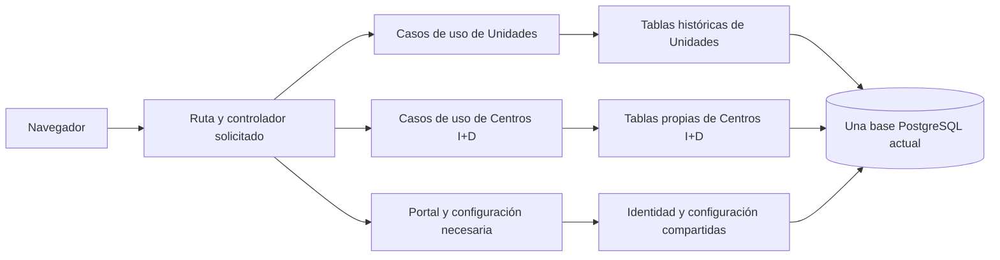

# Auditoría integral y ruta de producción — 10–11 de octubre de 2026

## Dictamen y alcance

> Seguimiento del 11 de octubre: [Centros I+D ya separados localmente y verificación del corte](separacion-centros-verificacion-2026-10-11.md). Los apartados de diagnóstico siguientes describen el punto de partida del 10 de octubre.

El sistema tiene una base útil para operar como monolito modular y seguir evolucionando con actualizaciones aditivas. Se encontraron y corrigieron consultas innecesarias, importaciones anticipadas, una configuración obsoleta de estáticos y riesgos en recuperación de respaldos. **La publicación en producción sigue condicionada a validar infraestructura, credenciales restringidas, restauración y capacidad real.** La revisión local no acredita ausencia universal de fallos ni un número de usuarios soportados.

Punto de partida: commit 060af88f en reestructura-modular. Se revisaron inventario del árbol completo, modelos y relaciones, rutas, middleware, configuración, migraciones, administración, importaciones, archivos, pruebas y documentación previa. El análisis automatizado de todos los archivos se complementó con revisión semántica dirigida de recorridos críticos. No se afirma haber ejecutado manualmente cada pantalla ni revisado cada línea de terceros. Las lecturas de la base operativa se protegieron mediante READ ONLY; las pruebas de escritura se ejecutaron en bases separadas. No se borraron datos, archivos de compatibilidad ni migraciones históricas, y no se desplegó el sistema.

Los informes de detalle forman parte de este dictamen:

- [Datos, consultas y escala](auditoria-bd-escala-2026-10-10.md).
- [Seguridad y operación](auditoria-seguridad-produccion-2026-10-10.md).
- [Organización y continuidad editorial](auditoria-modular-contenidos-2026-10-10.md).

## Estado real de la arquitectura

| Capa | Estado comprobado | Decisión de continuidad |
| --- | --- | --- |
| Identidad, catálogo académico, niveles y calendario | Configuración institucional versionada, publicable y persistida | Editar mediante gestión; no reemplazar registros al desplegar código |
| Centros I+D | 40 tablas propias y módulos propios | Conservar dueño de datos y contratos; preparar extracción física sin introducir FKs a Unidad |
| Laboratorios y demás unidades | Presentación y permisos por vertical; operación en tablas históricas webcitt | Extraer por caso de uso, manteniendo fachada, rutas e identificadores |
| Base de datos | PostgreSQL 17.9, una conexión default, 285 tablas visibles, aproximadamente 75,6 MiB locales | No confundir tamaño pequeño con capacidad probada; medir sobre datos representativos |
| Portal | Inicio administrable; otras páginas combinan plantillas y datos/proveedores | Completar publicación editorial de Quiénes somos, Servicios y Normativa sin sustituir sus contenidos actuales |
| Ejecución | Proceso Django compartido | La modularidad de código no evita que un error de arranque detenga el proceso; aislar trabajos costosos |
| Adjuntos | Almacenamiento persistente en var, autorización en backend | Mantener nombres y permisos al actualizar; respaldar base, medios y marca |

**No hay todavía dos bases físicas independientes para Centros I+D y Unidades.** Las tablas de los centros son distintas, pero comparten servidor, conexión, usuarios y proceso. Laboratorios usa proxies; un proxy no crea una tabla propia. Activar un router sin migrar dependencias rompería integridad. Se identificaron 19 relaciones de centros a usuarios compartidos; Django no admite integridad referencial entre bases diferentes. [Documentación oficial de múltiples bases](https://docs.djangoproject.com/en/5.2/topics/db/multi-db/).

El recorrido actual de una petición y la propiedad lógica de los datos se resumen así:

La arquitectura objetivo mantiene dos dominios operativos dueños de sus datos: centros y unidades. Identidad/autenticación permanece como contrato compartido, con identificadores estables. Para separar físicamente: inventariar relaciones, introducir proyecciones de identidad, migrar por copia a staging, reconciliar claves/conteos/archivos/permisos, ensayar recuperación y realizar un corte controlado con una única fuente de escritura. Separar los cinco contextos en microservicios de inmediato añadiría operación sin resolver los cuellos de botella actuales.

## Carga selectiva por página

Django debe registrar modelos y administración al arrancar un proceso. Esto no lee todas las tablas ni descarga todo el sistema a cada usuario. La unidad de optimización es la petición: consultas evaluadas, imports de controladores, archivos descargados y trabajo realizado.

Cambios aplicados:

1. Las 249 rutas heredadas registran callbacks diferidos: importar el mapa no importa dominios de negocio ni necesita django.setup. El controlador se carga al usarlo y se reutiliza dentro del proceso. Se preservan rutas, nombres, argumentos y las dos exenciones CSRF de callbacks firmados de videollamada; pruebas comparan estos metadatos con las vistas reales.
2. La presentación, catálogo, niveles y calendario se resuelven al usarse, una sola vez por petición. No existe caché global de permisos o datos personales. Los ámbitos explícitos de auditoría conservan resolución estricta.
3. Los avisos de la cabecera se consultan cuando una plantilla los muestra. Un fragmento, modal o PDF no ejecuta sus cuatro consultas por pasar por un context processor.
4. La política global de cámara/micrófono consume un adaptador de configuración pequeño; no importa controladores del aula, matrícula y certificados.
5. Los centros resuelven únicamente sus colecciones necesarias; la portada precarga resúmenes por conjuntos. La oferta de cursos agrupa aforos sin una pareja de COUNT por grupo.

La optimización sigue la recomendación de medir consultas y planes antes y después, y evitar materializar relaciones que la página no necesita. [Django: optimización de acceso a datos](https://docs.djangoproject.com/en/5.2/topics/db/optimization/).

### Medición local reproducible

Cliente Django anónimo, PostgreSQL local con escritura SQL bloqueada, sin red, TLS, descarga de imágenes/JS ni navegador real. Los conteos incluyen control de transacciones/savepoints. Primera y última versión se ejecutaron en procesos nuevos; los tiempos individuales varían y no se presentan como SLA.

| Página | Consultas iniciales | Consultas finales |
| --- | ---: | ---: |
| Inicio | 14 | 5 |
| Quiénes somos | 12 | 3 |
| Servicios | 12 | 3 |
| Normativa | 12 | 3 |
| Portada Centros I+D | 51 | 10 |

Antes de modificar la galería, los cinco HTML conservaron su tamaño durante la comparación, además de responder 200. La reducción afecta trabajo de servidor; no demuestra igualdad visual por sí sola. En la secuencia inicial de páginas se importaban 183 módulos de negocio frente a 108 después de diferir rutas/configuración; sigue existiendo carga común de modelos, administración y permisos.

La oferta vinculada se prueba con 40 grupos y 1.200 matrículas sintéticas: dos consultas de conteo y cinco para construir toda la oferta. Esto demuestra ausencia de crecimiento N+1 en ese recorrido, no capacidad concurrente del sistema completo.

Nuevo comando para repetir mediciones sin permitir escrituras SQL:

~~~text
python manage.py auditar_rendimiento_paginas --repeticiones 3 --json var/auditoria/rendimiento.json
python manage.py auditar_rendimiento_paginas --ruta /servicios/ --max-consultas 3
~~~

Admite solo rutas locales y GET anónimo; entre una y diez muestras. Informa tablas, conteo, estado, bytes HTML y mediana. No imprime SQL, credenciales ni contenido de usuarios. Devuelve error si una ruta falla o supera el presupuesto indicado. Una vista que escribe en GET puede fallar bajo READ ONLY: se debe revisar ese flujo, no desactivar la protección para auditar datos reales.

## Organización del repositorio y archivos

El inventario inicial comprendió 3.861 archivos y 320,5 MB, sin errores sintácticos detectados ni colisiones Linux/Windows. Encontró seis pares idénticos: recursos de distribución de un curso y alias de catálogo. No son evidencia de código redundante eliminable. Se mantuvieron para no romper rutas persistidas ni paquetes descargables.

Aproximadamente 280 MB son estáticos; esto no equivale al peso por página. Videos, recorridos 360 y algunas imágenes grandes requieren variantes optimizadas, miniaturas y descarga bajo demanda. El visor PDF ya carga su motor al abrir un documento; hay que mantener esa regla para nuevos simuladores y bibliotecas pesadas.

La portada solicitaba sus 13 PNG inmediatamente, aunque solo mostrara uno por opacidad. Se corrigió: una imagen inicial con prioridad y doce URLs diferidas; el controlador específico solicita una por turno y conserva la anterior hasta terminar. La suma de fotos solicitables al inicio pasa de 24.291.562 a 1.613.150 bytes (93,36% menos), más un controlador de 3.309 bytes. Son tamaños de archivos locales, no una medición HTTP o LCP. No se inicia una nueva descarga con pestaña oculta o movimiento reducido. Tres casos Django y siete escenarios Node comprobaron carga, errores, preferencias y ausencia de saltos de foco; hay solapamiento porque un caso Django invoca los escenarios Node.

PDF.js importa motor y worker al montar un documento. Los recursos HTML/ZIP crean su iframe al abrirlos, y el aula presenta la lección seleccionada. Persisten dependencias globales que conviene separar por componentes reales: Bootstrap/Dore/jQuery, estilos institucionales compartidos, model-viewer predeterminado y el asistente de reservas de unos 393 KB antes de abrir el modal. El CSS de Quiénes somos ronda 285 KB y se importa desde portal.css; la portada reutiliza parte de esos componentes, por lo que retirarlo sin extraerlos rompería su aspecto. Completar variantes WebP/AVIF/srcset y medir navegador/dispositivos constituye otra entrega, no se atribuye a esta corrección.

Se sustituyó STATICFILES_STORAGE, obsoleto para la versión actual de Django, por STORAGES con WhiteNoise comprimido. Los medios mantienen FileSystemStorage. Una prueba aislada verificó generación efectiva de gzip (164.000 bytes originales, 556 comprimidos para CSS repetitivo de ensayo); esa relación no representa todos los archivos reales.

No se renombra webcitt ni se borran migraciones para que el árbol parezca más corto. Ese identificador pertenece al historial de permisos y tablas. Los módulos grandes requieren extracción gradual de responsabilidades, conservando compatibilidad: certificados históricos por versión, gestión por caso de uso y modelos por agregado. La documentación de estructura enumera tamaños y ubicaciones concretas.

## Actualizaciones frecuentes y datos administrables

La regla de producción es que el código y los datos evolucionen de forma distinta:

| Cambio | Mecanismo |
| --- | --- |
| Nombre, logo, color, catálogo, texto, curso o documento ya modelado | Gestión editorial/formulario autorizado; sin reiniciar la base |
| Nuevo campo, índice o restricción | Migración versionada y probada; preferir ampliación compatible |
| Importación de contenido inicial faltante | Comando explícito e idempotente, fuera del arranque web |
| Corrección masiva de datos | Trabajo por lotes con simulación, respaldo, conciliación y registro de cambios |
| Retirar una entidad con historial | Desactivar o archivar; borrado controlado solo con análisis de dependencias |
| Revertir una versión de código | Mantener compatibilidad con el esquema ampliado; no restaurar una base antigua perdiendo escrituras nuevas |

La consulta administrativa de diseños, participantes de eventos y certificados ya tiene un lugar explícito dentro de la formación de cada unidad, con filtros propios y los permisos existentes. Los certificados contemplan tanto matrícula como participante externo; la interfaz no concede permisos ni permite alterar el registro histórico desde una ficha incompleta.

Se añadió cargar_centros_id --conservar-existentes para respetar también vacíos intencionales, estados inactivos, relaciones retiradas y archivos existentes. Solo crea faltantes. No puede combinarse con --reescribir. Los scripts web no recargan semillas ni hacen flush durante un despliegue. Los nuevos índices son exclusivamente aditivos y usan CREATE INDEX CONCURRENTLY; se aplicaron localmente el 11 de octubre después de respaldo; véase el seguimiento de separación.

El servicio migrate de Compose ejecuta migraciones automáticamente antes de arrancar web, scheduler y respaldos. Eso no acredita un respaldo previo: para cada actualización de producción se debe obtener una copia externa verificable y revisar migrate --plan antes de iniciar ese servicio. La automatización de un respaldo coherente previo a cada cambio y el ensayo de retorno siguen pendientes.

No se puede prometer que una función nueva nunca requiera migración. La continuidad se obtiene mediante cambios compatibles, pruebas y preservación de registros. Guardar toda la operación en JSON sin restricciones para evitar esquemas perjudicaría consultas e integridad. [Django: migraciones](https://docs.djangoproject.com/en/5.2/topics/migrations/).

Para ampliar administración faltan publicaciones versionadas de algunas páginas institucionales, historial editorial uniforme, autocompletados autorizados de grandes catálogos y política de archivo/retención. Los contenidos de los centros y cursos cuentan con edición operativa, pero eso no convierte automáticamente todas las frases de plantillas, guías y simuladores en un CMS universal.

### Comprobaciones automáticas para cada actualización

Se añadió [GitHub Actions](../.github/workflows/ci.yml) para push, pull request y ejecución manual. Usa una base PostgreSQL 17 efímera, Python 3.11, dependencias del lock, requisitos con hashes, hashers normales, medios temporales y credenciales ficticias. PyMuPDF 1.28.2 y tblib 3.2.2 se añaden solo al entorno temporal de QA para ejecutar comprobaciones PDF y trazas paralelas; no cambian el runtime web ni el lock de la aplicación. Comprueba Django, migraciones, módulos, contratos de señales, plantillas/referencias, inventario, Ruff, pruebas JavaScript y regresión Django. Un trabajo separado consulta avisos de vulnerabilidades Python y falla ante hallazgos o errores de consulta.

Las acciones se fijan por SHA, los permisos del workflow se limitan a lectura y el checkout no conserva credenciales. No hay despliegue automático ni acceso a datos institucionales. Se verifican estructura YAML y comandos localmente; **su ejecución completa en GitHub queda pendiente de subir estos cambios**. Tampoco sustituye el ensayo de migración con una copia de datos existente, la matriz ASVS, el análisis de la imagen y frontend o la restauración previa a cada entrega.

## Condiciones de seguridad y producción

| Prioridad | Condición | Estado de esta revisión |
| --- | --- | --- |
| P0 | Rol web sin SUPERUSER, BYPASSRLS, propiedad de tablas ni membresías elevadas | La conexión local es elevada; verificar_seguridad_bd la rechaza correctamente |
| P0 | Credenciales de producción nuevas y revocación de secretos históricos | Pendiente de acreditar con TI; no se imprimieron valores ni se alteró historial Git |
| P0 | DNS, TLS, proxy, SMTP, volúmenes y firewall reales | Configuración revisada; validación de servidor pendiente |
| P0 | Respaldo externo y restauración coherente de base/medios/marca | Scripts mejorados; falta ensayo real y medición de RTO |
| P1 | Dependencias Python, imagen y bibliotecas web escaneadas al entregar | pip-audit: 38 paquetes fijados, cero vulnerabilidades conocidas reportadas; imagen y bibliotecas web pendientes |
| P1 | Salud de web, latencia, saturación y antigüedad de respaldos monitorizadas | Sondas internas y healthcheck Compose implementados; alertas y métricas reales pendientes |
| P1 | Colas para importación, emisión y exportación de gran volumen | Flujo actual síncrono y acotado; requiere evolución antes de ofrecer alto volumen |

Existen controles de CSRF, CSP con nonce, saneado de contenido, orígenes, archivos privados, límites de entrada y permisos por objeto. Seis tablas personales tienen RLS; no es cobertura universal y el superusuario local lo elude. Un test que aprueba una cabecera no valida toda la aplicación ni infraestructura.

Se incorporaron dos sondas internas: /salud/vivo/ devuelve 204 sin SQL; /salud/listo/ comprueba SELECT 1 y devuelve 204 o 503 sin divulgar detalles. Evitan autenticación, sesiones y RLS únicamente para esos dos paths. Validan Host, admiten GET/HEAD y deshabilitan caché. La exención HTTPS es exacta para permitir la sonda loopback, mientras Nginx bloquea ambas rutas públicas. Compose consulta disponibilidad cada 30 segundos con timeout y reintentos; unhealthy requiere alertas/intervención, no provoca reinicio por sí solo. No acredita integridad funcional, migraciones o recuperación.

El verificador de respaldo ya no elimina una base ajena si createdb falla; limpia únicamente una base que confirmó haber creado. También valida prefijo y retención. Se acotó capacidad de Waitress y tiempos de proxy, y el auditor evita leer archivos privados incluso si se añaden por error a Git.

La trazabilidad mínima de esta entrega agrupa controles y evidencia; no sustituye una matriz completa de requisitos ASVS:

| Control | Evidencia en el proyecto | Límite pendiente |
| --- | --- | --- |
| Cabeceras, CSP, orígenes y cuentas | test_seguridad_produccion, test_endurecimiento | Comprobar TLS/proxy/orígenes reales y prueba de penetración |
| Permisos y propiedad por unidad | Pruebas de gestión, aislamiento de centros y filtros administrativos | Revisar nuevas capacidades y tareas de fondo con el mismo alcance |
| Datos personales y rol SQL | verificar_seguridad_bd; seis políticas RLS verificadas | Rol local elevado; no hay RLS universal |
| Recuperación | test_operacion_produccion y scripts de respaldo/restauración | Ensayo con respaldo real, copia externa y RTO |
| Dependencias Python | pip-audit sobre requirements.txt: 38 paquetes, cero hallazgos conocidos | Escanear también imagen, sistema y frontend; repetir en CI |
| Contratos y estructura | Auditores de módulos, señales, plantillas, referencias y repositorio | Una comprobación estática no demuestra toda la ejecución |

Como marco de verificación se propone una matriz trazable de requisitos, evidencia, alcance y pendientes basada en ASVS 5.0.0. No se ha certificado la totalidad de ASVS ni una norma ISO. [OWASP ASVS](https://owasp.org/projects/asvs). Los controles de despliegue se deben ejecutar con los ajustes de producción y en la infraestructura real. [Lista de despliegue Django](https://docs.djangoproject.com/en/5.2/howto/deployment/checklist/).

## Escala, rendimiento y recursos del servidor

Estimación inicial, pendiente de prueba: piloto sin cargas pesadas en 2 vCPU/4 GiB y SSD; primera producción institucional en 4 vCPU/8 GiB y SSD/NVMe, con 80–160 GiB iniciales según archivos y crecimiento. No representan usuarios garantizados. Las videollamadas propias, contenedores de alumnos, IA y simulación intensiva requieren capacidad separada.

Plan de capacidad de staging: datos sintéticos de 10.000, 100.000 y, para tablas de actividad relevantes, 1.000.000 de registros; relaciones, historial y adjuntos representativos. Mezcla de navegación, búsquedas, agenda, matriculación, documentos y PDF con escalones de 10, 25, 50 y 100 sesiones concurrentes. Ensayos de 15–30 minutos por escalón con pausas realistas; detener el escalado si hay errores o saturación. Son objetivos de ensayo, no mediciones realizadas aquí.

Metas iniciales propuestas para acordar: p95 de páginas interactivas y operaciones pequeñas inferior a 1 segundo de servidor bajo carga prevista; ninguna violación de cupo, duplicado o acceso entre unidades; cola con progreso para trabajos largos. Medir por separado red/TTFB/LCP del cliente, CPU/RAM/I/O, conexiones, bloqueos, tiempo SQL, memoria por exportación y tamaño descargado. No usar medias para ocultar p99 ni extrapolar una muestra local de milisegundos a internet.

La base local configura max_connections=100. Presupuestar hilos por proceso más tareas y administración; canales HTTP, usuarios registrados y conexiones SQL no son la misma cifra. Evitar aumentar conexiones sin medir memoria. Consultas lentas requieren EXPLAIN y estadísticas sobre datos representativos. [PostgreSQL: EXPLAIN](https://www.postgresql.org/docs/17/using-explain.html), [estadísticas y monitoreo](https://www.postgresql.org/docs/17/monitoring-stats.html).

No se particionan tablas, agregan réplicas ni instalan cachés globales sin evidencia. La paginación de catálogos científicos, índices justificados, proyecciones públicas y archivo de históricos preceden a mecanismos más complejos. Las exportaciones largas no deben recorrer consultas fuera del contexto RLS de la petición: usar generación autorizada en tarea/archivo privado o preservar explícitamente el contexto.

## Comparación funcional y evolución nativa

La comparación se limita a funciones documentadas públicamente y a código comprobado del SLCID; no demuestra exclusividad o superioridad global.

| Aspecto | Referencias externas | SLCID actual y oportunidad |
| --- | --- | --- |
| Aprendizaje guiado | LabXchange organiza recursos y simulaciones en itinerarios y aulas | Cursos, módulos, lecciones, evaluaciones y seguimiento; extender recorridos reutilizables por unidad/centro |
| Práctica virtual | LabXchange ofrece técnicas de laboratorio con cuaderno, reinicio y experimentación | Simulaciones de plantas/procesos, ERP educativo y herramientas de centros; falta catálogo validado de alta fidelidad para cada especialidad |
| Gestión del aprendizaje | Moodle documenta actividades, evaluación, progreso y herramientas de curso | Se integran con operación de unidades, reservas y certificados; completar interoperabilidad si se conecta a un LMS |
| Operación institucional | La documentación consultada de LabXchange se enfoca en aprendizaje | El aporte específico de SLCID es conectar recurso físico, práctica, producción/calidad, evidencia, formación y capacidades de investigación |
| Calidad científica | La existencia de una animación no acredita un método validado | Exigir validación académica, unidades, supuestos, incertidumbre y versiones antes de publicar un simulador como científico |

Fuentes: [LabXchange para docentes](https://about.labxchange.org/featured/science-teaching-resources), [simulaciones y cuaderno virtual](https://help.labxchange.org/en/articles/7239233), [características de Moodle](https://docs.moodle.org/503/en/Features).

El aporte defendible es la integración contextual con recursos y trazabilidad institucional, no que cursos o simuladores sean nuevos en sí mismos. La biblioteca de terceros requiere revisar licencia, permiso de incrustación y acceso; no se copia contenido protegido ni se promete una API no verificada.

### Contrato para una nueva herramienta por unidad o centro

Cada herramienta tendrá identificador y versión estables, dominio propietario, objetivo pedagógico, entradas con tipo/rango/unidad, método, fuentes/licencia, escenarios, salidas, supuestos y límites. El catálogo guarda estos metadatos; la implementación ejecutable vive en un proveedor de código versionado, nunca en Python o SQL arbitrario guardado por el administrador.

Separar motor científico puro, adaptador de aplicación y presentación. Los permisos y límites se comprueban al ejecutar y al descargar resultados. Herramientas ligeras cargan JS/recursos solo al abrirse; cálculos costosos se envían a trabajadores aislados con tiempo/memoria y progreso. Cada resultado guarda versión de motor, parámetros, fecha, propietario y evidencia. Una actualización no recalcula resultados históricos silenciosamente.

| Contexto | Primer candidato de implementación | Validación mínima |
| --- | --- | --- |
| FabLab | Preparación de impresión 3D: material, tiempo y coste estimado | Datos de máquina/material, calibración con trabajos reales y rango de error |
| Plantas piloto | Balance de masa/energía y control de un proceso | Conservación, unidades, casos límite, comparación con protocolo docente |
| Centros experimentales | Diseño de ensayo y cálculo de riego | Modelo agronómico documentado, escenarios locales y límites |
| Observatorios | Exploración de series/escenarios con procedencia | Versiones de conjuntos, metodología, datos faltantes y reproducibilidad |
| Centros I+D | Diseño experimental, capacidad y portafolio de proyectos | Revisión por especialistas, supuestos, escenarios e historial |

Son candidatos de hoja de ruta; no se presentan como simuladores ya construidos en esta auditoría. Primero se entrega un motor con escenarios y resultados verificados por especialidad, luego se amplía interacción y visuales. Un render 3D por sí solo no aporta precisión científica ni garantiza utilidad educativa.

## Secuencia de entrega sin desarmar lo existente

1. Cerrar P0 de infraestructura y recuperación; ejecutar pruebas con rol restringido y copia anonimizada en staging.
2. Entregar esta optimización compatible, aplicar los índices aditivos mediante rol de migración y medir después de desplegar.
3. Introducir trabajos persistentes, idempotencia y descargas privadas para lotes; paginar científicos y catálogos grandes.
4. Completar publicación editorial de portal y herramientas de administración por dominio.
5. Extraer físicamente Centros I+D mediante plan de datos probado, manteniendo identidad común por contrato.
6. Incorporar herramientas científicas nativas por especialidad como capacidades nuevas, inicialmente desactivadas y publicadas tras validación.

Cada entrega debe tener contrato compatible, pruebas dirigidas, migración revisada, respaldo/retorno ensayados y un indicador medible. No juntar en una misma publicación una división de base, cambio de autenticación, traslado de archivos y sustitución de interfaz.

## Validación final

La regresión integral final aprobó **3.025 pruebas en 613,584 segundos**, sin fallos ni errores, sobre PostgreSQL y cuatro trabajadores. El ejecutor completo terminó con código 0. Las bases de QA son independientes de la base operativa; MEDIA_ROOT también se aisló. Para acelerar únicamente ese proceso se utilizó un hasher MD5 de pruebas, sin modificar los ajustes de contraseñas del sistema ni registros reales. Además, 34 casos dirigidos de cursos, catálogo y seguridad aprobaron con los hashers habituales.

La primera regresión había ejecutado 3.008 casos con 16 fallos y dos errores. Se corrigieron antes de repetirla: faltaba ubicación administrativa para certificados; el inventario de señales recorría dependencias de un entorno QA y faltaban contratos de receptores de matrícula; varias expectativas de interfaz y fechas de escenarios ya no correspondían al producto vigente. Se preservaron permisos, validaciones de certificación y CSP. Una comprobación de hashes también se invalidó por editar fuentes durante su ejecución; la regresión final se hizo con fuentes congeladas.

Aprobaron los auditores estrictos de módulos, señales (33 contratos, 33 conexiones, cero hallazgos), plantillas activas (376, cero errores) y referencias huérfanas; check y makemigrations --check --dry-run no señalaron incidencias. Los casos focales se solapan con la suite general y no se suman como pruebas distintas. El inventario final de 3.887 archivos no encontró errores sintácticos, archivos huérfanos ni colisiones de nombres; seis grupos de archivos idénticos se conservaron por su función de distribución o compatibilidad.

También aprobaron cinco casos de límites temporales de mantenimiento. check --deploy --fail-level WARNING pasó con config.settings_production y valores sintéticos, con SQL bloqueado: verifica reglas de configuración, no el servidor real ni su rol. El análisis actualizado de requirements.txt revisó 38 paquetes fijados, sin vulnerabilidades conocidas reportadas al momento de la consulta; no equivale a una auditoría de imagen o frontend.

Después de esa regresión aprobaron **86 pruebas dirigidas con los hashers habituales** (144,924 s), incluidas las nuevas sondas, galería, cabeceras, endurecimiento, carga selectiva y contratos de superficies/señales. También aprobaron las **27 pruebas Node** disponibles; se solapan con un caso Django que invoca los siete escenarios de galería. Esta comprobación posterior no se presenta como una segunda ejecución completa de los 3.040 casos descubiertos en el árbol final. La sintaxis/política del workflow, bloques Bash/Python y correspondencia de 1.098 líneas de requisitos/hashes pasaron; la ejecución remota completa sigue pendiente. Compose se validó con una copia YAML y variables ficticias, sin arrancar servicios. La prueba real de Docker BuildKit sobre un contexto sintético confirmó que se conservan fuentes y recursos, y se excluyen entornos QA, venv, node_modules, cachés, archivos .env/clave anidados y datos de ejecución. No se construyó ni desplegó una imagen con datos operativos. Al cierre se eliminaron exclusivamente las cinco bases temporales de esta regresión, tras comprobar nombres, propiedad y ausencia de conexiones. Los datos de operación permanecen intactos.

Las evidencias locales se guardan en var/auditoria-integral-20261010, incluidos tests-final.log, tests-final-result.json, controles-estables.json, rendimiento-final.json, dependencias.json y docker-contexto-verificacion.json. El cierre posterior consta también en cierre-focal-result.json, node-cierre.log, controles-cierre.json, compose-config-verificacion.json y limpieza-bases-qa.json; la validación del workflow está en var/qa-ci. La verificación de carga concurrente, recuperación con copia real, interfaz en navegadores/dispositivos y controles de infraestructura siguen pendientes.
