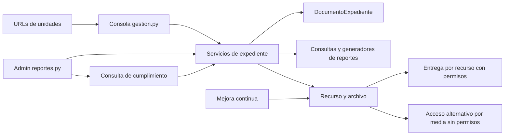

# Auditoría del centro de reportes, laboratorios y unidades

Actualización posterior: los pasos 1 y 2 se implementaron en el
[cierre de seguridad e integridad del expediente](cierre-seguridad-integridad-expediente.md).
Los hallazgos siguientes conservan el diagnóstico del código examinado;
consulta el cierre para conocer las correcciones y su validación.

Fecha: 25 de septiembre de 2026. Código examinado: `47bb1918`, rama
`reestructura-modular`. Alcance: diagnóstico y ruta de continuación; esta
auditoría no modifica las reglas operativas ni elimina contenidos.

El sistema tiene una base funcional amplia, pero el expediente todavía necesita
correcciones de autorización, integridad y cierre del circuito al decanato.
Que las pantallas abran y las pruebas existentes pasen no demuestra que esos
casos estén cubiertos.

## Evidencia y límites

- Django 5.2.17; PostgreSQL 17.9. Sin migraciones pendientes en la base activa
  y sin cambios de modelos pendientes de migración.
- `manage.py check`: sin incidencias.
- `manage.py auditar_admin`: **747 pantallas, 0 fallas**, con PostgreSQL forzado
  a solo lectura. Recorre GET como superusuario; no acredita aislamiento entre
  usuarios, acciones POST, filtros inválidos ni todos los objetos de cada tabla.
- Contratos de señales: **22 contratos, 22 conexiones, 0 hallazgos**.
- Registro de módulos: validación ejecutada; sus metadatos no son autorización.
- Inventario de superficies: 11 módulos, 111 rutas heredadas y 232 administradores.
  Catálogo institucional: 56 campos compatibles. Calendario: 1 período y 16 semanas,
  sin incompatibilidades; ambas auditorías se ejecutaron en solo lectura.
- **179 plantillas** compilan. Sin referencias literales faltantes a estáticos
  ni a `include`/`extends`, considerando también el renderizador de formularios.
  Esto no sustituye la revisión visual ni comprueba rutas construidas dinámicamente.
- Ruff: **16 incidencias**. `uv pip check`: 38 paquetes compatibles.
  La exportación de `uv.lock` coincide con `requirements.txt`, salvo el comentario
  que registra el comando de exportación. No se realizó un escaneo exhaustivo de CVE.
- Sondas específicas: **14/14 reproducciones confirmadas** en base independiente.
  Estas sondas afirman el comportamiento defectuoso observado; que pasen significa
  que lo reproducen, no que el sistema haya quedado corregido. Cubren A01–A07 y la
  fecha imposible de A08. La comprobación de caché simula otro escritor mediante
  actualización directa; no es una prueba de despliegue multiproceso.
- Suite integral: `python manage.py test --noinput`, **1.762 pruebas, OK, 1 omitida**,
  2.276,305 segundos de ejecución de pruebas. Una sola corrida integral, sin
  `--keepdb`. Su resultado no cubre los fallos reproducidos por las sondas adicionales.
- Consultas de inventario y recorrido administrativo sobre datos activos bajo
  `default_transaction_read_only=on`. Sondas de escritura sobre otra base de pruebas,
  con adjuntos temporales. No se modificaron usuarios ni asignaciones de la base
  activa. La suite existente tiene casos sin aislamiento de medios, indicados abajo.
- El entorno local carga `config.settings` con DEBUG activo. La comprobación con
  `config.settings_production` se detiene correctamente porque la clave local no
  satisface el mínimo exigido. No acredita ni invalida un despliegue externo que
  utilice otras variables; queda pendiente verificar ese entorno real.

## Hallazgos prioritarios

### A01 — P0: los adjuntos internos tienen una ruta alternativa sin autorización

`webcitt/routing/heredadas.py:231` registra `/media/` incondicionalmente.
`webcitt/domains/portal/media.py:9` sirve cualquier archivo existente bajo
`MEDIA_ROOT`, sin comprobar usuario, unidad, visibilidad o revisión de seguridad.
La contención de rutas impide salir de ese directorio, pero no protege sus
documentos internos. Esta ruta omite también el rastro de lectura del expediente.

La ruta por recurso sí tiene comprobaciones en
`webcitt/domains/unidades/recursos_publicos.py:48`; conocer la ruta física permite
evitarlas. El inventario registra 75 recursos internos con campo de archivo;
no se descargaron sus contenidos para la auditoría.

Corrección: separar medios públicos de documentos protegidos, servir estos últimos
mediante autorización por recurso y retirar el acceso alternativo. Conservar
compatibilidad de los recorridos y medios realmente públicos mediante clasificación
explícita. Probar anónimo, usuario ajeno, responsable y receptor autorizado con
DEBUG desactivado y con el servidor frontal de producción.

### A02 — P0: un receptor puede consultar y observar documentos de otra unidad

Hay dos entradas independientes:

- `webcitt/admin/expediente.py:147`: `DocumentoExpedienteAdmin` hereda el queryset
  global. El permiso `view_documentoexpediente` concedido a receptores abre documentos
  ajenos. Las acciones masivas de observar/validar no declaran permisos de cambio.
- `webcitt/admin/reportes.py:118`: el POST del tablero busca por ID global después
  de exigir únicamente permiso de lectura. `observar_documento`, en
  `webcitt/domains/unidades/expediente.py:684`, exige superusuario solo si el estado
  ya era `validado`. Por tanto, un receptor puede observar un documento ajeno pendiente,
  cargado o generado. Ocultar el botón en la plantilla no protege este POST.

Corrección: una política común de alcance y acción aplicada en servicio, admin
general, proxies, consola, descargas y acciones masivas. El decanato solo lee lo
autorizado; designar responsables no le concede autoridad para alterar entregas.
Añadir pruebas de denegación con receptor ajeno y receptor retirado.

### A03 — P1: consultar materializa documentos y la unicidad admite duplicados

`webcitt/domains/unidades/expediente.py:154` usa `get_or_create` y actualizaciones
durante la construcción del expediente, llamada desde vistas GET y el PDF.
Consultar otro año puede crear obligaciones; la consola prepara el expediente
aunque se esté usando otra pestaña (`gestion.py:3916`).

`DocumentoExpediente.Meta.unique_together`, en `webcitt/models/expediente.py`,
incluye `mes`, que admite NULL. PostgreSQL permite varias filas iguales cuando
ese componente es NULL; después `get_or_create` puede fallar con
`MultipleObjectsReturned`. **No hay grupos duplicados en la base activa examinada**;
el defecto es la falta de garantía ante nuevas escrituras o concurrencia.

Corrección: separar inicialización explícita y consulta, imponer unicidad efectiva
para documentos sin mes y añadir pruebas concurrentes. PostgreSQL 17 permite
`UniqueConstraint(nulls_distinct=False)`; comprobar y resolver duplicados antes de
una migración, conservando evidencias e historial. Véase la
[referencia oficial de restricciones](https://docs.djangoproject.com/en/5.2/ref/models/constraints/#nulls-distinct).
La recomendación de mantener GET sin cambios de negocio está en la
[documentación de CSRF](https://docs.djangoproject.com/en/5.2/ref/csrf/).

### A04 — P1: la evaluación sobrevive a la devolución y al reemplazo de evidencia

`observar_documento` borra recepción, pero conserva `evaluacion`, `evaluado_por`
y `evaluado_en`. La carga/generación posterior tampoco invalida esa evaluación.
`DocumentoExpediente.nota` y `cumple` la siguen utilizando aunque el documento
esté observado. Una entrega devuelta puede seguir apareciendo con 95 % y cumplir;
una versión nueva puede arrastrar una nota que pertenecía a otra evidencia.

Corrección: vincular evaluación a versión/recurso; invalidar la evaluación vigente
al reabrir, preservando la anterior en historial. Probar observar → reemplazar →
validar → recalificar, incluyendo dos solicitudes simultáneas.

### A05 — P1: las compuertas de entrega no coinciden entre entradas

- `_exigir_entrega_abierta` comprueba vencimiento, pero no `abre_el`: permite pasar
  su control antes de abrir la ventana que `entrega_abierta` muestra como cerrada.
- `recibir_documento` admite un documento en estado `generado` aunque exija firma;
  el responsable no podría validarlo por esa misma razón. La excepción de recepción
  del Director puede convertir un borrador sin firmar en entrega validada.
- `_marcar_tardanza` usa el día de ejecución. Recibir después del plazo un archivo
  cargado antes marca tardanza. Debe definirse y persistirse qué evento representa
  la entrega para no atribuir a la unidad una demora de recepción de la Dirección.
- `evaluar_documento` exige hallazgo/recomendación contra la nota bruta. Con mínimo
  70, penalización 20 y nota bruta 80, admite una nota final 60 sin recomendación.

Corrección: centralizar ventana, firma, evento de entrega y nota efectiva; mantener
la excepción autorizada del Director sin omitir silenciosamente requisitos documentales.

### A06 — P1: el informe de mejora no completa la entrega al decanato

Actualización: el flujo técnico está implementado en el
[circuito de mejora](circuito-mejora-decanato.md), con la migración 0236 aplicada.
Sigue pendiente la configuración institucional de adscripciones y receptores.
El hallazgo original se conserva a continuación como evidencia de partida.

`webcitt/domains/unidades/mejora_continua.py:199` guarda un `Recurso` interno y
escribe «Elevado a…», pero no crea relación con `DocumentoExpediente`. La excepción
de lectura del receptor en `recursos_publicos.py:57` depende de esa relación.
El receptor puede leer el expediente de su facultad y tener denegado el informe
de mejora que se generó para él.

La función archiva el informe; no registra destinatarios, envío, acuse ni una
resolución estructurada. El PDF deja espacios para decisión, motivo, responsable
y fecha. Esto representa una parte pendiente del circuito funcional.

Datos vigentes: 21 unidades activas (13 laboratorios, 5 plantas, 2 centros
experimentales y 1 observatorio); **14 sin dependencia, 3 dependencias activas sin
receptores y las 21 unidades sin receptor asignado**.

Corrección: relación explícita informe–unidad–período–dependencia, lectura autorizada,
bandeja/acuse, resolución y seguimiento. Incorporar comunicación externa solo con
destinatarios y mecanismo institucional definidos. La asignación de personas y
dependencias requiere información institucional; no se debe adivinar.

### A07 — P1: política de calidad sin límites suficientes y caché por proceso

`webcitt/models/expediente.py:179-239` mantiene `_POLITICA` en memoria sin caducidad.
Guardar limpia solo el proceso que guarda: otros procesos pueden seguir calculando
con la política anterior. Los campos positivos tampoco limitan valores a 100;
`full_clean()` acepta mínimo 150 y penalización 200.

Corrección: rangos en formulario, modelo y base; lectura consistente por petición
o caché compartida versionada. Definir expresamente si modificar la política
recalcula informes históricos o solo períodos futuros; actualmente la nota usa
siempre la política vigente.

### A08 — P2: entradas inválidas y navegación entre informes

Implementado en el [paso 4: filtros y rendimiento](reportes-filtros-rendimiento.md).
El documento de cierre registra comportamiento, presupuestos de consultas y
validación. Lo siguiente describe el hallazgo original.

`parse_date` se invoca sin controlar `ValueError` en reportes: una fecha con formato
correcto pero imposible, como `2026-02-31`, produce excepción. Convertir el año a
entero tampoco limita el rango admitido por `date`. IDs mal formados merecen
respuesta de validación, no una excepción del ORM.

`reportes_consolidados.py:39` construye enlaces de detalle sin propagar `desde` y
`hasta`; al abrir el detalle se recuperan otros valores por defecto. El cuadro y
el informe pueden representar períodos distintos. `cumplimiento.py` fija cuatro
códigos base, mientras otros reportes usan `codigos_por_base`: las tipologías
personalizadas necesitan una prueba de inclusión coherente.

Corrección: objeto/formulario compartido de filtros y período, conservado en HTML,
PDF, XLSX, visor y enlaces de detalle; pruebas con fechas imposibles, años fuera
de rango, subtipos y filtros combinados.

### A09 — P2: el rastro no basta para reconstruir todas las decisiones

Las vistas guardan el cambio y después llaman a `registrar_auditoria`, sin una
transacción que incluya ambos. En las decisiones del tablero no envían instantáneas
anteriores/nuevas; una recalificación sustituye la nota anterior y deja una
descripción genérica. Las acciones masivas del admin no llaman a ese registro.
Las transacciones de base tampoco revierten automáticamente archivos ya escritos
por `_archivar`; un error posterior puede dejar un archivo sin fila asociada.

En el editor, `expediente_redaccion.py:1311` compara `version_base` antes de tomar
el bloqueo de la fila en la línea 1320; dos peticiones pueden superar la comparación
y guardar sucesivamente. Debe repetirse la comparación bajo el bloqueo. La respuesta
AJAX también retorna antes del registro de auditoría del borrador. Son riesgos
identificados por lectura, pendientes de pruebas concurrentes específicas.

Corrección: servicio transaccional con actor, versión, antes/después y evento;
control de concurrencia y compensación de archivos en errores. Probar fallos
intermedios. No borrar supuestos huérfanos de medios sin cruzarlos con la base.

## Arquitectura y limpieza

La conexión principal examinada es:

Las conexiones existen, pero A01–A09 muestran dónde sus reglas difieren o el
circuito queda incompleto. La construcción de datos y las decisiones necesitan
contratos compartidos antes de extraer más aplicaciones.

La dirección arquitectónica es razonable: monolito modular con contratos y
adaptadores, conservando rutas y datos. La extracción de operación todavía es
parcial:

- `webcitt` conserva **106 modelos concretos**. Las cuatro verticales de unidades
  tienen modelos proxy sobre las tablas heredadas; esos archivos y sus migraciones
  cumplen una función real de administración/permisos y no son duplicados sobrantes.
- `configuracion_institucional` tiene 11 modelos concretos; `portal`, 2;
  `centros_id`, 1. Plantas incorpora reglas propias en `domain/`, pero todavía
  depende de persistencia y operación compartidas.
- `gestion.py` tiene 4.433 líneas; `gestion_reportes.py`, 1.751;
  `expediente_redaccion.py`, 1.418. La extracción debe seguir responsabilidades
  funcionales, con contratos de datos y permisos, en lugar de mover bloques sin
  reducir dependencias.
- En el tablero se midieron **953 consultas SQL para 21 unidades**, 3,09 segundos
  totales y 1,49 segundos SQL en una corrida local con renderizado. No es una prueba
  de carga. Preparar catálogo/calendario una vez, traer documentos en lote y evitar
  materializar el expediente en lecturas reducirá trabajo repetido.
- El registro modular aún declara verticales en etapa de presentación y listas
  vacías de administración/migraciones pese a que ya existen. `docs/arquitectura.md`
  conserva pasajes donde afirma que no están registradas. Actualizar inventarios
  y documentación para que indiquen lo implementado y lo pendiente.
- Noticias mantiene contenido escrito en plantilla: la ruta funciona, pero no
  equivale a una sección editorial administrable terminada.

No aparecieron archivos fuente íntegramente idénticos en el análisis de Python,
HTML, CSS y JS no triviales (más de 150 caracteres; migraciones excluidas).
Se compararon además por SHA-256 **773 activos versionados** de imagen, fuente,
video y PDF, sin grupos de contenido idéntico. Este resultado no abarca los medios
de ejecución ignorados por Git.
Se encontró un cuerpo de función idéntico de al menos diez líneas:
`gestion.py:1257:_decimal_opcional` y `reservas/correccion.py:62:_decimal_opcional`.
También hay cálculo de nivel semejante en `cumplimiento.py` y `mejora_continua.py`;
conviene una definición compartida con contratos de alcance.

El control inicial de huérfanos señaló cinco archivos: cuatro documentos
(`cumplimiento-del-expediente.md`, `expediente-de-calidad.md`,
`prestamos-y-evidencias.md`, `seguimiento-de-mantenimiento.md`) y
`webcitt/management/commands/auditar_admin.py`. Son documentación sin índice y un
comando invocable por Django; no evidencia suficiente de código eliminable.
El detector considera menciones de texto y nombres cortos, por lo que puede
omitir código muerto y aceptar referencias exclusivamente documentales.
Después de indexar este informe, el mismo control devuelve **0 de 1.973 archivos**
porque aquí se mencionan esos cinco nombres. No se eliminó ni conectó código
operativo para obtener ese resultado: ilustra el límite de la comprobación textual.

Además, `test_direccion_recibe_y_califica.py` y `test_cumplimiento_expediente.py`
generan adjuntos sin redefinir `MEDIA_ROOT` ni limpiar sus archivos. La base de
pruebas sí se elimina, pero el almacenamiento de archivos no participa en ese
rollback: esas pruebas pueden dejar residuos bajo `var/media`. Aislar los medios
de toda la suite y auditar referencias base–almacenamiento antes de limpiar.
No se eliminaron archivos existentes basándose en su nombre o fecha.

Las 16 incidencias de Ruff incluyen imports y variables sin uso, un import repetido
de `receiver`, una exportación de modelos que debe hacerse explícita y sombreado
de `_`. Revisar cada una; no aplicar borrado masivo sobre migraciones, proxies,
exportaciones Django ni medios. El almacenamiento estático efectivo es
`StaticFilesStorage`: la configuración conserva `STATICFILES_STORAGE`, eliminada
desde Django 5.1, y debe migrarse a `STORAGES`. Véanse las
[notas oficiales](https://docs.djangoproject.com/en/5.2/releases/5.1/#features-removed-in-5-1).

Actualización del 10 de octubre: este hallazgo de almacenamiento se resolvió
con `STORAGES` y WhiteNoise comprimido; medios conservan FileSystemStorage.
Evidencia y alcance en la [auditoría integral](auditoria-integral-produccion-2026-10-10.md).
El párrafo anterior conserva el diagnóstico histórico del 25 de septiembre.

La comprobación de firma de PDF detecta marcadores, no verifica criptográficamente
certificado, identidad o integridad de la firma. Está documentado en
`reservas/guia_firma_certificada.py`; conservar la validación externa con FirmaEC
y evitar presentar la detección como certificación completa.

## Ruta de continuación y criterios de cierre

| Orden | Bloque | Resultado verificable |
| --- | --- | --- |
| 1 | Seguridad documental y permisos (A01–A02) | Ninguna ruta alternativa permite leer adjuntos internos; receptor/usuario ajeno no modifica entregas por ningún POST ni acción masiva. |
| 2 | Integridad del expediente (A03–A05, A07, A09) | Lectura sin materialización; unicidad real; evaluación por versión; ventanas/firma/nota efectiva coherentes; decisión e historial atómicos; pruebas concurrentes y de fallos. |
| 3 | Cierre Dirección → decanato (A06) | Adscripciones y receptores revisados por la institución; informe accesible; destinatario, recepción y decisión trazables; acciones con responsable, plazo y seguimiento. |
| 4 | Reportes consistentes y ágiles (A08) | Un período/filtro compartido en todas las salidas; subtipos incluidos; errores de entrada controlados; presupuesto de consultas y medición de carga representativa. |
| 5 | Limpieza y extracción gradual | Resolver Ruff; enlazar documentación útil; retirar solo código sin consumidores demostrados; actualizar manifiestos; extraer servicios y consultas de reportes conservando URLs/tablas. |
| 6 | Operación institucional y verticales | Verificar configuración real, respaldos/restauración y roles; continuar pendientes de Plantas y otros tipos con propietarios claros, sin migraciones masivas prematuras. |

Cada bloque termina con pruebas proporcionales, una revisión del flujo afectado y
commit validado en `reestructura-modular`. Antes de abrir nuevas funciones del
centro de reportes, cerrar los dos primeros bloques. La nueva extracción de tablas
o permisos necesita la puerta de recuperación institucional prevista en la
[ruta de arquitectura](ruta-cierre-reestructuracion-y-verticales.md).
