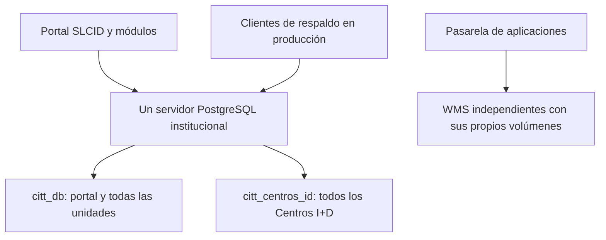

# Bases institucionales y organización de Docker

## Decisión y estado comprobado el 12 de octubre de 2026

Estado vigente de aplicaciones: PostgreSQL, pasarela y WMS 90 de Logística,
**tres contenedores y dos volúmenes**. Las pruebas 88/89 se archivaron fuera de
Docker con copias privadas verificadas; consultar su
[organización y comprobación](organizacion-aplicaciones-2026-10-12.md).

Agregar un laboratorio, unidad o Centro I+D **no crea otro servidor ni otro
contenedor**. Se crean registros de la entidad dentro de su dominio, con sus
relaciones y permisos. Los contextos funcionales pueden ser modulares sin
necesitar un proceso PostgreSQL por entidad.

La instalación local tiene **un servidor PostgreSQL**,
`slcid-postgresql-institucional`, que aloja:

| Base / alias Django | Contenido | Crecimiento |
| --- | --- | --- |
| `citt_db` / `default` | Portal, identidad, permisos, configuración, laboratorios y unidades, cursos y operación institucional. | Las 32 unidades existentes comparten esta base; nuevas unidades son nuevos registros. |
| `citt_centros_id` / `centros` | Gestión propia de todos los Centros I+D: centros, proyectos, investigadores, resultados y transferencia. | Los tres centros existentes comparten la base del dominio; no se crea una base por centro. |

Se contrastaron ambos aliases con `current_database()` e `inet_server_addr()`:
los dos conectan al mismo servidor y puerto, conservando nombres de base
distintos. El router de Centros dirige exclusivamente `centros_id` al alias
`centros`; no duplica usuarios, sesiones o contraseñas institucionales allí.

El catálogo conserva también la base administrativa `postgres` y las plantillas
internas normales. Las seis bases históricas de QA se inspeccionaron y retiraron
en la [limpieza local posterior](limpieza-desarrollo-bases-2026-10-12.md).
No se eliminó ninguna base operativa.



Un servidor PostgreSQL puede administrar varias bases; compartir servidor
**no fusiona sus tablas ni sus permisos**. Sí comparte CPU, memoria, disco y
disponibilidad. La capacidad real depende también de consultas, índices,
paginación, concurrencia y tamaño de adjuntos; esta organización no certifica
un número de usuarios ni sustituye las pruebas de carga universitarias.
Referencia: [administración de bases PostgreSQL](https://www.postgresql.org/docs/17/managing-databases.html).

## Qué representan los otros contenedores

- En producción, `slcid-respaldos-laboratorios-unidades` utiliza herramientas como `pg_dump`.
  La imagen `postgres:17` no significa que ese contenedor sea otro servidor.
  El respaldo de Centros se configura con sus propias credenciales y destino.
  El cliente periódico local se retiró a petición del usuario; no era otra base.
- Los WMS son aplicaciones Django subidas como microproyectos. Cada una
  utiliza SQLite en su volumen `/data`; no son bases institucionales adicionales
  ni se generan al registrar una unidad. Sus paquetes, dependencias y sesiones
  permanecen aislados del portal. La pasarela Nginx es compartida.
- Un curso, guía, simulador nativo, reserva o nuevo centro utiliza los modelos
  del sistema. Solo desplegar explícitamente una aplicación independiente añade
  un contenedor. No desplegar una copia completa del portal para cada unidad.
- Las dos pruebas identificadas se retiraron tras revisar sus tablas, desactivar
  sus recursos y verificar sus archivos privados. No se retira una aplicación
  únicamente por la palabra «prueba» en su título.

## Desarrollo local y despliegue con un servidor compartido

Para Django nativo local, usar exclusivamente `docker-compose.desarrollo.yml`:
solo declara `db`, reutiliza `citt_postgres_data` como volumen externo y no
inicia respaldos periódicos. No combinarlo con los archivos de producción.
Consultar [arranque local y alcance de la limpieza](limpieza-desarrollo-bases-2026-10-12.md).

Para producción, usar la base `docker-compose.yml` y **una sola** de estas alternativas:

| Archivo adicional | Resultado |
| --- | --- |
| `docker-compose.centros-compartido.yml` | Un servidor `db` para las dos bases; refleja la organización local actual. |
| `docker-compose.centros.yml` | Servidor `db-centros` y volumen propios para aislar recursos o disponibilidad de Centros. |

La alternativa compartida no añade servidor ni volumen PostgreSQL. Dirige
Centros a `db:5432` y ofrece el cliente de respaldo en el perfil
`centros-backup`. No combinar ambos archivos ni cambiar entre ellos como si
movieran datos automáticamente.

Antes del primer arranque compartido, el DBA debe crear la base Centros con
nombre y propietario distintos de la principal y aprovisionar los roles
necesarios. Mantener credenciales de web, migración y respaldo separadas por
dominio; los roles PostgreSQL son globales al servidor. La creación de
`POSTGRES_DB` de la imagen inicializa únicamente la base principal cuando el
volumen está vacío: no crea la segunda base ni altera un volumen existente.
Seguir el [procedimiento de separación y permisos](separacion-centros-operacion.md)
para preparar, copiar, comprobar y activar `CENTROS_DB_ENABLED`. Una base de
Centros activa ya existente no necesita repetirse ni volver a copiarse.

Validar sin imprimir secretos:

```sh
docker compose -f docker-compose.yml -f docker-compose.centros-compartido.yml config --quiet
```

Después de aprovisionar las dos bases, revisar sus roles y respaldar el conjunto,
usar los mismos archivos en **todos** los comandos de actualización:

```sh
docker compose -f docker-compose.yml -f docker-compose.centros-compartido.yml build
docker compose -f docker-compose.yml -f docker-compose.centros-compartido.yml run --rm migrate
docker compose -f docker-compose.yml -f docker-compose.centros-compartido.yml --profile centros-backup up -d
```

Conservar `name: citt`, el alias de servicio `db` y `citt_postgres_data`.
No ejecutar `down -v` ni crear otro volumen vacío como solución a errores de
conexión. En modo compartido, el volumen PostgreSQL contiene **ambas bases**;
los respaldos lógicos y su recuperación deben incluir las dos, medios y marca
en una ventana coherente. Tener dumps separados no garantiza coherencia entre
ellos. Un servidor dedicado es una opción futura que exige migración y corte
verificados; no es necesario por el simple aumento del número de unidades.

## Limpieza y comprobaciones de esta entrega

- Se eliminó `slcid-postgresql-sin-asignar-detenido`, ID `7d7c25c5896b`, y su
  volumen exclusivo, después de verificar que estaba vacío, detenido y sin
  otros consumidores. No se eliminó ninguna base operativa.
- El servidor activo se identificó como `slcid-postgresql-institucional`,
  conservando ID, proceso, montajes, alias `db` y puertos. La modificación no
  aplica otros cambios pendientes de Compose ni despliega en la universidad.
- La autorización específica posterior permitió archivar y retirar los 18
  volúmenes históricos desconectados. Se conservan 17 copias privadas verificadas.
  También se retiraron seis bases QA, el servicio periódico local y sus dos
  volúmenes vacíos. Ese bloque terminó con cinco contenedores y cuatro volúmenes;
  el archivo posterior de los WMS 88/89 deja tres contenedores y dos volúmenes en
  uso, sin volúmenes desconectados. No se ejecutó `volume prune` ni `system prune`.
- Se validaron seis combinaciones Compose: base, compartida y dedicada, cada
  una con perfiles optativos apagados y encendidos. La compartida no incorpora
  `db-centros` ni otro volumen PostgreSQL. Se verificaron dependencias,
  credenciales elevadas vacías en procesos web, destinos de respaldo y nombres
  estables de volúmenes. No se arrancó una instalación de producción nueva.
- Las dos bases operativas respondieron; los tres WMS dieron HTTP 200 con sus
  direcciones originales. Django check no encontró problemas. La inspección de
  procesos del respaldo existente mostró `sh` y `cron`, sin servidor PostgreSQL.

Ejecutar las pruebas y sus bases `test_*` en infraestructura QA separada del
servidor universitario. No añadir clones de prueba a producción ni usar esa
instalación como entorno habitual de ensayos. La configuración compartida
organiza las bases; no repara por sí sola los roles elevados de desarrollo,
la publicación antigua de 5433, documentados en las auditorías anteriores.
El respaldo periódico se conserva en las configuraciones de producción.

Comprobación posterior: 769 relaciones FK sin huérfanos, 138 documentos con
huella verificada y ambos aliases sin migraciones pendientes. Alcance y
normalización de tres metadatos heredados en el
[informe de limpieza](limpieza-desarrollo-bases-2026-10-12.md).

Evidencias privadas: `var/estructura-bases-20261012/` y
`var/limpieza-desarrollo-20261012/`. Los datos históricos, secretos y evidencias
locales no forman parte del paquete de código para producción.
