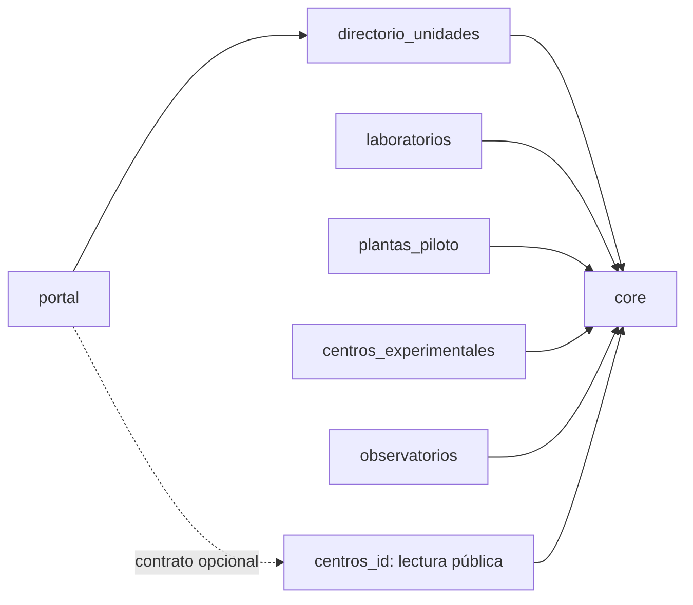

# Estructura objetivo del Sistema de Laboratorios y Centros I+D

> La propiedad de los modelos y la retirada del contenedor general se
> implementaron el 12 de octubre de 2026. Consultar el
> [mapa vigente](../apps/README.md) y el procedimiento de
> [actualización](arquitectura.md). Esta propuesta conserva otros objetivos
> de evolución; no implica despliegues independientes por aplicación.

## Nombre del producto e identidad institucional

| Uso | Nombre recomendado |
| --- | --- |
| Nombre oficial | **Sistema de Laboratorios y Centros de Investigación y Desarrollo** |
| Nombre corto visible | **Sistema de Laboratorios y Centros I+D** |
| Código técnico nuevo | `SLCID` |
| Dominio por instalacion | Configurable; `laboratorios.upec.edu.ec` es solo un ejemplo para UPEC |
| Paquete de configuración | `config` |
| Etiqueta heredada temporal | `webcitt` |

El nombre oficial es una marca visible. `webcitt` es actualmente una identidad
de base de datos y no debe sustituirse con una búsqueda global. Durante la
transición puede seguir existiendo internamente sin aparecer ante estudiantes,
docentes ni administradores.

SLCID es el nombre base acordado del producto reutilizable. La marca, logos,
contactos, catalogos academicos y dominio de cada institucion son configuracion
separada; UPEC sera un perfil de instalacion. Una institucion puede contratar
solo Laboratorios y usar un titulo visible acorde a su alcance, sin habilitar
Centros I+D. El nombre del producto no obliga a instalar todas sus funciones.

Primero se soportaran instalaciones independientes por institucion con base,
adjuntos, credenciales y respaldos propios. Un SaaS compartido multiinstitucion
requiere una fase adicional de aislamiento; no se obtiene con `SITE_ID` ni
con un filtro visual. El nucleo se versiona una sola vez, sin ramas por cliente.

## Árbol final propuesto

La estructura definitiva usa verticales por tipo de unidad. La especificación
completa, propiedad de datos, contratos y aislamiento se encuentra en
[Arquitectura vertical de unidades y Centros I+D](arquitectura-vertical-unidades-centros-id.md).

```text
sistema-laboratorios/
|-- config/                         # arranque y perfiles de despliegue validados
|-- apps/
|   |-- core/                       # identidad, acceso, institucion, modulos y auditoria
|   |-- portal/                     # Inicio, Quiénes somos, Servicios, Normativa y Noticias
|   |-- directorio_unidades/        # nombre, tipo, slug y responsables
|   |-- laboratorios/               # sesiones, prácticas, muestras y recursos
|   |-- plantas_piloto/             # procesos, corridas, lotes y calidad
|   |-- centros_experimentales/     # campo, ciclos y activos biológicos
|   |-- observatorios/              # datos, indicadores y publicaciones
|   |-- centros_id/                 # investigación, proyectos y transferencia
|   |-- aprendizaje/                # guias/asignaturas; consume motores del propietario
|   `-- integraciones/              # contratos entre verticales
|-- shared/                         # adaptadores técnicos sin negocio
|-- tests/{architecture,integration,smoke}/
|-- docs/
|-- scripts/
`-- var/                            # ejecucion: media, static, cache, logs, backups, private (no versionado)
```

Cada vertical posee `domain`, `application`, `infrastructure`, `presentation`,
plantillas, estáticos y pruebas. Las carpetas se crean cuando reciban código
real; no se generan capas vacías por anticipación.

Este arbol es el catalogo completo del producto, no el conjunto obligatorio
de apps cargadas en cada instalacion. El nucleo organiza `institucion`,
`modulos`, `identidad`, `acceso` y `auditoria` sin contener reservas o procesos.
Los ajustes seleccionan paquetes disponibles y dependencias minimas al
arrancar; el administrador habilita sus capacidades autorizadas. El perfil
solo Laboratorios no carga ni agenda tareas de otras verticales. Las
integraciones opcionales se registran por contrato y admiten proveedor ausente.

Las extensiones operativas se empaquetan bajo un namespace propio y se prueban
contra contratos versionados. No se crea un modulo por cada categoria ni
capas genericas que reintroduzcan el acoplamiento. El namespace instalable se
define en M12 conservando las identidades Django historicas necesarias.

Dentro de `portal`, cada pestaña institucional mantiene su propio módulo y grupo
administrativo. La definición editorial se encuentra en
[arquitectura-portal-administrable.md](arquitectura-portal-administrable.md).

## Responsabilidades y dependencias

`core` no contiene reservas ni operación. `directorio_unidades` conserva solo
la identidad pública de una unidad. Laboratorios, plantas piloto, centros
experimentales y observatorios son propietarios de sus datos y reglas. Centros
I+D funciona independientemente y se relaciona con capacidades mediante
contratos e identificadores estables.

Una app vertical no importa modelos, vistas, formularios ni funciones privadas
de otra. El portal consume modelos de lectura; `integraciones` consume contratos
públicos y no contiene reglas de negocio. No se permiten borrados en cascada
entre contextos.



Los nombres comunes expresan operaciones distintas: un laboratorio agenda una
sesión, una planta programa una corrida, un centro experimental gestiona un
ensayo o ciclo y un observatorio recibe una solicitud de datos. No habrá una
aplicación universal de reservas que obligue a todos a seguir el mismo flujo.

## Cómo quedará el administrador

El menu siguiente muestra todas las capacidades posibles. Cada institucion
solo ve las habilitadas y cada administrador solo las que puede gestionar.
La configuracion institucional incluye modulos/limites y catalogos propios;
sus cambios no conceden permisos adicionales ni instalan codigo.

```text
Sistema de Laboratorios y Centros I+D
|-- Configuracion institucional, modulos y limites
|-- Identidad, acceso y períodos
|-- Portal institucional
|   |-- Inicio
|   |-- Quiénes somos
|   |-- Servicios
|   |-- Normativa
|   `-- Noticias, agenda y convocatorias
|-- Directorio institucional de unidades
|-- Laboratorios
|-- Plantas piloto
|-- Centros experimentales
|-- Observatorios
|-- Centros de Investigación y Desarrollo
`-- Aprendizaje, guías y simuladores
```

Cada área registra sus propios modelos, permisos, formularios, acciones y
reportes. Elegir un tipo en el directorio abre la administración especializada;
no muestra un formulario único con campos ajenos a esa unidad.

Una categoria de laboratorio es un dato administrable asociado a capacidades
soportadas, por ejemplo microbiologia o calibracion. Una modalidad con reglas
distintas requiere una estrategia o app implementada. Los cuatro tipos
operativos actuales son implementaciones iniciales, no un limite permanente.
Se reutilizan los catalogos `Categoria` y `TipoLaboratorio` existentes cuando
su semantica coincida, preservando relaciones e historial. Ocultar/archivar
categorias, productos, carpetas y recursos conserva las operaciones historicas
y filtra acceso directo. Suspender un modulo no elimina datos.

## Cambio de nombre: qué se modifica

### Capa 1. Marca visible

Es la primera y más segura. Se centralizarán estas constantes:

```python
SYSTEM_NAME = "Sistema de Laboratorios y Centros de Investigación y Desarrollo"
SYSTEM_SHORT_NAME = "Sistema de Laboratorios y Centros I+D"
SYSTEM_CODE = "SLCID"
INSTITUTION_NAME = "Universidad Politécnica Estatal del Carchi"
```

Los valores institucionales anteriores ilustran el perfil UPEC; se cargaran
desde una configuracion validada, no se copiaran como constantes obligatorias
del producto. Credenciales y claves no pertenecen a esta configuracion visible.

Un procesador de contexto y los constructores de documentos consumirán la misma
fuente. Se modificarán:

- títulos, encabezados, navegación y acceso;
- administrador de Django;
- correos y comprobantes;
- PDF y Excel;
- metadatos HTML y textos alternativos;
- README y documentos operativos;
- textos de tareas programadas.

Hoy la marca `Plataforma Científica UPEC` aparece en 33 archivos. Después del
cambio no deberá quedar copiada como texto fijo en plantillas.

### Capa 2. Infraestructura

Se cambiarán de forma compatible:

- nombre del proyecto en `pyproject.toml`;
- contenedores `citt-*` a `slcid-*`;
- tareas programadas `CITT - ...` a `SLCID - ...`;
- nombres de servicios, registros y respaldos;
- nombre del repositorio y de la carpeta local, en una ventana coordinada.

El nombre de la base PostgreSQL puede conservarse inicialmente. Cambiarlo no
aporta modularidad y exige coordinar respaldos, credenciales y despliegue.

### Capa 3. Identificadores de negocio

Los códigos como `CITT-PPL`, `CITT-PPC` o `CITT-PPA` pueden estar impresos en
documentos, vinculados a registros o usados por integraciones. Hay dos opciones:

1. conservarlos como identificadores históricos; o
2. migrarlos a `SLCID-*` mediante una tabla de alias y una migración de datos.

No deben reemplazarse directamente en los cargadores sin auditar primero los
registros existentes. Los documentos históricos conservarán el código con el
que fueron emitidos.

### Capa 4. Identidad técnica `webcitt`

Es la última capa. Actualmente participa en:

- 176 archivos de código o documentación;
- imports Python;
- `app_label` de 95 modelos;
- tablas `webcitt_*`;
- permisos como `webcitt.change_reserva`;
- rutas del admin como `admin:webcitt_reserva_change`;
- `ContentType`, Guardian, pruebas y migraciones.

Mientras los modelos se distribuyen entre las nuevas apps, `webcitt` se
mantendrá como paquete de compatibilidad. Cuando quede vacío se podrá elegir:

- mantener los nombres físicos `webcitt_*` indefinidamente, que es seguro y no
  afecta al usuario; o
- renombrar tablas y permisos en una migración final con parada controlada.

La opción recomendada es conservar los nombres físicos hasta después de validar
la nueva arquitectura en producción.

## Archivos que se deben modificar por etapa

### Etapa A. Nombre centralizado

Primer bloque implementado: contratos de identidad en `apps/core/identidad.py`,
perfil UPEC y constructor en `config`, adaptador de presentacion compartido y
validacion sin consultas. Consultar
[Identidad del producto e institucion](identidad-producto-institucion.md)
para configuracion, consumidores y alcance pendiente.

Segundo bloque implementado: contrato de catalogo en `apps/core/catalogos.py`,
configuracion por instalacion y providers compartidos para modelos/formularios.
La auditoria comprueba compatibilidad antes de retirar codigos. Consultar
[Catalogo academico institucional](catalogo-academico-institucional.md).

El tercer bloque separa niveles y rutas de avance academico, conserva opciones
historicas y comparte proveedores con perfil, admin y reservas:
[Niveles y avance institucional](niveles-y-avance-institucional.md).

El cuarto bloque configura ciclos/ambitos y semanas del calendario compatible:
[Calendario institucional](calendario-academico-institucional.md).

- mantener una sola identidad publica en los contratos y adaptador anteriores;
- conservar el procesador de contexto y sus claves sin colision con el negocio;
- reemplazar textos visibles en plantillas, correos y documentos;
- parametrizar títulos del admin;
- añadir pruebas que impidan reintroducir la marca antigua.

No requiere migraciones.

### Etapa B. Rutas independientes

Primera frontera implementada el 16 de septiembre: las entradas publicas ya
tienen propietarios y contratos, y 104 rutas operativas conservan compatibilidad
en `webcitt/routing/heredadas.py`. Las fachadas anticipadas del portal y Unidades
se retiraron. Quedan las del paquete de reservas hasta extraer sus consumidores.
Consultar [Rutas y contratos modulares](rutas-y-contratos-modulares.md).

- reducir `webcitt/urls.py` a inclusiones compatibles;
- crear URLs independientes para portal, laboratorios, plantas piloto,
  centros experimentales, observatorios y Centros I+D;
- conservar nombres y paths actuales;
- dejar los `__init__.py` sin fachadas que importen todo el dominio.

No requiere migraciones.

### Etapa C. Casos de uso

- separar `crear_reserva` por modalidad y `gestion_unidad_view` por tipo;
- extraer comandos a servicios transaccionales;
- extraer lecturas a selectores;
- mover PDF y Excel a adaptadores de documentos;
- eliminar ciclos entre vistas, cronograma, cambios y guías.

No requiere migraciones.

### Etapa D. Apps y recursos propios

- agregar una app por vertical a `INSTALLED_APPS`;
- mover vistas, formularios, admin, plantillas, estáticos y pruebas a su
  propietario;
- mantener adaptadores temporales hacia los modelos heredados;
- añadir pruebas de importación y salud por app.

No mueve tablas todavía.

### Etapa E. Modelos y permisos

- trasladar modelos por contexto;
- conservar `db_table`;
- usar `SeparateDatabaseAndState`;
- migrar `ContentType`, permisos y reglas Guardian;
- mantener alias de las URLs administrativas durante la transición;
- probar migración y reversión sobre una copia de PostgreSQL.

Esta es la etapa de mayor riesgo y se ejecutará en commits pequeños.

### Etapa F. Retiro del legado

- retirar exports y adaptadores sin consumidores;
- decidir si se conservan tablas `webcitt_*`;
- cambiar infraestructura y nombre del repositorio;
- actualizar documentación y procedimientos de despliegue;
- eliminar el paquete heredado solo cuando no tenga imports, modelos ni
  migraciones activas nuevas.

## Orden recomendado de implementación

La secuencia operativa detallada y sus requisitos de cierre estan en
[Ruta de ejecucion modular](ruta-ejecucion-arquitectura-modular.md).
Los hitos M00-M13 distinguen reorganizacion de codigo, traslado de datos y
aislamiento de ejecucion; no se confunden con los pasos funcionales de plantas.

1. Inventariar rutas y propietarios por vertical.
2. Separar rutas sin cambiar URLs.
3. Añadir contratos y pruebas automáticas de arquitectura.
   Antes de extraer verticales, completar M02.1-M02.4: nombre/configuracion
   institucional, manifiestos/habilitacion/limites, categorias y contratos.
4. Extraer Observatorios del flujo de reserva física.
5. Extraer Plantas piloto con toda su operación productiva.
6. Crear la operación propia de Centros experimentales.
7. Extraer Laboratorios y su sesión por recursos.
8. Implementar Centros I+D como contexto independiente.
9. Migrar modelos y permisos por contexto.
10. Completar la marca iniciada en M02.1, empaquetar la distribucion y retirar
    solo el legado sin consumidores. Validar cuatro perfiles institucionales.

Cada paso debe dejar `manage.py check`, migraciones, reglas arquitectónicas,
pruebas por app, pruebas integrales y casos de humo en verde.

Configuracion regional compatible y limites actuales:
[Idioma, zona y agendas civiles](configuracion-regional-institucional.md).
