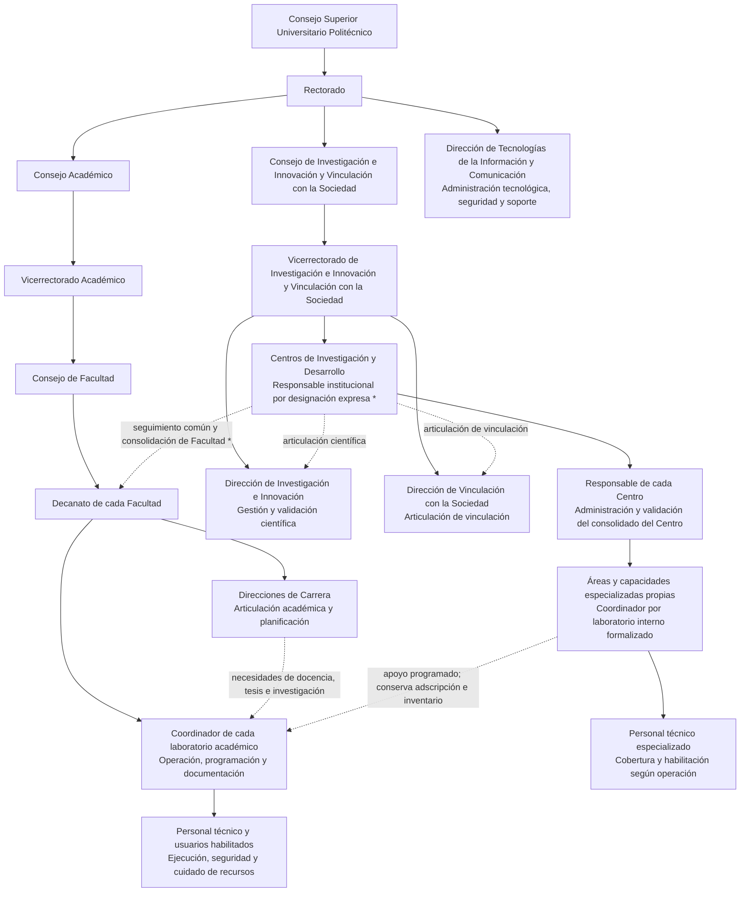
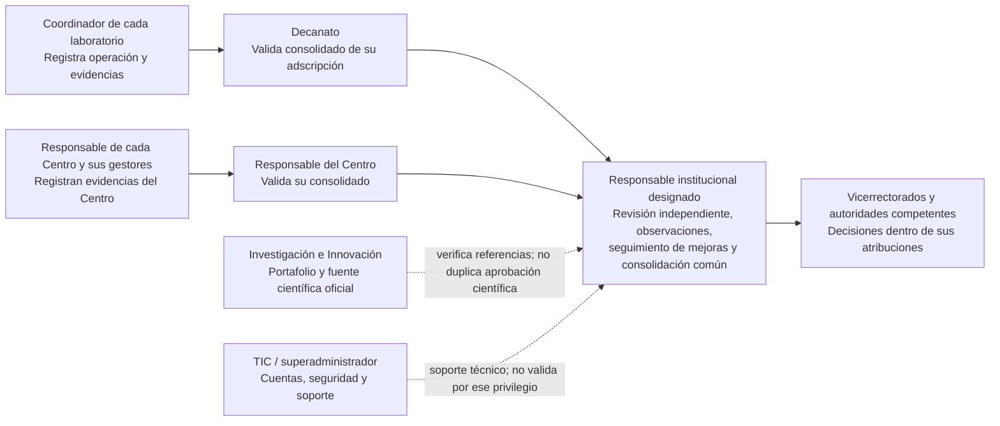

# Organización y responsabilidades de Laboratorios y Centros

Propuesta funcional para SILAB-CID y el proyecto de reglamento. 15 de noviembre de 2026. Se distingue la estructura publicada por la UPEC de las funciones que requieren designación expresa. Este esquema no crea cargos ni sustituye el organigrama aprobado.

## Estructura

Las líneas continuas muestran dependencia en este extracto de la organización y el desarrollo funcional propuesto para los Centros. Las líneas discontinuas muestran articulación y seguimiento; no trasladan los laboratorios académicos a los Centros.

\* La denominación **Centros de Investigación y Desarrollo** se mantiene al mismo nivel que las dos Direcciones bajo el Vicerrectorado correspondiente. La figura de responsable institucional es la solución funcional propuesta: su denominación de puesto, designación, dedicación y facultad para consolidar también los laboratorios de las Facultades deben quedar expresamente respaldadas. La posición del recuadro no autoriza a denominarlo automáticamente «Director» ni a colocar a los Decanatos bajo su administración.

## Circuito en SILAB-CID

| Actor | Responsabilidad y límite |
|---|---|
| Coordinador de cada laboratorio | Gestiona ese laboratorio y su personal autorizado. No hay una coordinación general adicional de laboratorios por Facultad. No aprueba su propia gestión como revisor institucional. |
| Decanato, con Direcciones de Carrera | Administra sus laboratorios y su planificación; valida el consolidado de la adscripción una vez por período y versión. No se añade una aprobación a cada reserva. |
| Responsable institucional de Laboratorios y Centros | Revisa consistencia, documentación, cobertura y mejoras; consolida ambos ámbitos. Su alcance común requiere asignación formal. No administra cotidianamente los laboratorios de las Facultades ni aprueba resultados científicos por revisar documentos. |
| Responsable de cada Centro | Administra capacidades propias y coordina apoyos vinculados; valida el consolidado del Centro. Un gestor operativo no sustituye automáticamente a su responsable. |
| Coordinador de laboratorio interno de un Centro | Atiende el laboratorio formalmente identificado dentro del Centro. El área temática y el laboratorio enlazado no se contabilizan como dos instalaciones propias. |
| Personal técnico especializado | Opera y mantiene recursos según competencia, habilitación, seguridad y cobertura autorizadas. La plataforma no reemplaza el personal necesario. |
| Dirección de Investigación e Innovación | Mantiene el procedimiento y la fuente oficial científica. En SILAB-CID verifica la correspondencia de referencias al Portafolio; esa verificación no constituye otra aprobación científica. |
| Dirección de Vinculación con la Sociedad | Articula actividades de vinculación dentro de sus atribuciones. El uso de un laboratorio para vinculación no modifica su adscripción. |
| TIC / superadministrador | Configura y mantiene la plataforma. Registra las designaciones respaldadas y sus revocaciones; no recibe por ese privilegio atribuciones para validar o evaluar. |

## Ejemplo de Realidad Extendida

El laboratorio académico de XR de Logística conserva su adscripción, coordinador, inventario y agenda. El área especializada de XR del Centro aporta capacidades avanzadas. Si el Centro necesita equipos o participantes adicionales, utiliza el laboratorio académico mediante apoyo programado y aceptado. La actividad investigativa se registra sobre la capacidad existente; no crea por sí sola un tercer laboratorio. La creación de otra instalación independiente exige justificar una necesidad que no pueda atenderse compartiendo o ampliando las capacidades actuales y obtener la aprobación competente.

## Fuentes y validación

- [Estatuto institucional, ficha de Resolución 093-CSUP-2026](https://normativa.upec.edu.ec/handle/123456789/481).
- [Estructura Organizacional, Resolución 047.1-CSUP-2026](https://normativa.upec.edu.ec/handle/123456789/478).
- Propuesta local de Reglamento de Laboratorios y Centros, versión de concordancia con el borrador de Investigación 2026, especialmente los apartados de organización, coordinación, plataformas y seguimiento. Los dos reglamentos de trabajo siguen siendo borradores.

Antes de su aprobación deben confirmarse las denominaciones del puesto responsable, sus competencias, dedicación, sustitución y el alcance transversal acordado entre los Vicerrectorados. Las designaciones en la plataforma deben corresponder a esos actos y a las adscripciones realmente vigentes.
