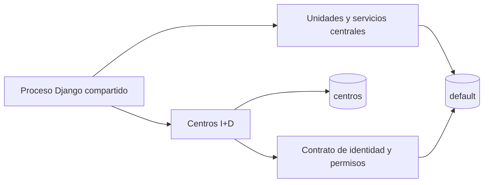

# Arquitectura del Sistema de Laboratorios y Centros I+D

Revisión de `webcitt/` del 12 de octubre de 2026: consultar el
[mapa de responsabilidades de ese corte](estructura-webcitt-2026-10-12.md).
Se mantienen 182 modelos y 259 rutas operativas heredadas; las verticales de
unidades todavía usan proxies sobre esas tablas. Las carpetas convencionales
de Django no son el problema: queda pendiente extraer la operación por dueño.
El registro de rutas difiere la carga de sus vistas y pasó sus pruebas de
contrato; esto no supone procesos ni despliegues independientes.

La secuencia vigente para cerrar la reestructuración y volver al desarrollo de
Plantas piloto, Centros experimentales, Observatorios y Centros I+D está en
[Ruta de cierre de la reestructuración y desarrollo de verticales](ruta-cierre-reestructuracion-y-verticales.md).
La primera puerta funcional de esa ruta quedó aprobada en [Aceptación de
Laboratorios](aceptacion-laboratorios.md).

Punto de control actual, hitos terminados/parciales y siguiente secuencia:
[Estado vigente de la planificación](estado-plan-y-responsive-20260916.md).

Inventario actual de entradas, autoridad declarada y limites compartidos:
[Superficies y autoridades de capacidades](superficies-y-autoridades-capacidades.md).
Incluye señales dentro de modelos, comandos y tareas antes de ampliar controles.
La revision de sus efectos, registro unico y limites esta en
[Contratos de señales heredadas](contratos-senales-heredadas.md).
La asignacion y recuperacion administrativa de codigos de reserva esta en
[Codigos de reserva: asignacion y recuperacion](codigos-reserva-recuperacion.md).
Las entradas de escritura, su autoridad y los contratos pendientes de reservas
estan en [Escritores y autoridad de reservas](escritores-y-autoridad-reservas.md).

> **Estado de este documento:** describe la arquitectura vigente y algunas
> decisiones objetivo que todavía conservan la etiqueta técnica `webcitt`.
> El diagnóstico vigente al 19 de septiembre de 2026, las fronteras de las
> futuras apps y el plan seguro de migración están en
> [Auditoría de arquitectura modular](auditoria-arquitectura-modular.md).
> El árbol final y el cambio de nombre institucional están definidos en
> [Estructura objetivo del Sistema de Laboratorios y Centros I+D](estructura-objetivo-sistema-laboratorios.md).
> La separación obligatoria de los cuatro tipos de unidad y de Centros I+D se
> define en [Arquitectura vertical de unidades y Centros I+D](arquitectura-vertical-unidades-centros-id.md).
> La propiedad y administración de Inicio, Quiénes somos, Servicios, Normativa
> y Noticias se define en [Arquitectura del portal administrable](arquitectura-portal-administrable.md).
> La secuencia de implementacion, controles y reversa se sigue desde
> [Ruta de ejecucion modular](ruta-ejecucion-arquitectura-modular.md).
> Registro de codigo, dependencias y limites actuales:
> [Manifiestos y registro modular](manifiestos-y-registro-modular.md).
> Primer control operativo de capacidad, suspension e historial de Inicio:
> [Controles de capacidades](controles-capacidades.md).
> La primera configuracion neutral y el ensayo local de recuperacion estan en
> [Identidad del producto e institucion](identidad-producto-institucion.md).
> Catalogo academico y auditoria compatible:
> [Catalogo institucional](catalogo-academico-institucional.md).

Configuracion de niveles y propuestas de avance:
[Niveles y avance institucional](niveles-y-avance-institucional.md).

Ciclos, ambitos, limites y asociacion automatica:
[Calendario institucional](calendario-academico-institucional.md).

Idioma de interfaz, selector ES/EN y catálogos compartidos:
[Internacionalización](internacionalizacion-es-en.md).

## Propósito

La plataforma organiza las capacidades científicas y tecnológicas de la UPEC.
Su núcleo no es una página de proyectos independiente: son **Unidades** y
**Centros I+D**, cada uno con funciones administrables y crecimiento propio.

## Dominios

| Dominio | Responsabilidad |
| --- | --- |
| `core` | Identidad institucional, usuarios, periodos, permisos y auditoria. |
| `portal` | Inicio, Quiénes somos, Servicios, Normativa y Noticias, cada sección con rutas, contenido, permisos y administración propios. |
| `directorio_unidades` | Identidad pública, clasificación y responsables de las unidades; no contiene operación. |
| `laboratorios` | Sesiones, prácticas, muestras, equipos, licencias y consumos de laboratorio. |
| `plantas_piloto` | Procesos, recetas, corridas, lotes, calidad y trazabilidad productiva. |
| `centros_experimentales` | Áreas, ciclos, ensayos de campo, activos biológicos y bitácoras. |
| `observatorios` | Fuentes, conjuntos de datos, indicadores, publicaciones y solicitudes de análisis. |
| `centros_id` | Centros I+D, investigadores, líneas, proyectos científicos, resultados, servicios y transferencia; funciona como contexto independiente. |

Las funciones con el mismo nombre no se comparten automáticamente. La reserva
por horas de un laboratorio, la corrida de una planta, el ensayo de campo y la
solicitud de datos pertenecen a contextos distintos. Solo identidad, acceso,
auditoría, documentos base y contratos técnicos pueden compartirse.

## Páginas públicas vigentes

| Ruta | Plantilla principal | Dominio |
| --- | --- | --- |
| `/` | `portal/pages/inicio/inicio.html` | Portal |
| `/quienes-somos/` | `portal/pages/quienes_somos/quienes_somos.html` | Portal |
| `/servicios/` | `portal/pages/servicios/servicios.html` | Portal |
| `/normativa/` | `portal/pages/normativa/normativa.html` | Portal |
| `/noticias/` | `portal/pages/noticias/noticias.html` | Portal |
| `/centros-id/` | `centros_id/portada.html` | Centros I+D |
| `/laboratorios-unidades/` | `portal/pages/unidades/catalogo_unidades.html` | Unidades |
| rutas por tipo de unidad | catálogo compartido filtrado | Unidades |
| rutas con `slug` | `portal/pages/unidades/detalle/detalle_unidad.html` | Unidades |

`/hublab/` permanece únicamente como alias compatible de enlaces publicados y
muestra el catálogo de laboratorios. No se usará en código nuevo.

La antigua página `/proyectos/` fue eliminada porque duplicaba el catálogo de
Unidades. Los proyectos científicos continuarán como información propia de
Centros I+D; los proyectos o prácticas de una unidad permanecerán dentro del
detalle de esa unidad. También se retiraron `/cursos/` y
`/transferencia_tecnologia/`, que solo contenían páginas vacías de “próximamente”.

`apps/centros_id` ya posee modelos, migraciones, administración, investigación
y atención propios. Se articula con las unidades mediante proveedores
opcionales de identidad y oferta pública; conserva sus rutas de Centros I+D.

Cursos, eventos formativos y certificados pertenecen a su `Unidad` organizadora
y siguen en la operación compartida de `webcitt`. Su gestión usa el permiso
`practicas`; aún no constituyen una capacidad de despliegue independiente.

## Estructura vigente

Las entradas publicas ya estan separadas bajo `apps/<contexto>/presentation`.
`webcitt/urls.py` compone esos modulos y `webcitt/routing/heredadas.py` conserva
las rutas operativas compartidas. El directorio publica contratos
inmutables y los adaptadores temporales viven en `apps/integraciones`.
Las cuatro verticales de Unidad tienen registro Django propio, pero conservan
sus tablas y la operación compartida en `webcitt`; Centros I+D dispone de una
base PostgreSQL propia al activar `CENTROS_DB_ENABLED` tras el corte verificado.
Esto no demuestra aislamiento completo de despliegue o de procesos.
`configuracion_institucional` ya tiene persistencia y administración propias;
`portal` incorpora ahora su primera sección editorial: la portada bilingüe de
Inicio, con borradores, vista previa y publicación conservando historial.
Las otras secciones editoriales siguen pendientes. Alcance y recuperación:
[Portada de Inicio administrable](portada-inicio-administrable.md).
El detalle del bloque y su inventario estan en
[Rutas y contratos modulares](rutas-y-contratos-modulares.md).

```text
configuración Django: config/               # arranque, ajustes y rutas raíz
aplicación Django:   webcitt/               # app_label transitorio
├── admin/                                  # administración separada por dominio
│   ├── __init__.py                         # autodiscovery y catálogos administrativos básicos
│   ├── equipos.py                          # catálogo, categorías y unidades de equipamiento
│   ├── fabricacion.py                      # fabricación digital y servicios FabLab
│   ├── inventario.py                       # consumibles y movimientos de existencias
│   ├── mantenimiento.py                    # incidencias, mantenimiento y ciclo de vida
│   ├── reservas.py                         # reservas, estadísticas y reportes PDF
│   └── unidades.py                         # unidades, módulos y recursos
├── domains/                                # casos de uso separados por dominio
│   ├── portal/                          # entrega heredada de multimedia
│   ├── usuarios/
│   └── unidades/
│       └── reservas/
├── models/                                 # datos agrupados por responsabilidad
│   ├── operaciones.py                      # configuración y operación detallada por unidad
│   └── mantenimiento.py                    # mantenimiento y trazabilidad de activos
├── tests/                                  # pruebas separadas por dominio
│   ├── test_admin.py
│   ├── test_portal.py
│   ├── test_unidades.py
│   └── test_reservas.py
├── templates/
│   ├── admin/ account/ registration/       # convenciones de Django
│   └── portal/
│       ├── layouts/
│       ├── components/
│       └── pages/
│           ├── inicio/ quienes_somos/ servicios/ normativa/ noticias/
│           └── unidades/
│               ├── catalogo/
│               └── detalle/
├── static/portal/
│   ├── css/{core,components,pages,admin}/
│   ├── js/{components,pages}/
│   └── visualizadores/
└── migrations/                             # historial inmutable de base de datos
```

No se mantienen carpetas vacías por anticipación. Los formularios y servicios
reutilizables se incorporarán dentro del dominio responsable cuando exista una
implementación concreta que justifique separarlos.

Los recursos compartidos viven en `webcitt/static/`; cada app puede aportar su
propio directorio `static/` con espacio de nombres, como Centros I+D. Los finders
de Django reúnen estas fuentes sin convertir `var/staticfiles/` en fuente. Todo lo que la
aplicación escribe en ejecución vive bajo `var/`, que no se versiona: `media/`
(adjuntos), `static/` (salida de `collectstatic`), `cache/`, `logs/`,
`output/`, `backups/` y `private/institutional-brand/` (marca subida desde el
administrador, fuera de todo alias público). La raíz del repositorio solo
contiene código, configuración, documentación y scripts.

`manage.py auditar_huerfanos` señala los archivos versionados a los que nadie
hace referencia; con `--estricto` termina en error si aparece alguno. Lo que un
paquete externo pide por su nombre —las plantillas de allauth— y lo que se
invoca desde la línea de órdenes se declara como excepción en el propio comando,
con el motivo. Las imágenes no se auditan ahí: muchas se cargan por rutas
construidas en ejecución, como los mosaicos de un recorrido 360.

Las ramas anteriores a esta reorganización sí versionaban los adjuntos y los
respaldos en la raíz: `origin/version2` y `origin/main` llevan 5 659 archivos y
959 MB bajo `media/`, con PDF, imágenes y volcados de base. Quien venga de una
de ellas se encuentra esas carpetas en el disco al cambiarse aquí, porque Git
no borra lo que no versiona. `.gitignore` ignora `/media/`, `/backups/`,
`/static/`, `/staticfiles/` y `/logs/` para que no vuelvan a colarse; borrarlos
del historial de aquellas ramas es una reescritura y una decisión aparte.

En la implementación vigente las cuatro clases todavía comparten `Unidad`,
`Reserva`, catálogo y detalle. Es una compatibilidad transitoria, no la
arquitectura final. Cada tipo tendrá configuración, datos, rutas, administración
y pruebas propias. `Centros I+D` y `Centros Experimentales` son conceptos
distintos: el primero gestiona investigación y el segundo es una unidad de campo.

## Convenciones

- Archivos y carpetas propios en `snake_case`; clases Python en `PascalCase`.
- URLs públicas en minúsculas y con guiones.
- Cada página tiene un archivo principal con nombre funcional; `index.html`
  solo se admite como entrada técnica de un visor o paquete externo.
- CSS y JavaScript compartidos tienen una sola fuente en `static/portal/`.
- No se crean carpetas `nuevo`, `final`, `version2`, `pagina` o `prueba`.
- Los recursos cargados en `media/` y las migraciones no se mueven por una
  búsqueda textual: pueden estar enlazados desde la base de datos.
- Un enlace público se retira únicamente tras sustituir sus consumidores o
  conservar una redirección compatible.

## Identidad técnica heredada

El nombre del producto es **Plataforma Científica UPEC**. El paquete de
configuración anterior ya fue sustituido por `config/`. `webcitt/` permanece
como identidad técnica de la aplicación porque su etiqueta está almacenada en
migraciones, `ContentType`, permisos, fixtures y relaciones de base de datos.

La evolución segura pendiente será:

1. dividir gradualmente la aplicación por los cuatro tipos de unidad y por
   Centros I+D, usando `directorio_unidades` solo para identidad pública;
2. conservar temporalmente `db_table` y etiquetas de migración para no perder
   datos;
3. migrar permisos, `ContentType`, fixtures y relaciones;
4. retirar la etiqueta heredada solo después de verificar la base real.

Hasta completar esa secuencia no debe hacerse un reemplazo global del texto
`webcitt`, porque es una identidad técnica de datos, no un texto de marca.

## Próximas fases recomendadas

1. Mantener los registros administrativos separados por dominio y ampliar sus
   pruebas de permisos y operaciones, conservando el autodiscovery y las rutas
   administrativas compatibles.
2. Crear el dominio administrable de Centros I+D sin reutilizar el modelo
   histórico `Proyecto` que actualmente representa unidades.
3. Normalizar codificación UTF-8 y retirar cadenas con mojibake.
4. Consolidar el CSS histórico aún importado por páginas activas.
5. Añadir pruebas de permisos, reservas, inventario, paginación e integraciones.

Cada fase debe terminar con `manage.py check`, migraciones verificadas, pruebas
automatizadas y revisión visual en escritorio, tableta y móvil.

Los limites de seguridad, continuidad, respaldos, restauracion y aislamiento
operativo son obligatorios durante esta transicion y se mantienen en
[seguridad-continuidad.md](seguridad-continuidad.md).

### Transición de vistas iniciada en `version3`

Las rutas de Inicio, Unidades, autenticación y perfil consumen módulos de
`webcitt/domains/portal/`, `webcitt/domains/unidades/` y
`webcitt/domains/usuarios/`. El catálogo, el detalle, las API de inventario
físico y los flujos públicos de reserva tienen implementación propia en esos
dominios. Los reportes administrativos permanecen integrados en
`ReservaAdmin`, donde Django aplica los permisos del administrador.

El antiguo módulo monolítico `webcitt/views.py` fue retirado después de
comprobar que ninguna ruta o consumidor activo dependía de él. Las nuevas
vistas deben ubicarse directamente en el dominio responsable; no debe
recrearse una fachada global de vistas.

Las pruebas también dejaron de residir en un único `tests.py`. El paquete
`webcitt/tests/` separa los contratos del portal, las unidades y las reservas,
de modo que cada dominio pueda crecer sin volver a concentrar toda la
verificación en un archivo monolítico.

El administrador ya utiliza el paquete `webcitt/admin/`. Su `__init__.py`
conserva el autodiscovery de Django y carga módulos internos por dominio:
`admin/unidades.py` contiene unidades, módulos y recursos, mientras que
`admin/fabricacion.py` contiene fabricación digital y servicios FabLab, y
`admin/inventario.py` administra el catálogo detallado de materiales y
consumibles, junto con sus movimientos de existencias,
`admin/equipos.py` contiene el catálogo, las categorías y las unidades físicas
de equipamiento, `admin/reservas.py` concentra reservas, estadísticas y
reportes PDF, y `admin/reportes.py` presenta el resumen operativo restringido
por unidad. `admin/__init__.py` queda como punto de autodetección y registro
de los catálogos básicos, sin lógica de dominio extensa.

## Política de datos y archivos

La aplicación utiliza exclusivamente PostgreSQL. Las bases SQLite, fixtures,
importadores y documentos de migración del proyecto anterior fueron retirados
del código operativo porque la versión actual comienza con un modelo de datos
nuevo y no migrará registros heredados. `db.sqlite3` está excluido de Git para
impedir que vuelva a incorporarse accidentalmente.

`var/media/` conserva únicamente archivos enlazados por registros de la base vigente
o utilizados directamente por las plantillas actuales. El conjunto mínimo que
forma parte de la presentación base se versiona explícitamente; las cargas
futuras permanecen fuera de Git y deben respaldarse junto con PostgreSQL. Los
recursos generados por `collectstatic`, archivos temporales y registros de
ejecución tampoco forman parte del código fuente.

Configuracion regional compatible y limites actuales:
[Idioma, zona y agendas civiles](configuracion-regional-institucional.md).

## Continuacion modular 145: configuracion institucional propia

La presentacion publica tiene una app Django instalada independiente:

```text
apps/configuracion_institucional/
  apps.py                    registro y nombre administrativo
  models.py                  revisiones inmutables y publicacion actual
  services.py                guardar, publicar y recuperar con autoridad
  selectors.py               proyeccion publica validada
  admin.py                   editor, historial y confirmacion
  migrations/                esquema propio aditivo
  tipologias/                catalogo administrable de tipologias de unidad
  management/commands/       auditoria agregada de lectura
  templates/admin/           pantallas administrativas propias
  tests/                     reglas e integracion verificadas
apps/core/presentation/
  presentacion_institucional.py  contexto HTTP/tareas
  identidad.py                  adaptador/base de despliegue
```

El codigo operativo de la app no importa webcitt ni verticales. Solo enlaza
AUTH_USER_MODEL para atribucion y usa contratos/adaptadores del nucleo.
Configuracion institucional tiene dos modelos propios; el resto de modelos
operativos sigue en webcitt. Las seis entradas de portal previamente separadas
siguen siendo adaptadores de carga, no seis bases ni servicios aislados.
El inventario distingue modelos heredados y modelos propios registrados.

No se renombra CITT, la base ni las tablas/permisos existentes. Dos tablas
nuevas y su migracion no trasladan datos antiguos. La independencia de codigo
no asegura continuidad de todas las apps ante una caida del motor/proceso
compartido. M01 institucional y aislamiento M11 siguen pendientes.
Edicion, permisos, reversa y alcance:
[Presentacion institucional administrable](presentacion-institucional-administrable.md).

## Continuacion modular 146: catalogos academicos propios

La misma app agrega `catalogos/` con models, services, selectors, forms y admin.
Sus plantillas y estaticos estan dentro de la app, junto a pruebas y migracion
0002. `versionado.py` comparte guardas del historial y bloqueos del publicador
con la presentacion; no duplica el motor ni crea otra carpeta de configuracion.
La app tiene cuatro modelos propios en total, sin trasladar el ORM operativo.

El contrato puro `apps/core/catalogos.py` valida estructura y transiciones.
`apps/core/presentation/catalogo_institucional.py` resuelve la publicacion una
vez por solicitud o ambito de tarea. El adaptador de choices conserva rutas
usadas por migraciones, y el auditor introspectivo valida compatibilidad sin
importar modelos operativos. Verificacion usa ese ambito tambien fuera de HTTP.

Guardar un borrador no cambia el catalogo en uso. Publicar revalida permisos,
version de base y referencias; conserva codigos y relaciones academicas
reservadas. Carrera retirada pasa a historica. No autoaprobar cuentas ni
conceder permisos. El esquema aditivo mantiene datos y tablas anteriores.
La separacion del codigo no aísla el motor PostgreSQL ni el proceso compartido.
Procedimiento y limites: [catalogo academico](catalogo-academico-administrable.md).

### Continuacion 160: habilitacion institucional de Inicio

Configuracion institucional posee `capacidades/` (models, selectors, services,
admin), plantillas y CSS propios. 0007 agrega estado por instalacion y cambios
auditados, sin mover tablas operativas. La composicion conecta un proveedor
opcional fijo de estado mediante core; Portal puede arrancar con auth sin
Configuracion institucional cuando el despliegue omite el proveedor.

El administrador institucional puede habilitar la edicion de Inicio con
permiso especifico, confirmacion y version esperada. Los derechos y disponibilidad
del despliegue son independientes. Servicios y modelos de Inicio comparten el
bloqueo institucional; suspension conserva puntero e historia. Lecturas publicas
recargan habilitacion; errores usan portada base. No ofrece suspension para
otras secciones o unidades sin proteger todas sus superficies.
Procedimiento, permisos y limites: [controles de capacidades](controles-capacidades.md).

## Continuacion modular 147: niveles y editor comun

niveles/ agrega publicaciones propias y 0003 aditiva: seis modelos propios
total. editor_revisiones.py, formularios.py y editor.css comparten el flujo
admin con catalogos; cada editor configura contrato, servicios y puntero.
Publicaciones de catalogos y niveles independientes, sin trasladar ORM.
Scope de niveles en middleware y APIs de vigencia/verificacion fuera de HTTP;
choices compatibles con migraciones y auditor propuesto/estricto. No modifica
calendario oficial ni confirma niveles del estudiante al publicar. Motor y
proceso compartidos, M01/M11 abiertos. [Alcance](niveles-academicos-administrables.md).

### Continuacion 148: politica de calendario persistente

calendario pertenece a configuracion_institucional (models/selectors/services/
forms/admin/plantillas/JS), usa editor comun y agrega 0004. Ocho modelos propios;
no mueve periodos/versiones/semanas/vinculaciones webcitt. Publicacion valida
codigos, tipos y limites contra historial; no genera fechas o reservas.
Proveedor fijo/contexto por peticion y auditor estricto por alias, sin SQL al
importar/checkear. Tareas fuera HTTP requieren scope explicito. Motor/proceso
compartidos y M01/M11 abiertos. Ver calendario-academico-administrable.md.

## Separación física de Centros I+D · 2026-10-11

El router dirige los 42 modelos concretos de `centros_id` a `centros`; los demás
modelos permanecen en `default`. El destino contiene 49 tablas del dominio y
su registro de migraciones, sin tablas de usuarios, sesiones o Unidades.
Las 19 referencias a usuarios y la M2M de gestores usan `CuentaCentro` local.
Esta proyección almacena presentación e ID institucional, nunca contraseñas,
grupos ni privilegios. Los permisos consultan la identidad canónica vigente.



Las transacciones de Centros usan explícitamente su alias. No hay FK ni
transacción distribuida entre bases. Una cuenta local histórica puede
conservarse al retirar la cuenta canónica, pero nunca concede autorización.
Los archivos mantienen sus nombres y almacenamiento; Documento/Recurso se
sirven por un endpoint que verifica centro, visibilidad y usuario antes de
abrir el archivo. No se copian medios ni se regeneran semillas al migrar.

El propietario de migración y el usuario web de Centros son diferentes.
Las migraciones históricas permanecen para actualizar instalaciones existentes;
la baseline reemplazante crea el destino autónomo sin depender de `auth`.
Las listas científicas y expedientes paginan en SQL; las cifras usan agregados.
El formulario administrativo limita relaciones al centro que se edita, incluidas
las relaciones muchos a muchos y las tablas anexas.

Procedimiento, controles y límites: [operación de Centros I+D](separacion-centros-operacion.md).
