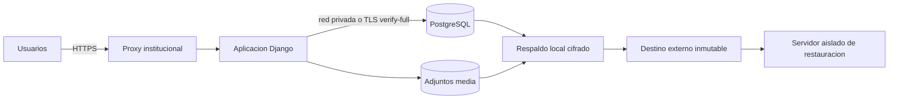

# Seguridad, respaldos y continuidad operativa

Este documento define el minimo obligatorio para operar el Sistema de
Laboratorios y Centros I+D. La seguridad no se considera terminada por tener
un archivo de respaldo: debe existir una copia independiente, verificarse su
integridad y demostrarse periodicamente que puede restaurarse.

## Estado de la base tecnica

La rama `reestructura-modular` incorpora estas protecciones:

- Django 5.2 LTS y dependencias actualizadas y bloqueadas en `uv.lock`;
- comprobaciones de despliegue que rechazan claves de base debiles, un host de
  base vacio, login social por GET, CSP con `unsafe-eval` y conexiones externas
  sin TLS verificado;
- PostgreSQL publicado solo en `127.0.0.1` cuando se usa Docker;
- credenciales de base obligatorias, sin `postgres/postgres` como respaldo;
- login social mediante POST y token CSRF;
- salida HTML del administrador escapada y colores de categorias limitados al
  formato hexadecimal esperado, para impedir contenido almacenado ejecutable;
- limites de conexion, espera de sentencias y bloqueos configurables;
- respaldo atomico de PostgreSQL en formato `custom`, inventario legible por
  `pg_restore` y checksum SHA-256;
- respaldo independiente de `media/`, tambien validado y con checksum;
- restauracion de ensayo en una base temporal que se elimina al terminar;
- una regla automatizada que impide agregar nuevas dependencias desde modelos
  hacia los dominios de aplicacion.

La CSP conserva temporalmente `unsafe-inline` porque hay vistas activas con
scripts y eventos incrustados. Retirarlo requiere moverlos a archivos JS y usar
nonces o hashes. `unsafe-eval` no tiene consumidores y ya fue eliminado.

## Topologia minima de produccion



El proxy es el unico punto publico. PostgreSQL, el programador y el contenedor
de respaldo no publican servicios a Internet. Para una base alojada fuera de
la red privada se exige `DB_SSLMODE=verify-full` y `DB_SSLROOTCERT`; dentro de
la red privada de Docker se declara `DB_NETWORK_ISOLATED=true`.

## Politica obligatoria de copias

Se aplica la regla 3-2-1: tres copias, en dos tipos de almacenamiento, con una
copia fuera del servidor principal. La copia externa debe estar cifrada,
versionada, protegida contra borrado y accesible con una cuenta distinta a la
aplicacion. Las claves de cifrado se guardan en un gestor de secretos separado;
si se pierden, los datos cifrados no se recuperan.

| Copia | Frecuencia | Retencion minima | Comprobacion |
| --- | --- | --- | --- |
| PostgreSQL logico | diaria | 30 dias | `pg_restore --list` y SHA-256 |
| Adjuntos `media/` | diaria | 30 dias | lectura completa de `tar` y SHA-256 |
| Copia externa inmutable | diaria | 90 dias | checksum tras transferencia |
| Restauracion de ensayo automatica | en cada respaldo | registro del contenedor | base temporal + consulta SQL (`BACKUP_VERIFY_RESTORE`) |
| Restauracion de ensayo en servidor aislado | mensual | evidencia 12 meses | mismo volumen de datos, infraestructura limpia |

El objetivo inicial es RPO de 24 horas y RTO de 4 horas. Para datos operativos
que requieran un RPO menor se debe activar archivado continuo de WAL, respaldo
base y recuperacion a un punto en el tiempo (PITR). Un `pg_dump` diario no puede
cumplir por si solo un RPO de minutos.

## Ejecucion y restauracion

Docker guarda las copias en `BACKUP_HOST_DIR`, una ruta del host que no debe
estar dentro del volumen de PostgreSQL. El ciclo ejecuta ambos respaldos cada
`BACKUP_INTERVAL_SECONDS` y conserva `BACKUP_RETENTION_DAYS`. Tras cada copia
de base restaura el archivo recien creado en una base temporal, ejecuta una
consulta y la elimina; si la restauracion falla, el ciclo se detiene con error
visible en el contenedor en lugar de acumular copias no restaurables.
`BACKUP_VERIFY_RESTORE=false` desactiva el ensayo automatico cuando el volumen
de datos lo haga impracticable en el mismo servidor.

Para comprobar una copia de base en un servidor aislado:

```sh
DB_HOST=servidor-pruebas \
DB_USER=operador_restauracion \
DB_PASSWORD='desde-el-gestor-de-secretos' \
sh scripts/verify_database_backup.sh /backups/database_YYYYMMDDTHHMMSSZ.dump
```

El usuario de restauracion requiere `CREATEDB`. El script crea un nombre
temporal, verifica el checksum, restaura con `--exit-on-error`, ejecuta una
consulta y elimina la base incluso si ocurre un error. La recuperacion real
debe ensayarse con una copia del mismo volumen de datos y nunca sobre la base
activa.

La restauracion de un incidente sigue este orden:

1. aislar el sistema afectado y conservar registros y WAL disponibles;
2. escoger la ultima pareja de base y adjuntos cuyos checksums sean validos;
3. restaurar en infraestructura limpia y ejecutar migraciones solo despues de
   confirmar la version del codigo que creo la copia;
4. ejecutar `manage.py check --deploy`, pruebas de humo y controles de conteos;
5. habilitar acceso de lectura, validar con responsables y luego habilitar
   escritura;
6. documentar perdida maxima de datos, tiempos y causa del incidente.

## Secretos y accesos

- `.env` nunca se versiona ni se incluye en una imagen.
- Produccion debe obtener secretos desde el gestor institucional o archivos
  montados con permisos minimos.
- Aplicacion, migraciones, respaldo y restauracion deben usar usuarios de base
  diferentes y con el menor privilegio posible.
- Las claves se rotan al cambiar personal, ante una sospecha de exposicion y en
  el calendario institucional. `SECRET_KEY_FALLBACKS` solo se usa durante una
  rotacion corta.
- Los accesos administrativos exigen un segundo factor propio del sistema
  (aplicación autenticadora), obligatorio en producción y aplicado a toda
  entrada al administrador, y pueden limitarse a las redes institucionales
  ([detalle](autenticacion.md#segundo-factor-para-administrar)). El MFA del
  proveedor de identidad se suma, no lo sustituye. Las cuentas compartidas no
  son aceptables.

## Contencion de fallos y modularidad

La meta inmediata es un monolito modular: cada app sera propietaria de modelos,
servicios, URLs, admin y pruebas; las otras apps solo consumiran contratos
publicos. Esto permite desplegar y probar cambios con menor impacto, pero un
error de importacion durante el arranque todavia puede detener el proceso
Django compartido. El aislamiento total requiere procesos o servicios
separados.

La secuencia de extraccion es:

1. congelar dependencias actuales con pruebas de arquitectura;
2. crear `core`, `portal`, `directorio_unidades` y las verticales
   `laboratorios`, `plantas_piloto`, `centros_experimentales`, `observatorios`
   y `centros_id` sin cambiar rutas ni tablas;
3. mover primero codigo puro y adaptadores, despues URLs/admin y finalmente
   modelos mediante `SeparateDatabaseAndState` cuando sea necesario;
4. sacar a procesos independientes tareas que pueden fallar sin bloquear una
   peticion: correo, PDF pesados, recordatorios y exportaciones;
5. evaluar servicios separados solo donde el RTO, la carga o el riesgo lo
   justifiquen.

Cada extraccion mantiene compatibilidad de importacion, rutas, permisos y
tablas hasta que la suite y recorridos funcionales de los cuatro tipos de
unidad y Centros I+D demuestren que el contrato nuevo reemplaza al anterior.
La matriz de propiedad y las reglas completas estan en
[arquitectura-vertical-unidades-centros-id.md](arquitectura-vertical-unidades-centros-id.md).

## Control de calidad continuo

- `uv.lock` es la fuente reproducible de dependencias; `requirements.txt` se
  genera desde el lock con hashes y la imagen lo instala con `--require-hashes`.
  `uvx pip-audit -r requirements.txt` se ejecuta al cambiar dependencias y
  mensualmente; ultima ejecucion sin vulnerabilidades conocidas el 20 de
  septiembre de 2026.
- `manage.py check --deploy --settings=config.settings_production` bloquea un
  arranque inseguro.
- La suite completa se ejecuta antes de cada publicacion.
- Los archivos duplicados solo se eliminan despues de comprobar referencias y
  equivalencia funcional. La auditoria actual encontro tres pares de imagenes
  identicas con rutas publicas diferentes; se conservan hasta migrar sus
  consumidores a un activo canonico.
- Los modulos grandes se reducen por casos de uso, con pruebas antes de cada
  movimiento. No se renombran tablas ni rutas durante una limpieza de carpetas.

## Controles que requieren infraestructura institucional

El repositorio deja preparados los contratos, pero el operador debe proveer y
verificar: TLS y dominio real, gestor de secretos, destino externo cifrado e
inmutable, monitoreo y alertas, escaneo de imagenes, firewall, MFA, rotacion de
credenciales, PITR y servidor de restauracion. El despliegue no se declara
recuperable hasta completar un ensayo documentado.

## Primer ensayo local M01 - 16 de septiembre de 2026

Se comparo una restauracion real en una base temporal mediante hashes de todas
las filas: 135 tablas y 6.654 registros, incluidos usuarios, ContentType y
permisos Guardian. Se recuperaron y compararon 358 adjuntos; cero FK sin
validar. La base temporal se elimino al terminar. Copias/checksums/evidencia
quedan fuera de Git y protegidos por ACL Windows del operador y SYSTEM.

Este resultado supera el probe SELECT 1 del restaurador existente, pero es
una evidencia local, no una prueba del servidor de contingencia. No demuestra
captura coordinada ante subidas/escrituras simultaneas, restauracion de roles
PostgreSQL de produccion, cifrado externo, inmutabilidad ni RPO/RTO reales.
La credencial de desarrollo es superusuario; separar la credencial de
ejecucion antes de produccion. No cerrar M01 ni habilitar traslados de datos
con ese resultado solo. Consultar
[Identidad y evidencia del bloque](identidad-producto-institucion.md).
